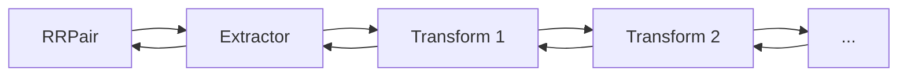
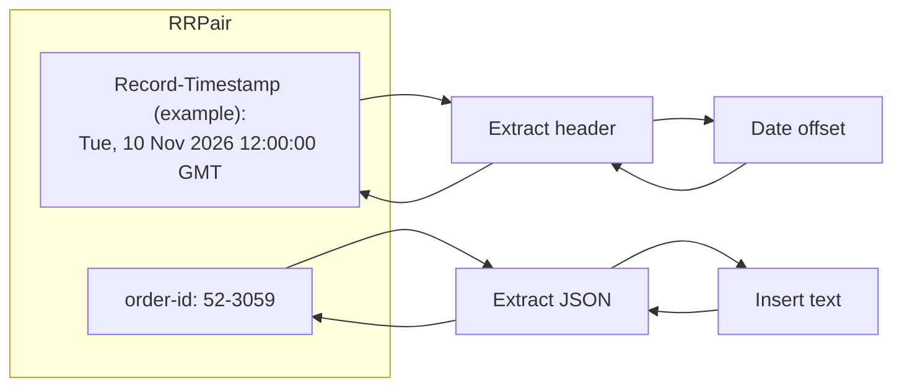
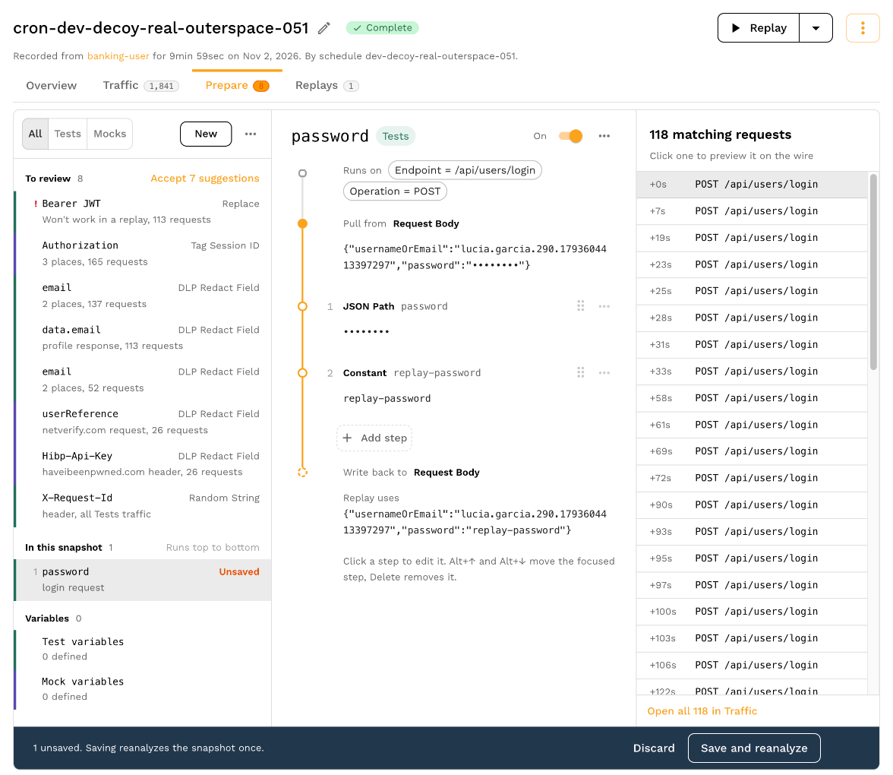
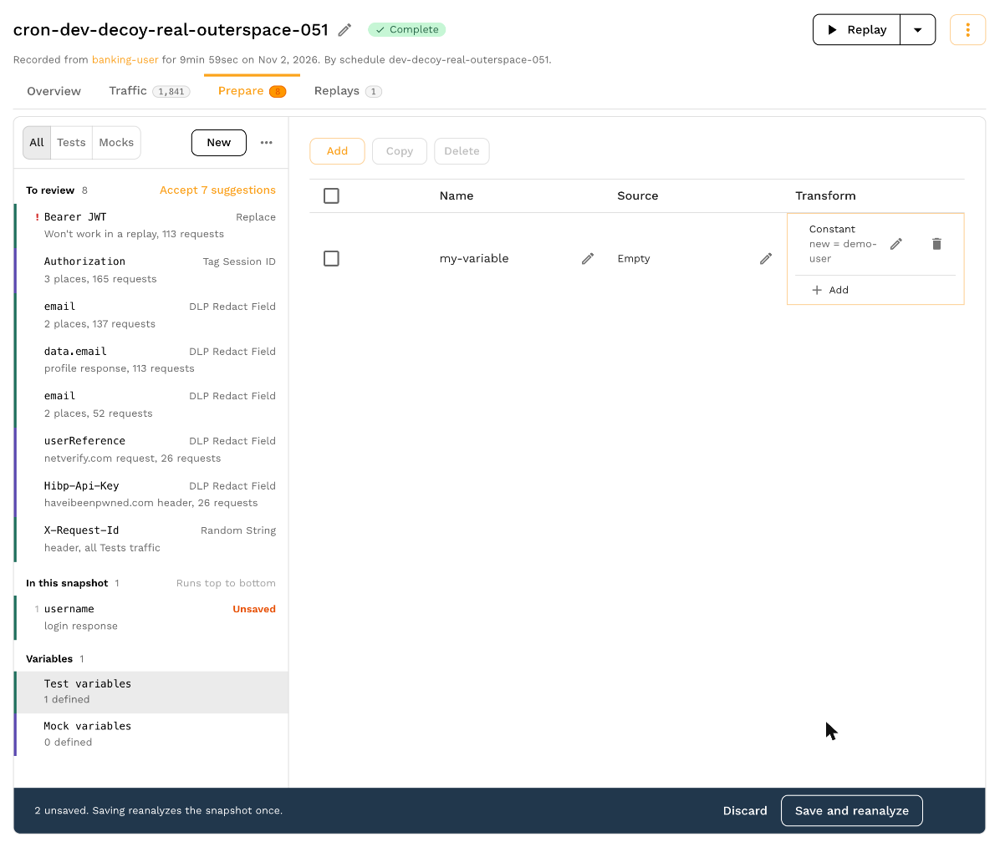
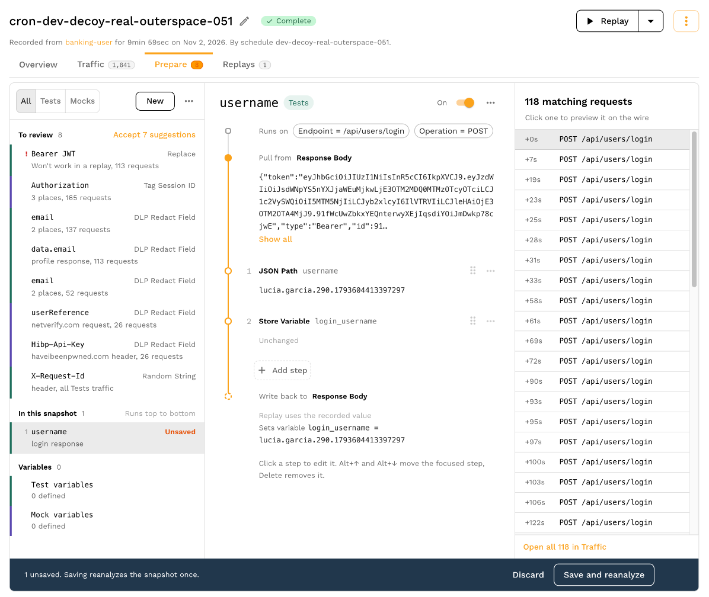

# Transforms

<iframe src="https://www.youtube.com/embed/RojqxxHL7oc?rel=0&modestbranding=1" width="640" height="582" frameborder="0" allow="autoplay; fullscreen; picture-in-picture" allowfullscreen></iframe>

Automatically modify traffic before or during a replay.

## Transforms, templates, and blueprints

A **transform** is one operation, such as replacing a value or re-signing a JWT. A **transform chain** starts with an extractor and runs ordered transforms on the extracted value. Filters can restrict the traffic a chain acts on.

Speedscale Cloud saves reusable configurations as **Traffic Transform Templates**. proxymock saves them in **blueprints**, which wrap the transform configuration with a name, activation state, and local metadata. Both use the same engine and transform library.

Use the [Cloud transformation guide](/guides/transformation/overview.md) for snapshot templates or [Create and Verify Blueprints](/proxymock/guides/blueprints.md) for local authoring, preview, and runtime checks.

## Basic Principles

In order to replay properly, most apps require traffic to contain up to date JWTs, timestamps and more. Speedscale provides a general purpose data transformation system very similar to Unix pipes for this purpose.



First, data is extracted from the [RRPair](/reference/glossary.md#rrpair) using an **Extractor**. For example, an extractor might pull the value of a particular HTTP header in an request. Extractors always produce a string that can be further transformed. The extracted string is called a **token** throughout this documentation.

Next, the token is mutated or further isolated using a **Transform**. Transforms can do simple things like change the data to a hard coded text value. They can also do more complex things like parse and shift a date or insert a value selectively like a switch statement in a programming language. Transforms are always executed sequentially.

Transforms also have a data cache where **variables** can be stored. Variables are named values that can be stored and reused across requests. Their lifetime depends on the execution context; generator variables are scoped to a virtual user.

Last, the transformed data is re-inserted into the RRPair in exactly the same location. Each transform runs in reverse order to re-encode the new **token** and place it back in its correct place.

<div className="docs-diagram-scroll" style={{'--docs-diagram-width': '900px'}} tabIndex={0} role="region" aria-label="Transform extraction and reinsertion">



</div>

### Read-only chains

Some chains exist only to observe a value, not to change it. A chain that reads a JWT claim and tags the session with it is one example: the claim cannot be turned back into a JWT, so writing it back would replace the `Authorization` header with the claim. Set `readOnly` on the chain to skip the re-insert step entirely.

```json
{
  "readOnly": true,
  "extractor": { "type": "http_req_header", "config": { "name": "Authorization" } },
  "transforms": [
    { "type": "jwt_claim", "config": { "claim": "email" } },
    { "type": "tag_session" }
  ]
}
```

A read-only chain still runs every transform forward, so side effects such as `tag_session`, `variable_store` and signature changes happen as usual. Nothing is written back into the RRPair, and transforms that do their work during the re-insert step, such as `smart_replace`, `map` and `var_load`, have no effect.

Chains that redact data with `dlp_field` or `dlp_json` cannot be read-only, because redaction is applied when the chain writes back. Saving a DLP rule with such a chain is rejected, and the forwarder writes back any redaction chain regardless of the setting.

## Where to Transform Traffic

Modify traffic and see the effects on a real request with the transform editor on the Prepare tab.



Data can be transformed at several points during a replay:

- **generator**
  - **RRPair request** - modify data before the [generator](/reference/glossary.md#generator) sends it to the [SUT](/reference/glossary.md#sut)
  - **RRPair response** - extract data from the response the generator receives from the SUT
- **responder**
  - **RRPair request** - modify a request received by the [responder](/reference/glossary.md#responder) before attempting to pattern match a response
  - **RRPair response** - modify captured response data before the responder sends it back to the SUT

Variable caches store data extracted from traffic in one location and apply it in another:



- **Test variables** - used to pre-load the variable cache when the generator starts up
- **Mock variables** - used to pre-load the variable cache when the responder starts up

:::note
Test variables are scoped to the [vUser](/reference/glossary.md#vuser). For example, a random string variable would be new and different for each VU, but the same for all requests within the same VU.
:::

How can the request and response both use the same transforms? Because each transform chain starts with an extractor that specifically targets the request or the response. In the generator, that means if the extractor references the HTTP Request Body, then the request will be modified before it is sent to the SUT. If an HTTP Request Body is extracted in a responder chain, then the request is modified before signature matching (response lookup) is run.

In Speedscale Cloud, a reusable transform configuration is stored as a Traffic Transform Template (TTT). You can view these in [Traffic Transforms](https://app.speedscale.com/trafficTransforms). The following example is a bare transform configuration. In a proxymock blueprint, this configuration lives under `tokenizeConfig`:

```json
{
  "id": "sample_transforms",
  "generator": [
    {
      "extractor": {
        "type": "http_req_body"
      },
      "transforms": [
        {
          "type": "json_path",
          "config": {
            "path": "UserName"
          }
        },
        {
          "type": "one_of",
          "config": {
            "options": "ken,liz,mike",
            "strategy": "sequential"
          }
        }
      ]
    }
  ],
  "generatorVariables": [
  ],
  "responder": [
  ],
  "responderVariables": [
  ]
}
```

The id must be unique for your tenant. Each top level section (generator, responder, etc) follows the same internal format.  A single "extractor" must be defined and then an array of transforms that will be run sequentially.

## Variables

Transform variables provide a way to share data between requests.  For example, you may want to store an ID from the response body of one request and use it in the URL of another.

Variables can be thought of as a map of key=value pairs. Once set, they can be retrieved and modified using a set of transforms including:

- **[var_store](/guides/transformation/transforms/variable_store)** - Assign a new value to a variable
- **[var_load](/guides/transformation/transforms/variable_load)** - Replace current value with the value of a variable

This is the simplest way to interact with the variable storage system, but not necessarily the most powerful. Keep in mind that [smart replace](/guides/transformation/transforms/smart_replace.md) transforms are independent of the variable cache and changes made in one will not be reflected in the other. Variables are for custom use cases. Smart replace is for more automated use cases and is a better starting place for most users.

### Scope

Variables for Tests on the Prepare tab are scoped to the current [vUser](/reference/glossary.md#vuser) or "thread" within the load generator, which runs through the snapshot traffic at most 1 time. Each vUser has a separate variable cache, just like HTTP clients talking to the same server don't share information.



If you need more of a "global replace" functionality you should use variables from **Test variables** or **Mock variables** on the Prepare tab.  Transforms created here are run once at the start of each vUser.


### Embedded

Embed a variable in transform configuration with `${{variable1}}`. For example, a [Constant](/guides/transformation/transforms/constant.md) value of `new_value=${{variable1}}` substitutes the stored value while keeping the `new_value=` prefix.

The same syntax works in configuration fields for [JWT Resign](/guides/transformation/transforms/jwt_resign.md). Keep the placeholder in the field whose value should be supplied from a variable.

Embedded values also support environment variables, random strings, files, [user data](/reference/glossary.md#user-data), dataframe lookups and secrets. See [Embedded Syntax](/guides/transformation/embedded-syntax.md) for the complete reference.
