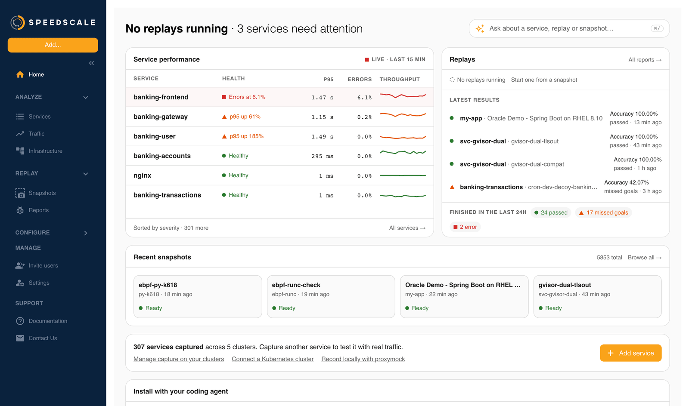
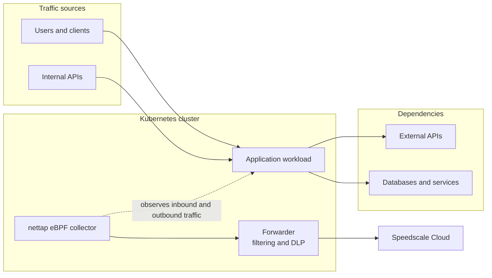
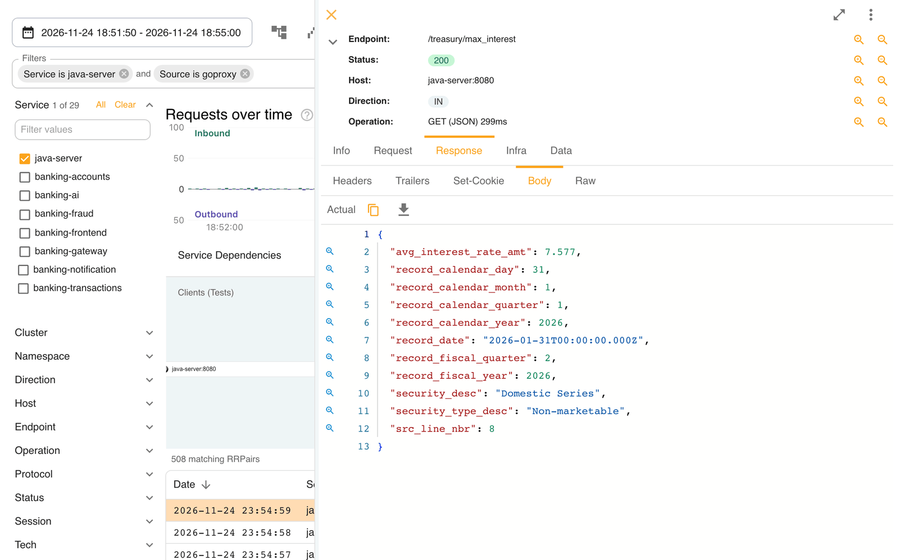
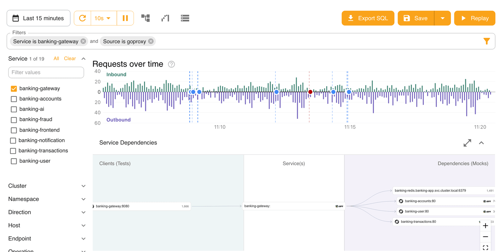
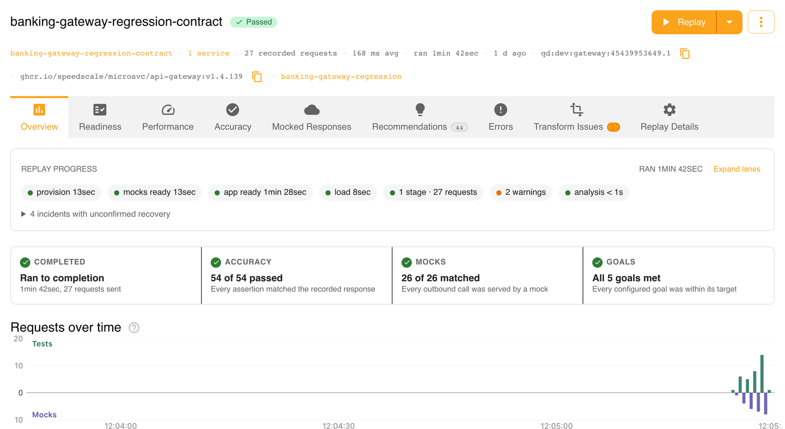

import StartPaths from '@site/src/components/StartPaths';

# Speedscale documentation

Speedscale records the real API traffic your service handles and replays it against a new build before release. The recorded requests become the tests. The recorded responses from databases and downstream APIs become the mocks, so the service under test runs without its dependencies. Each replay produces a report with one readiness verdict for that build.

## Choose a start

<StartPaths />

Both starts use the same recordings and reports. Traffic recorded in a cluster can be pulled down and replayed with proxymock, and a proxymock recording can be pushed to Speedscale Cloud.

## Find your way around

| You want to | Go to |
| --- | --- |
| Follow a full walkthrough with a demo app | [Tutorials](/tutorials/) |
| Do one job: capture, mock, replay, load test, protect data | [How-to guides](/guides/) |
| Decide whether a build is ready to ship | [Readiness and reports](/guides/readiness/) |
| Work with a specific database, message broker or protocol | [Technologies](/technologies/) |
| Install Speedscale or choose where traffic is stored | [Install Speedscale](./installation/install/README.md) |
| Look up a command, transform or config field | [Reference](/reference/) |

## Install

For an agent-assisted install, choose the scope first. The [proxymock-only prompt](/proxymock/getting-started/installation/#install-with-ai-agent) installs proxymock and MCP for local workflows. The [platform install prompt](./quick-start.md#install-with-ai-agent) deliberately installs both CLIs and can install the Kubernetes operator, asking before it touches a cluster.

[Command-line tools: proxymock and speedctl](./command-line-tools.md) explains what each CLI is for. [Install Speedscale](./installation/install/README.md) lists every environment and compares Speedscale Cloud with BYOC storage.

## Security and data control options

Apply Data Loss Prevention (DLP) to the setup you choose. Forwarder DLP can redact captured traffic before export, and `proxymock import --dlp-config` can redact imported traffic before writing local RRPair files. Import redaction does not change the original objects in your bucket. See the [DLP guides](/guides/dlp/) and [local rule guide](/proxymock/guides/local-rules.md).

For BYOC, configure the data destination and prevent Cloud export before turning capture on. Follow the [BYOC checklist](/byoc/#before-you-capture).

## Speedscale Cloud workflow

The dashboard workflow below uses Speedscale-managed storage. For BYOC capture and replay, follow your selected [BYOC setup](/byoc/).

### AI Assistant

Open the **AI assistant** from the **Ask about a service, replay or snapshot** box at the top of the Speedscale Cloud home screen. It can help you record traffic, find snapshots, run replays, and interpret results. See the [AI Chat Assistant guide](/guides/ai-assistant) for details on what it can do.

Speedscale follows a 3-part workflow: **Observe**, **Analyze**, and **Replay**.

### Observe 

In **Observe**, the classic operator uses eBPF collection where supported, with goproxy sidecars as a fallback. A namespaced installation uses sidecars applied by proxymock with your kubeconfig. See [Kubernetes installation options](./installation/install/kubernetes.md) for the permissions and capture mechanism for each mode.

The collector captures two data flows: inbound traffic to your API and outbound traffic to dependencies, including responses. This allows Speedscale to transform inbound requests into replayable tests and dependency traffic into mocked services for isolated replay.

In this Cloud workflow, captured traffic is sent to Speedscale-managed storage for analysis.

Once you have Speedscale installed, [view your services](https://app.speedscale.com/).

### Analyze 

In **Analyze**, you inspect historical traffic by API to understand real system behavior. Traffic is broken into requests and responses so you can investigate normal and failure paths.

Use filters to isolate the specific traffic patterns you want to test.

Once your application receives traffic, [view your traffic in Speedscale](https://app.speedscale.com/analyze)

### Replay 

In **Replay**, you run recorded traffic against the candidate version of your service before release. Speedscale can orchestrate this replay environment and execute the run automatically.

If you do not want outbound calls to hit real dependencies during replay, use a responder to stand in for those systems with captured responses.

Once you have run a replay, [view your test reports](https://app.speedscale.com/reports).
