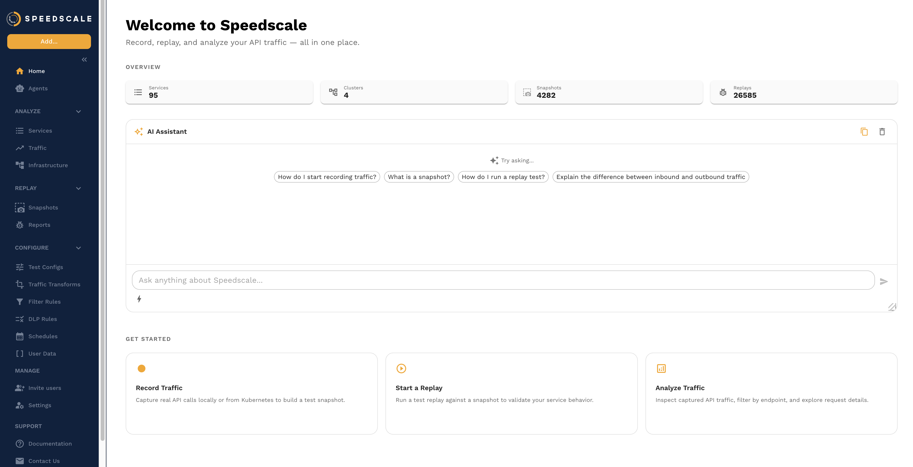
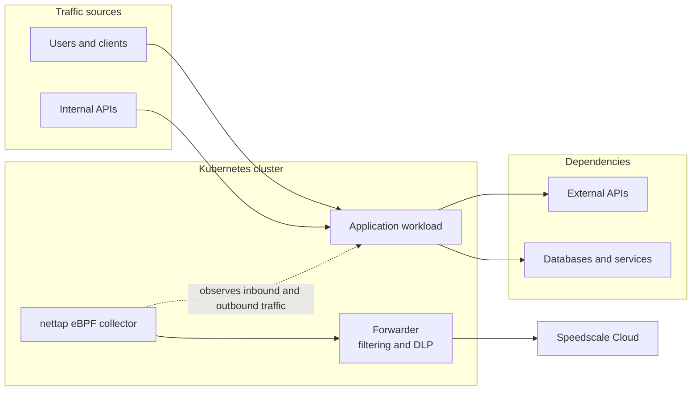
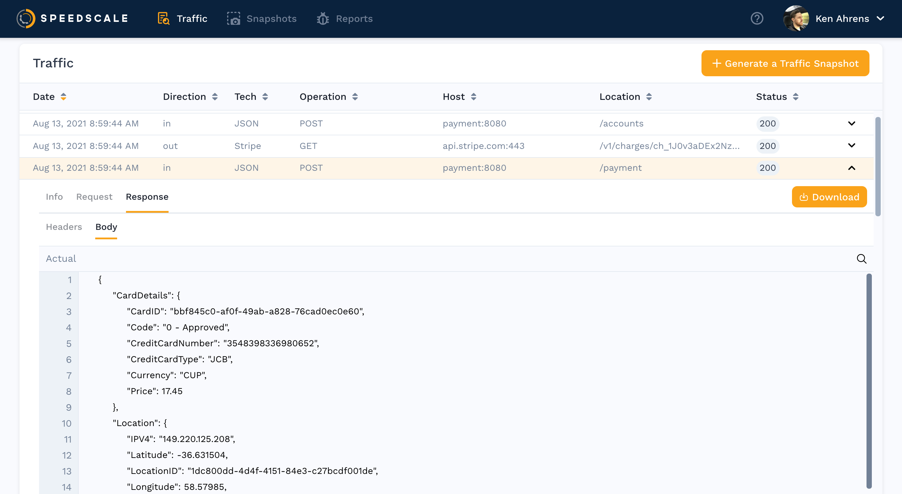
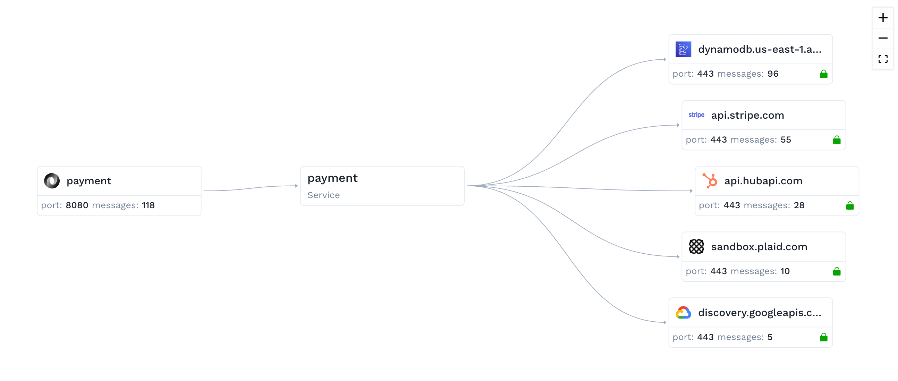
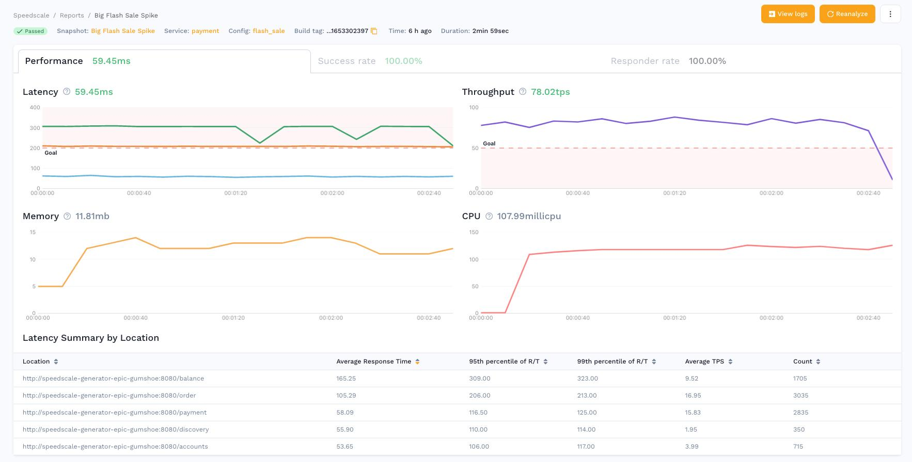

# Getting Started

Speedscale captures real API traffic from your running services and replays it against code changes before release. Recorded requests become tests, and recorded dependency responses become mocks.

## Choose your setup

Choose where captured traffic and replay results should live before installing:

| Setup | Use it when | Start here |
| --- | --- | --- |
| Speedscale Cloud | You want Speedscale-managed storage and dashboard workflows, with a classic or namespaced Kubernetes installation. | [Choose a Kubernetes installation](./installation/install/kubernetes.md) |
| BYOC direct storage | Captures, replay inputs, and reports must stay in your S3, S3-compatible, GCS, or Azure Blob storage. Requires a namespaced Kubernetes installation. | [Choose direct storage](/byoc/#direct-storage) |
| BYOC collector export on Kubernetes | You want an OpenTelemetry Collector to send captured traffic to your storage or observability tools. | [Configure Kubernetes export](/byoc/#collector-export-on-kubernetes) |
| BYOC collector export on ECS/Fargate | Your application runs on ECS/Fargate and captured traffic should go through a collector to your storage. | [Configure ECS/Fargate export](/byoc/#collector-export-on-ecs-fargate) |
| Local proxymock | You want to record, mock dependencies, and replay on your machine. | [Follow the local quickstart](/proxymock/getting-started/quickstart/quickstart-cli.md) |

Already have traffic in a BYOC bucket? [Import it into proxymock](/byoc/use-traffic.md) to inspect, mock, and replay it.

Speedscale Cloud and all BYOC deployments require Speedscale API connectivity for registration, configuration, and operational telemetry. BYOC controls the destination of captured traffic; it is not a self-hosted or air-gapped Speedscale platform. BYOC also uses your Speedscale tenant, through the dashboard or speedctl, for tenant values and rule configuration. Direct storage can use local Forwarder rule files; named collector exporters use tenant-managed filter and DLP configurations. Review [BYOC setup and data boundaries](/byoc/) before enabling capture.

Local proxymock keeps recordings on your machine by default. See [data and privacy](/proxymock/how-it-works/data_and_privacy/) for activation and telemetry details.

## Plan an evaluation

Start with [evaluation prerequisites and plan](./evaluation.md) to choose a service, prepare your environment and agree on success criteria before installation.

## Install

For an agent-assisted install, choose the scope first. The [proxymock-only prompt](/proxymock/getting-started/installation/#install-with-ai-agent) installs proxymock and MCP for local workflows. The [platform install prompt](./quick-start.md#install-with-ai-agent) deliberately installs both CLIs and can install the Kubernetes operator, asking before it touches a cluster.

Choose your tool before installing: [Command-line tools: proxymock and speedctl](./command-line-tools.md) explains their roles and links to both CLI installs. For manual Kubernetes setup, follow the [Kubernetes installation options](./installation/install/kubernetes.md). For recording, mocking, and replaying with proxymock, start with the [proxymock overview](/proxymock/).

## Security and data control options

Apply Data Loss Prevention (DLP) to the setup you choose. Forwarder DLP can redact captured traffic before export, and `proxymock import --dlp-config` can redact imported traffic before writing local RRPair files. Import redaction does not change the original objects in your bucket. See the [DLP guides](/guides/dlp/) and [local rule guide](/proxymock/guides/local-rules.md).

For BYOC, configure the data destination and prevent Cloud export before turning capture on. Follow the [BYOC checklist](/byoc/#before-you-capture).

## Speedscale Cloud workflow

The dashboard workflow below uses Speedscale-managed storage. For BYOC capture and replay, follow your selected [BYOC setup](/byoc/).

### AI Assistant

The **AI assistant** on the Speedscale Cloud home screen can help you record traffic, find snapshots, run replays, and interpret results. See the [AI Chat Assistant guide](/guides/ai-assistant) for details on what it can do.

Speedscale follows a 3-part workflow: **Observe**, **Analyze**, and **Replay**.

### Observe 

In **Observe**, the classic operator uses eBPF collection where supported, with goproxy sidecars as a fallback. A namespaced installation uses sidecars applied by proxymock with your kubeconfig. See [Kubernetes installation options](./installation/install/kubernetes.md) for the permissions and capture mechanism for each mode.

The collector captures two data flows: inbound traffic to your API and outbound traffic to dependencies, including responses. This allows Speedscale to transform inbound requests into replayable tests and dependency traffic into mocked services for isolated replay.

In this Cloud workflow, captured traffic is sent to Speedscale-managed storage for analysis.

Once you have Speedscale installed, [view your services](https://app.speedscale.com/).

### Analyze 

In **Analyze**, you inspect historical traffic by API to understand real system behavior. Traffic is broken into requests and responses so you can investigate normal and failure paths.

Use filters to isolate the specific traffic patterns you want to test.

Once your application receives traffic, [view your traffic in Speedscale](https://app.speedscale.com/analyze)

### Replay 

In **Replay**, you run recorded traffic against the candidate version of your service before release. Speedscale can orchestrate this replay environment and execute the run automatically.

If you do not want outbound calls to hit real dependencies during replay, use a responder to stand in for those systems with captured responses.

Once you have run a replay, [view your test reports](https://app.speedscale.com/reports).
