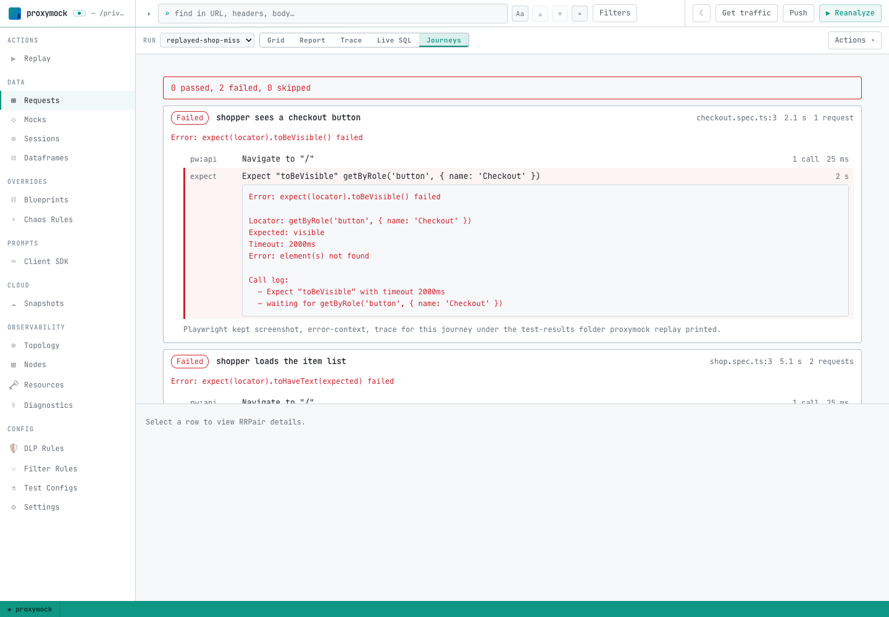

# Run journeys on your machine

`proxymock replay --browser` runs a folder of journeys in Chromium against a frontend on your machine. Run it next to `proxymock mock` and the frontend's API calls are answered from a recording, so you can work on the frontend with no API tier running.

## Before you start

- [proxymock](../../proxymock/getting-started/quickstart/quickstart-cli.md) installed.
- `node` on your `PATH`.
- `@playwright/test` and Chromium installed in the journeys folder or a folder above it:

```bash
npm install -D @playwright/test
npx playwright install chromium
```

Set `SPEEDSCALE_PLAYWRIGHT_DIR` to a directory that has them to use an install somewhere else. The journeys' own install wins when both exist.

## Replay with the API calls answered from a recording

Start a mock server on the recording that holds the frontend's API calls. A recording made with `proxymock record --browser` has them; see [Record a journey](./write-journeys.md#record-a-journey).

```bash
proxymock mock --in <recording>
```

In another terminal, run the journeys against the frontend, with the browser's traffic sent through the mock server's proxy port:

```bash
proxymock replay --in <recording> --browser ./journeys \
  --test-against http://localhost:3000 \
  --browser-proxy http://localhost:4140
```

`--test-against` is the frontend's base URL. The mock server answers each call it has a recording for and, by default, passes every other call through to the real host. Each call the recording could not answer is named under its journey, so you can see what to record next. Start the mock server with `--no-passthrough` to answer those calls with a 404 instead, and keep the run off the real APIs entirely.

When the proxy intercepts HTTPS calls, add `--browser-ignore-https-errors` so the browser accepts the mock server's certificate.

## Replay against the real APIs

To check that the real APIs still answer the way the recording says, have the mock server send every call to the real API and name the recorded call it matched:

```bash
proxymock mock --in <recording> --observe-real-apis
```

Run `proxymock replay --browser` against it as above. Each journey then lists the calls whose real response differs from the recording, with what differed, such as the status code or the JSON body. See [Mocks and real APIs](./mocks-and-real-apis.md#compare-the-real-apis-with-the-recording).

Leave out `--browser-proxy` to run the journeys with no proxy at all. The browser then calls whatever the frontend calls, and nothing is compared.

## Read the results

proxymock prints each journey as it finishes, then a summary:

```text
  ✗ shopper loads the item list (shop.spec.ts:3) 5.155s
      Error: expect(locator).toHaveText(expected) failed
      answered differently from the recording: GET http://api.demo.test/items (Body JSON)
  ✓ shopper sees a checkout button (checkout.spec.ts:3) 2.104s

Browser journeys: 1 passed, 1 failed, 0 skipped
Web vitals (p95 across journeys): LCP 412ms, FCP 388ms, TTFB 21ms, CLS 0
Traces and screenshots of failed journeys: /var/folders/.../speedscale-browser/<run>/test-results
```

`proxymock replay` exits with status 1 when any journey fails, so it can gate a CI job as it is.

Open a failed journey's trace with Playwright's trace viewer:

```bash
npx playwright show-trace <test-results>/<journey>/trace.zip
```

The run also writes `browser-journey-results.json` into the replay's output folder. In proxymock web (`proxymock web`), pick the run on the **Requests** page and switch to **Journeys** to see each journey's steps, the calls each step made, the calls the recording could not answer and the calls the real API answered differently. The **Journeys** view appears only for runs that ran journeys.



## Flags

| Flag | Default | What it does |
|---|---|---|
| `--browser <dir>` | none | Run the journeys in this folder instead of replaying recorded requests. |
| `--test-against <url>` | none | The frontend's base URL, which relative URLs in the journeys resolve against. |
| `--browser-proxy <url>` | none | Send the browser's traffic through this HTTP proxy, normally `proxymock mock` at `http://localhost:4140`. |
| `--browser-workers <n>` | `1` | Run this many journeys at once, each in its own browser context. |
| `--browser-ignore-https-errors` | off | Accept any TLS certificate, needed when the proxy intercepts HTTPS. |
| `--browser-block <glob>` | none | Abort requests matching this URL glob in the browser, for analytics and chat scripts. Repeatable. |

Pass `--test-config` to apply a test config's other browser settings, such as a [storage state](./write-journeys.md#start-signed-in), and its goals. The flags above override the matching config settings.
