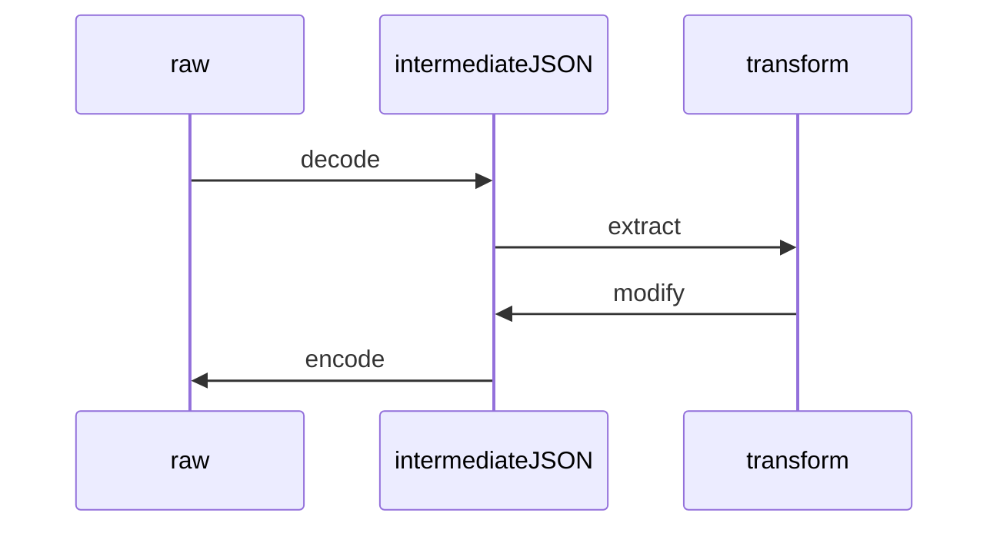

import Mermaid from '@theme/Mermaid';

# Understanding Request Bodies

For generic HTTP or JSON API requests, viewing requests and response bodies is very straightforward in Speedscale. The default RRPair viewer provides facilities for viewing as text, viewing as binary hexadecimal and JSON pretty print. Modifying this data with the transform system is equally straightforward since it is simply text.

However, Speedscale provides the ability to decode a wide variety of protocols, including binary or wire-format protocols. For these protocols, Speedscale translates the request and response payloads into whatever definition language will allow a mapping to JSON. Speedscale refers to this as the "intermediate JSON" or expanded payload. Speedscale's data analysis engine works on JSON by default and so once the protocol is rendered in this format it can be viewed, modified and then re-encoded. This allows you to modify the query using the transform system and then have it re-encoded by Speedscale into the proper format for your protocol.



Some protocols have no direct JSON-compatible mapping and so the formats are invented by Speedscale. Here are some examples to help you understand what is being shown in the UI:

## gRPC

gRPC is sent over HTTP/1.1 or HTTP/2 as a binary wire protocol: an HTTP request with the usual headers and trailers, wrapped around one or more binary protobuf messages. Protobuf bodies sent over plain HTTP with a content type such as `application/x-protobuf` are handled the same way. Speedscale decodes each [message](https://protobuf.dev/programming-guides/encoding/) without needing your `.proto` file and offers two views of it in the traffic viewer's Body tab.

**Protoscope** is the default. It is the readable text form of the protobuf wire format from the [protobuf project](https://github.com/protocolbuffers/protoscope), and it shows every byte of the message:

```
1: {"acct-1001"}
2: {"user-7"}
3: 50.5   # 0x4049400000000000i64
4: {"DEPOSIT"}
5: {"5411"}
```

Each line starts with the field number from the `.proto`. Text fields and nested messages are in `{ }`, whole numbers are varints (integers, booleans and enums), fixed-width values are shown as the number they most likely hold with their raw bits in a `#` comment, and anything else is hex in backticks. A stream shows one block per message, headed `# message 1 of 3` and so on. Protoscope is for reading only.

**Wire JSON** is the intermediate JSON that transforms, extractors and edits work on. Each key is `<field number>:<wire type>`:

```json
{
  "1:LEN": "acct-1001",
  "2:LEN": "user-7",
  "3:I64": 4632304060471443456,
  "4:LEN": "DEPOSIT",
  "5:LEN": "5411"
}
```

`LEN` holds strings, bytes and nested messages, `VARINT` holds integers, booleans and enums, and `I32` and `I64` hold fixed-width values as their raw bits, which is why the `double` 50.5 reads as `4632304060471443456` here. To change a field, change its value and keep the key. Speedscale re-encodes the message when it replays or mocks the call. The transform views always use Wire JSON.

Switch between the two with the Protoscope / Wire JSON control above the body. The field numbers in both views match the field numbers in your `.proto`. Upload the `.proto` and a third view, **Named**, shows the body with your field and enum names; see [Read protobuf bodies with your schemas](./protobuf-schemas.md). [proxymock](../../proxymock/grpc/index.md#read-a-body-as-protoscope) shows the same views for local recordings.

## GraphQL

GraphQL queries are converted into a JSON representation of GraphQL AST. See below snippet:

```json
{
  "operationName": "",
  "query": {
    "Definitions": [
      { "Directives": [], "Kind": "OperationDefinition", "Loc": null }
    ]
  }
}
```

These ASTs are very long and hard to interpret but most changes are made in the `variables` section of the AST. In well structured GraphQL, variables should extract many of the values that would need to be modified or inspected.

You rarely need to read the AST directly: a GraphQL request is addressed by [semantic path](../graphql/semantic-paths.md) instead — `variables.email`, `createUser.args.input.plan` — and edited with the [`graphql`](../transformation/transforms/graphql.md) transform. See the [GraphQL guide](../graphql/index.md).

## Postgres

```json
{
  "query": {
    "query": "SELECT * FROM \"users\" WHERE email = 'frank.gutierrez@example.com' AND \"users\".\"deleted_at\" IS NULL ORDER BY \"users\".\"id\" LIMIT '1'"
  }
}
```

Postgres queries are straightforward to modify. Add a `json_path` transform targeting `query.query` to modify the query statement. The Postgres response is broken into two sections with the first being the columns:

```json
{
  "query": {
    "messages": [
      {
        "rowDescription": {
          "fields": [
            {
              "dataTypeOid": 20,
              "dataTypeSize": 8,
              "name": "id",
              "tableAttributeNumber": 1,
              "tableOid": 16388,
              "typeModifier": -1
            }
          ]
        }
      }
    ]
  }
}
```

The section part of the response are the actual row values and they look like this:

```json
{
  "query": {
    "messages": [
      {
        "rowDescription": {
          "fields": [
            {
              "dataTypeOid": 19,
              "dataTypeSize": 64,
              "name": "current_database",
              "typeModifier": -1
            }
          ]
        }
      },
      {
        "dataRow": {
          "values": [
            {
              "asString": "microservices"
            }
          ]
        }
      },
      {
        "complete": {
          "tag": "SELECT 1"
        }
      }
    ]
  }
}
```

You'll need to understand which columns attach to which columns but the JSON modification is straightforward with a `json_path` to `query.messages.dataRow...`

## Redis

Speedscale represents the Redis wire protocol as structured command and argument arrays. Text values are human readable and editable, while binary values remain available for exact mock matching.

Captured Redis traffic can also be replayed as a dependency mock. See [Redis Mocking](/proxymock/databases/record/redis) for RESP2/RESP3 support, transaction requirements, and local proxymock commands.

```json
"array": {
    "values": [
        {
            "bulkString": {
                "message": "HGET"
            }
        },
        {
            "bulkString": {
                "message": "PRODUCT_HASH"
            }
        },
        {
            "bulkString": {
                "message": "Bushcraft-Jet-Emergency-Fire-Starter-Magnesium-Kit-Camping-Hiking-Bushcraft"
            }
        }
    ]
}
```

## Kafka

When a request is initiated by a network client to your service, that is considered inbound traffic. Outbound traffic is any traffic where the service under observation is initiating the connection. Kafka traffic is always considered "outbound" because the client always dials the Kafka broker. This outbound traffic contains both `Produce` and `Fetch` messages along with other Kafka operations. For eg. this is what a `Produce` message looks like.

```json
{
  "ProduceRequest": {
    "acks": -1,
    "timeoutMs": 30000,
    "topics": [
      {
        "name": "topicName",
        "partitions": [
          {
            "records": {
              "attributes": ["ATTRIBUTE_NO_COMPRESSION"],
              "baseSequence": -1,
              "baseTimestamp": "1764787375659",
              "batchLength": 8205,
              "crc32": 3478581886,
              "magic": 2,
              "maxTimestamp": "1764787375659",
              "producerEpoch": -1,
              "producerId": "-1",
              "records": [
                {
                  "valueString": "data being sent"
                }
              ]
            }
          }
        ]
      }
    ]
  },
  "apiKey": "KAFKA_API_KEY_PRODUCE",
  "apiVersion": 7,
  "clientId": "client",
  "correlationId": 4
}
```

## Next Steps

Speedscale is continually adding protocols and this list is not exhaustive. If you need help interpreting the specific format of your protocol please reach out in the [community Slack](https://slack.speedscale.com).
