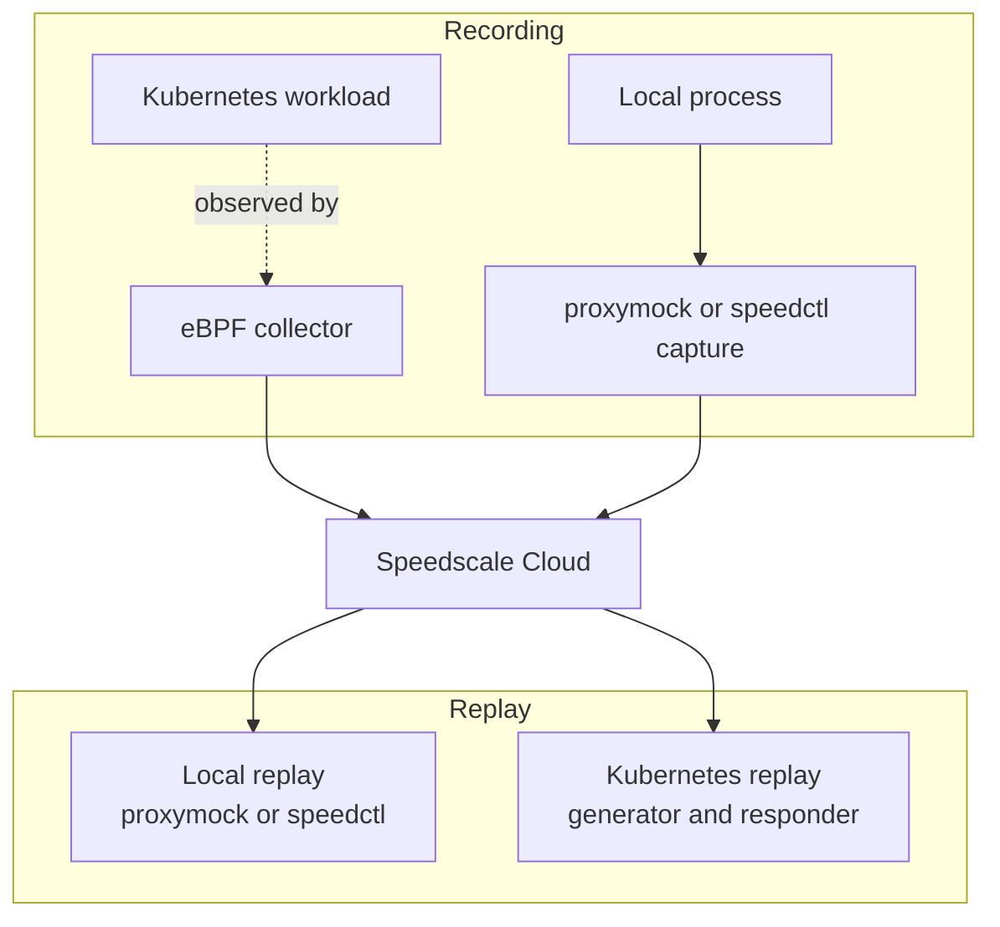

# Cluster Inspector

Speedscale is a cloud SaaS offering that provides both observability and replay of remote environments. The system is designed to record traffic from a remote environment, the local desktop or through data import. Replay works in a similar way on a similar set of platforms. When working remotely, Speedscale provides a point and click interface for starting and stopping replays.

The **Cluster Inspector** is a web interface for inspecting and managing Kubernetes clusters running Speedscale. It shows workloads, configuration, traffic, logs, and events while keeping operations within the configured Kubernetes RBAC boundaries.

To configure eBPF traffic capture or import a collection, follow the [tutorial](../../getting-started/tutorial.md).

## Overview

The Cluster Inspector presents cluster information in a tabular interface similar to K9s or kubectl. Use it to inspect the Speedscale deployment and the workloads it can access.

### Key Capabilities

- **Workload Management**: View cluster workloads and their Speedscale capture status
- **Traffic Monitoring**: Observe active traffic replays and analyze real-time traffic patterns
- **Configuration Management**: Inspect and validate Speedscale configuration across the cluster
- **Event & Log Analysis**: Access workload, Operator, and collector logs and events
- **Service Discovery**: Explore services, secrets, and node information
- **Remote Debugging**: Enhanced cluster debuggability for distributed teams

## Primary Features

### 1. Capture targeting and management

The Cluster Inspector shows which workloads are targeted for Speedscale capture. For new installations, enable the [eBPF collector](/reference/ebpf-traffic-collection) and use namespace and pod selectors or the `capture.speedscale.com/enabled` annotation to control the target set. This provides:

- **Selective capture** for specific workloads and namespaces
- **Capture status** without modifying application pods
- **Configuration visibility** for the Operator and collector
- **Fast rollback** by disabling a target annotation or selector

**Use cases:**
- Enable traffic capture on production workloads for testing
- Add monitoring to specific microservices
- Gradually roll out capture across your application stack

### 2. Debugging and observability

The Inspector also exposes workload logs and Kubernetes events for remote debugging:

- **Unified log viewing** for application workloads and Speedscale components
- **Real-time event monitoring** with filtering and search capabilities
- **Cross-reference logging** to correlate collector and application behavior
- **Historical event analysis** for troubleshooting past issues

**Benefits for remote teams:**
- Eliminates need for direct kubectl access
- Centralizes debugging information in a user-friendly interface
- Enables non-Kubernetes experts to troubleshoot effectively
- Provides context-rich debugging without cluster access credentials

## Security and Privacy

### Data Protection Guarantees

**No secret extraction**: The Cluster Inspector never extracts or exposes Kubernetes secrets from your cluster. All sensitive data remains secure within your environment.

**Local cluster access only**: All operations are performed within the cluster boundary using standard Kubernetes RBAC permissions.

**Audit trail**: All actions performed through the inspector are logged for security and compliance purposes.

### Optional Installation

The Cluster Inspector capability can be **completely disabled** by not installing the inspector service component. This provides organizations with full control over cluster access and debugging capabilities.

## Remote Replay and Data Collection

Speedscale provides the ability to remotely inspect and control Kubernetes clusters similar to [k9s](https://k9scli.io/) or [lens](https://k8slens.dev/). Unlike these inspection tools, Speedscale also allows clusters to be used for *remote replay*. Clusters assigned to Speedscale in this way can run replays on demand and can be treated as a shared resource for engineers or testers.

:::note
Clusters assigned to Speedscale can be used for other purposes. Speedscale consumes resources "just in time" to reduce cloud costs and does not lock down or otherwise monopolize a cluster when not in use.
:::

To enable remote data collection, please follow one of the installation [guides](../../getting-started/installation/install/kubernetes-operator.md). To enable remote replay, follow the same installation guide but ensure that the inspector is enabled (default).

## Clusters

Navigate to the [infrastructure](https://app.speedscale.com/infrastructure) page to view remote collectors. In most cases this will be a list of Kubernetes operators.

*Cluster/hostname* - name assigned during operator installation. A cluster installed outside the `speedscale` namespace also shows where it is installed.

*Capture* - eBPF collector health, such as **eBPF healthy** with the number of collectors ready, or **Sidecar only** when eBPF is not installed.

*Operator* - the running version, and **Behind** with the latest version when a newer release exists. A newer release does not mean this cluster can install it. Open the cluster's Operator tab to see what it can do.

*Start Time* - when the operator last started.

Filter the list to **Needs attention**, **eBPF** or **Sidecar only**. A cluster needs attention when its capture has a problem or its operator is behind.

## Inside a cluster

Click a cluster to open it. The same layout applies to every view:

- A status readout with **Capture**, **Workloads** and **Operator**. It uses the same words as the cluster list. A slot changes color only when it needs you, and then it names the next step, such as **Show 3 affected workloads** or **Review upgrade**.
- Tabs for **Workloads**, **Service map**, **Replays**, **Events**, **Resources** and **Operator**.
- A toolbar with the namespace, search and filters on the left, and Refresh on the far right.
- A click on any row opens its details in a panel on the right.

Lists start at **All namespaces**. Your namespace choice follows you between tabs and stays in the page URL, so you can share a link to it. **All namespaces** loads one namespace at a time in the background, and any namespace that fails to load is called out with a way to retry.

## Workloads

The Workloads tab shows every workload the inspector can see, grouped by namespace. Each heading says how much of that namespace is capturing, and namespaces with something capturing start open. Pick one namespace to get a flat list. New deployments should use eBPF capture. Sidecar status remains visible for existing sidecar deployments.

*Workload* - Kubernetes name, and the type when it is not a deployment

*Ready* - ready pods out of the total

*Capture* - the capture mode, which is also where you change it. A note appears only when there is something to say, such as a collector problem, **No ready pods** or **No recent signals**.

*Open* - **Logs**, **Traffic**, and a menu with capture settings, events and the workload's JSON

Filter the list to **All**, **Capturing**, **Needs attention** or **Not enabled**, with a count on each. **Needs attention** includes workloads affected by a collector problem, sidecars reporting Caution or Alert, and capturing workloads with no ready pods.

Speedscale's own workloads, such as replay responders and the operator, are hidden and left out of the counts unless they are capturing. Use **Show them** below the list to see them.

### Changing capture

Use **Turn on**, or the capture mode on any row, to pick a mode. Each mode states what it costs:

- **eBPF** starts or stops right away and does not restart pods. A notification offers **Undo**.
- **eBPF + Java TLS** adds a Java agent so TLS traffic in Java apps is captured too. Adding or removing the agent restarts the pods, so it asks you first.
- **Sidecar** injects a proxy and restarts the pods. It opens the workload's settings so you can review them before you apply. Sidecar capture is being retired, so choose eBPF for new workloads.
- **Off** stops capture. It restarts the pods only when that removes the Java agent or the sidecar.

To change many workloads at once, select rows or a whole namespace with the checkboxes and use **Turn on eBPF** or **Turn off eBPF**. A preview shows what will change and why anything is skipped, and nothing changes until you apply it. Bulk changes only switch eBPF, so sidecar workloads are skipped. Turning off eBPF in bulk stops Java capture too but leaves the agent installed, and the workload's settings say so.

**Select by label**, below the list, does the same for a pod template label selector across the namespaces you choose. Every condition in a selector such as `app=checkout,environment=staging` must match, and it matches the pod template labels, not the workload's own labels.

A bulk change is a one-time action on the previewed workloads, so workloads created later are not included. **Applied** means the cluster acknowledged the annotation, not that traffic is being captured yet, so check the capture note afterwards. Bulk changes cover Deployments, StatefulSets, DaemonSets, Jobs and Argo Rollouts. A preview expires after 15 minutes. A preview that matches more than 500 workloads, skipped ones included, or spans more than 100 namespaces is refused, so narrow the scope.

### Workload details

Click a workload to open it in a panel beside the list. Use the arrows in the panel, or the up and down arrow keys, to move to the next workload. In a narrow window, the panel opens over the list instead.

- **Capture** has the four modes, and the ignored ports for eBPF or the settings for a sidecar. When you change something, a footer says what will happen and whether pods restart, with **Apply** next to it.
- **Logs** streams the workload's logs and switches between the container and the sidecar when the workload has one. **Widen panel** gives long lines more room.
- **Events** shows Kubernetes events for the workload.

Use **List** and **Map** to switch to the [cluster map](../cluster-map.md).

### Capture management best practices
- Start with non-critical workloads to validate configuration
- Monitor [collector resource usage](/reference/ebpf-traffic-collection/resource-utilization) after enabling eBPF
- Use selective workload targets rather than cluster-wide capture
- Regularly review and remove capture targets that are no longer needed

## Service map

The Service map tab draws the services in this cluster from observed traffic. It follows the namespace filter and has its own time range. Search dims the services that do not match. Click a service to open its traffic.

## Replays

Use this tab to view replays. Speedscale utilizes a Custom Resource Definition called a `trafficreplay` to manage cluster replays. This view shows these resources whether currently active or not. Click a replay to see its status, snapshot, report and full definition, and use **Cancel replay** to remove it.

## Events

Similar to watching the logs, you can also view Kubernetes events, which helps you detect pod problems like CrashLoopBackOff. Filter to **Warnings** and search by reason, object or message. Click an event to read its full message and, when it belongs to a workload, open that workload.

**All namespaces** shows up to 100 events per namespace. Select a namespace to see up to 500.

## Resources

The Resources tab has four sections:

- **Nodes** lists each node with its status, workload count, instance type, region and capacity. Click a node to see the workloads running on it and its full description as JSON or text.
- **Services** lists the Kubernetes network services, with their type, cluster IP, external IP and ports.
- **Config maps** lists config maps with their number of keys. Click one to read its values or download it as JSON.
- **Secrets** lists the name and key names of secrets. **Critical security feature**: Unlike true Kubernetes management solutions, no secret values are transferred out of the cluster and they cannot be remotely inspected. This ensures sensitive data remains secure within your environment.

## Operator

The Operator tab has three sections:

- **Health** shows collector status and installation details, and collects eBPF diagnostics. On a cluster without eBPF, it shows the command that enables it.
- **Upgrades** shows the installed and latest versions, and plans an upgrade when this cluster can install one. When it cannot, it lists each reason.
- **Settings** shows the configuration of the operator itself and lets you search it. The operator provides a deprecated mechanism for altering remote configuration. When populated, the override value is used over the main value. This feature will be removed at a later date.

Operator configuration is explained in greater detail in the [installation](../../getting-started/installation/install/kubernetes-operator.md) guides.

## Getting Started with Cluster Inspector

### Prerequisites

- Speedscale operator deployed in the cluster
- Inspector service installed (optional component)
- Appropriate RBAC permissions configured

### Accessing the Inspector

The Cluster Inspector is accessible through the Speedscale web interface under **Infrastructure**. Select the cluster name to begin exploring your Kubernetes environment through the tabular interface.

### Initial Setup

1. **Verify permissions**: Ensure your user account has appropriate cluster access
2. **Review workloads**: Start by exploring existing workloads and their current state
3. **Identify candidates**: Select workloads that would benefit from traffic capture
4. **Configure capture**: Enable the eBPF collector and target the selected workloads

## Troubleshooting

### Common Issues

**Inspector not accessible**: Verify the inspector service is installed and running in the cluster.

**Missing workloads**: Check RBAC permissions and namespace access rights.

**Capture is missing**: Review the eBPF system requirements, target selectors, and nettap logs.

**Log viewing problems**: Ensure proper logging drivers and log retention policies.

### Debugging Workflows
- Use the unified log view to correlate application, Operator, and collector behavior
- Filter events by workload or namespace to focus troubleshooting
- Leverage historical data for pattern analysis
- Export logs for offline analysis when needed

### Getting Help

For technical support with the Cluster Inspector:
- Check the Speedscale operator logs for error messages
- Verify network connectivity and DNS resolution
- Review Kubernetes events for the speedscale namespace
- Contact Speedscale support with cluster configuration details
