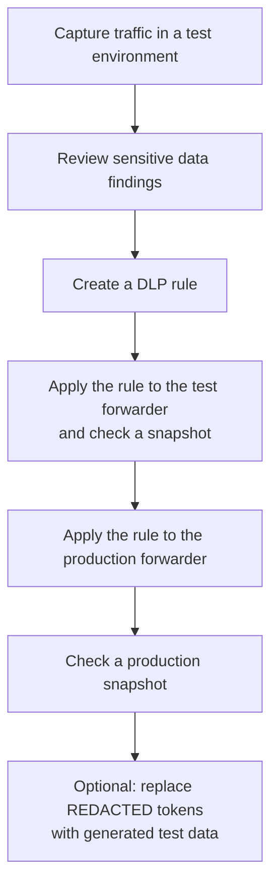

# Data Loss Prevention (DLP)

Speedscale DLP masks sensitive data in captured API traffic before it leaves your infrastructure. The forwarder in your cluster applies a DLP rule to every request and response it captures, so names, card numbers, tokens and other sensitive values reach Speedscale cloud only as `REDACTED-` tokens. No application changes are needed.

DLP helps you keep personal and payment data out of Speedscale storage for regulations such as GDPR, HIPAA and PCI DSS. See [Data Protection](../../security/data_protection.md) for how Speedscale handles the data it does receive.

:::note Enterprise Data Deletion
If sensitive data reaches Speedscale cloud by mistake, Enterprise customers can request its deletion. The deletion SLA depends on your support level. Contact your Speedscale account representative or support team.
:::

## How a Rule Masks Data

A DLP rule masks data in two ways, and one rule can use both:

- **Field names to mask.** A list of field and header names. Each name is masked wherever it appears in HTTP traffic: any depth of a JSON body, form fields, query parameters and headers. One name covers every place the field appears.
- **Transform chains.** A chain selects one location, such as a field in the body of one endpoint, and replaces its value. Use a chain for a field whose name is too common to mask everywhere, for a replacement other than a hash, or for traffic other than HTTP.

Field names, and the `dlp_field` transform at the end of a chain, replace each value with `REDACTED-<hash>`. The same input always produces the same hash, so distinct values stay distinct and replays and mocks can still match on them. See [Creating DLP Rules](./creating-rules.md) for both methods.

## Workflow

1. [Discover sensitive data](./discovering-pii.md) in a snapshot from a test environment, and review the [DLP recommendations](./recommendations.md) Speedscale proposes.
2. [Create a DLP rule](./creating-rules.md) from those recommendations, from field names you list, or both.
3. [Apply the rule](./applying-rules.md) to a test forwarder, check a snapshot, then apply it to production.
4. If several teams share one forwarder, give each its own [group rule](./group-rules.md).
5. [Generate test data](./test-data-generation.md) to replace `REDACTED-` tokens before replaying production traffic.

When something does not mask as expected, see [Troubleshooting](./troubleshooting.md). To manage rules from the command line, see the [speedctl DLP CLI reference](./cli-reference.md). To author and test rules against local recordings, see [proxymock local DLP rules](/proxymock/guides/local-rules/).

## Terms

- **DLP rule**: A named document (`DLPConfig`) holding the field names to mask, transform chains and settings. Rules are listed under **DLP Rules** in the dashboard.
- **Forwarder**: The Speedscale component in your cluster that applies DLP and sends captured traffic to Speedscale cloud.
- **Baseline rule**: The rule a forwarder applies to all captured traffic, named by its `SPEEDSCALE_DLP_CONFIG` setting. See [The baseline rule](./group-rules.md#the-baseline-rule-and-speedscale_dlp_config).
- **Group rule**: A rule scoped to the namespaces and services one group owns, applied on top of the baseline.
- **RRPair**: One captured request and its response, the unit DLP masks.
- **`REDACTED-` token**: The value that replaces masked data.
- **Snapshot**: A captured set of RRPairs, used to review findings and check that masking works.
