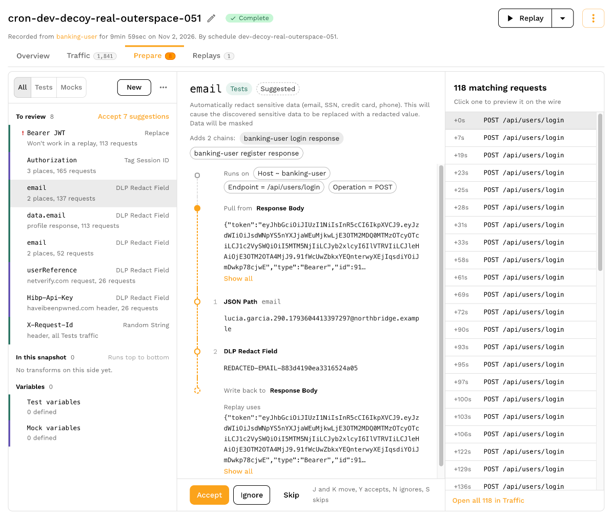

import PrepareSuggestionImage from '../transformation/recommendations/prepare-merged-row.png';

# Understanding DLP Recommendations

DLP recommendations are generated by Speedscale's DLP engine to identify PII in your snapshots and propose transform chains to redact or replace that data. Understanding recommendations is crucial for creating effective DLP rules.

## What are DLP Recommendations?

DLP recommendations are automated insights that:

- **Identify PII**: Point out where PII has been discovered in your snapshots
- **Propose Solutions**: Suggest transform chains to protect the identified PII
- **Provide Context**: Include metadata about the discovery (location, pattern type)
- **Enable Action**: Allow you to accept, modify, or ignore recommendations

### How Recommendations are Generated

Recommendations are generated automatically when:

1. **Snapshot Analysis**: A snapshot is analyzed by the DLP engine
2. **PII Discovery**: PII patterns are identified in the snapshot
3. **Transform Chain Creation**: Appropriate transform chains are proposed
4. **Recommendation Assembly**: Recommendations are assembled with metadata

### Recommendation Lifecycle

Recommendations follow this lifecycle:

1. **Generated**: Created during snapshot analysis
2. **Active**: Available for review and action
3. **Accepted**: Staged as snapshot transform chains; saved with **Save and reanalyze**
4. **Ignored**: Marked as ignored (can be restored later)

## Recommendation Types

Speedscale generates two main types of DLP recommendations:

### DLP Redaction Recommendations

**Purpose**: Mask PII in production traffic before it reaches Speedscale cloud

**When They Appear**: After analyzing snapshots containing real PII from test environments

**What They Recommend**: Transform chains that will:
- Identify PII using extractors (JSONPath, headers, query params, etc.)
- Apply DLP transforms to redact the PII
- Replace PII with `REDACTED-` prefixed tokens

**Outcome**: When applied to production forwarders, PII is replaced with `REDACTED-` tokens before data leaves your infrastructure

**Use Case**: Protecting production data from exposure

### DLP Test Data Recommendations

**Purpose**: Replace `REDACTED-` tokens with realistic test data for testing

**When They Appear**: After analyzing snapshots containing `REDACTED-` tokens from production traffic

**What They Recommend**: Transform chains that will:
- Identify `REDACTED-` tokens
- Discover the original data pattern (using pattern discovery)
- Generate appropriate test data matching the original pattern
- Replace `REDACTED-` tokens with test data

**Outcome**: Snapshots contain realistic test data instead of `REDACTED-` tokens, enabling effective testing

**Use Case**: Generating test data from redacted production traffic

## Viewing Recommendations

Open the snapshot's **Prepare** tab and select a DLP suggestion under **To review**. The middle pane shows its proposed transform chain and the value each step produces on a recorded request. The right pane lists matching requests; select several to check the scope of the change.

<a href={PrepareSuggestionImage}>Open screenshot full size</a>

Use **Open all in Traffic** to inspect every matching request. The [recommendation review guide](../transformation/recommendations.md) explains the shared queue, previews and keyboard shortcuts.

## Recommendation Components

Recommendations consist of transform chains that include three main components: filters, extractors, and transforms. For comprehensive documentation on transforms and extractors, see the [Transforms documentation](../../concepts/transforms.md).

### Transform Chains

A transform chain is a sequence of operations that process RRPairs in this order:

1. **Filters**: Identify which RRPairs to process (e.g., filter by service name or URL path)
2. **Extractors**: Extract data from specific locations (e.g., HTTP headers, request body, query parameters)
3. **Transforms**: Apply transformations to redact PII or generate test data (e.g., `dlp_json` transform)

Each chain has a unique identifier and can be customized to target specific data patterns and locations.

### Filters

Filters determine which RRPairs are processed by the transform chain. Examples include:

- Filter by service: `service="user-service"`
- Filter by URL path: `http.url CONTAINS "/api/users"`
- Filter by HTTP method: `http.method == "POST"`
- Combine conditions: `service="payment-service" AND http.method == "POST"`

### Extractors

Extractors identify and extract data from specific locations in RRPairs. Examples include:

- **HTTP Request**: Extract from headers (`http_req_header`), query parameters (`http_queryparam`), or body (`http_req_body`)
- **HTTP Response**: Extract from response headers (`http_res_header`) or body (`http_res_body`)
- **JSONPath**: Use JSONPath expressions to extract specific fields from JSON data (e.g., `$.user.email`)

### Transforms

Transforms perform the actual data modification. DLP recommendations use transforms like:

- **`dlp_json`**: DLP transformation for JSON data that redacts PII or generates test data
- Transforms can be chained together to perform multiple operations in sequence

For detailed information on all available extractors, transforms, and filter syntax, see the [Transforms documentation](../../concepts/transforms.md).

## Managing DLP Recommendations

**Accept** stages a suggestion's chains under **In this snapshot**. **Ignore** moves it to **Ignored**, and **Skip** leaves it undecided. Select **Save and reanalyze** to save staged edits, or **Discard** to drop them. Review the chain's filters and several matching requests before saving.

Accepting a suggestion changes the snapshot's transforms. To reuse a chain for capture redaction, open the saved transform's menu and select **Add to DLP rule**. Follow [Creating DLP Rules](./creating-rules.md#creating-rules-from-individual-recommendations) to select or create a rule, then [apply the rule to forwarders](./applying-rules.md). Accepting a snapshot suggestion does not deploy a capture rule.

To revisit a dismissed item, open **Ignored** in Prepare. For the complete review workflow, see [Working through recommendations](../transformation/recommendations.md#working-through-recommendations-in-the-prepare-tab).

## Next Steps

After understanding recommendations:

- [Creating DLP Rules](./creating-rules.md) - Create DLP rules from recommendations
- [Managing Recommendations](./recommendations.md#managing-dlp-recommendations) - Learn how to accept, ignore, and manage recommendations

## Related Documentation

- [Transform Chains](../../concepts/transforms.md) - Deep dive into transform chains
- [Creating Snapshots](../creating-a-snapshot.md) - Snapshot creation guide
- [Capturing Traffic](../../concepts/capture.md) - Traffic capture concepts
