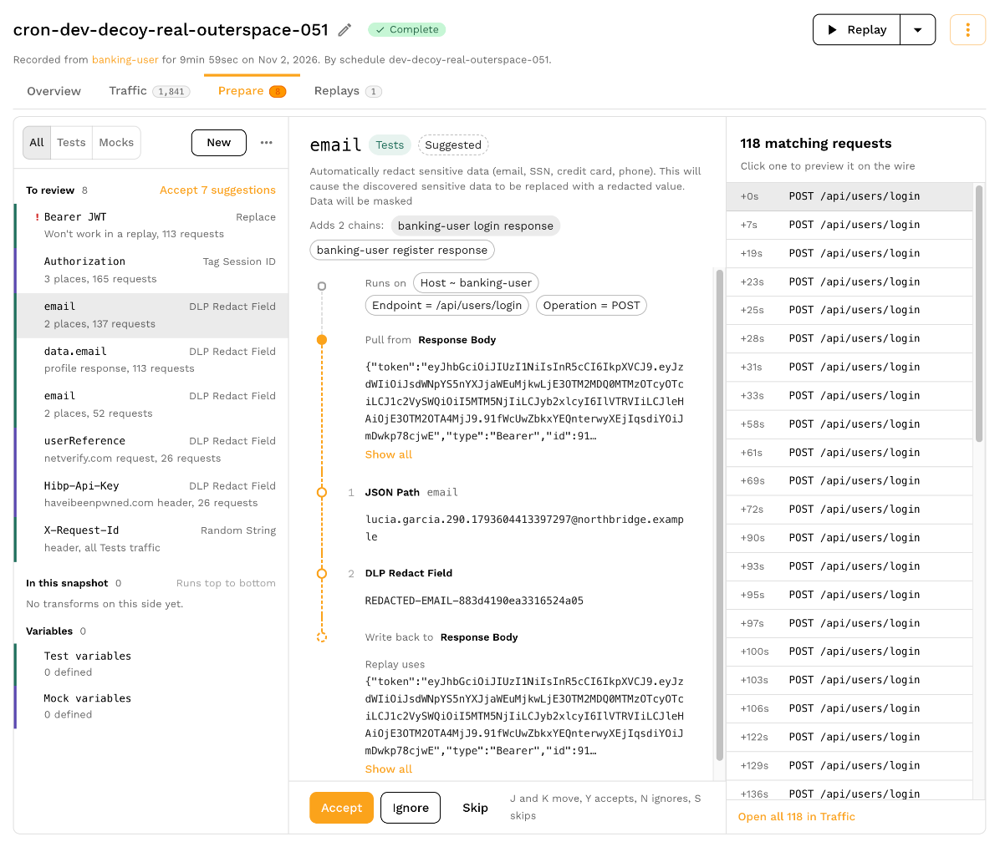

import PrepareSuggestionImage from '../transformation/recommendations/prepare-merged-row.png';

# Understanding DLP Recommendations

When Speedscale analyzes a snapshot, it proposes transform chains for the sensitive data it finds. These DLP recommendations appear in the snapshot's **Prepare** tab next to other suggestions. Each one names the location it found, the kind of data, and the chain that would mask or replace it.

## Two Kinds of Recommendation

| Kind | Appears when | Proposes |
|------|--------------|----------|
| **Redaction** | The snapshot holds real sensitive values, usually from a test environment. | A chain that replaces the value with a `REDACTED-` token. Added to a DLP rule, it masks the field in captured traffic. |
| **Test data** | The snapshot holds `REDACTED-` tokens, usually from production after masking. | A chain that replaces each token with a realistic generated value of the same kind, so replays send plausible data. See [Generating Test Data](./test-data-generation.md). |

## Viewing Recommendations

Open the snapshot's **Prepare** tab and select a DLP suggestion under **To review**. The middle pane shows its proposed transform chain and the value each step produces on a recorded request. The right pane lists matching requests; select several to check the scope of the change.

<a href={PrepareSuggestionImage}>Open screenshot full size</a>

Use **Open all in Traffic** to inspect every matching request. The [recommendation review guide](../transformation/recommendations.md) explains the shared queue, previews and keyboard shortcuts.

## What a Suggested Chain Contains

A suggested chain has the same parts as any [transform chain](../../concepts/transforms.md):

- **Filters** that limit which RRPairs it runs on, such as one host or endpoint.
- **An extractor** that selects where the value lives, such as a request header, a query parameter, or the request or response body.
- **Transforms** that narrow to the field, for example a **JSON Path** step inside a body, and then replace the value.

Check the filters before you accept: a chain scoped too widely can change traffic you meant to keep, and one scoped too narrowly misses the same field on other endpoints. When the same field name appears on many endpoints, consider [masking it by name](./creating-rules.md#masking-fields-by-name) instead of accepting one chain per location.

## Managing DLP Recommendations

**Accept** stages a suggestion's chains under **In this snapshot**. **Ignore** moves it to **Ignored**, and **Skip** leaves it undecided. Select **Save and reanalyze** to save staged edits, or **Discard** to drop them. Review the chain's filters and several matching requests before saving.

Accepting a suggestion changes the snapshot's transforms. To reuse a chain for capture redaction, open the saved transform's menu and select **Add to DLP rule**. Follow [Creating DLP Rules](./creating-rules.md#from-recommendations) to select or create a rule, then [apply the rule to forwarders](./applying-rules.md). Accepting a snapshot suggestion does not deploy a capture rule.

To revisit a dismissed item, open **Ignored** in Prepare. For the complete review workflow, see [Working through recommendations](../transformation/recommendations.md#working-through-recommendations-in-the-prepare-tab).

## Next Steps

- [Creating DLP Rules](./creating-rules.md): combine accepted chains and field names into a rule.
- [Applying Rules to Production](./applying-rules.md): point a forwarder at the rule.
