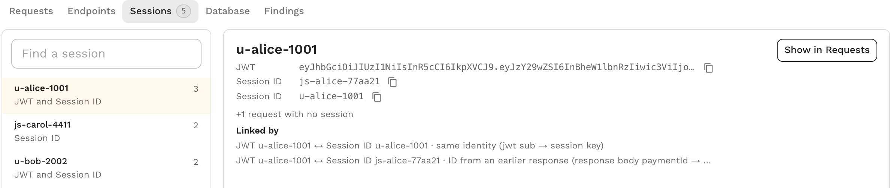
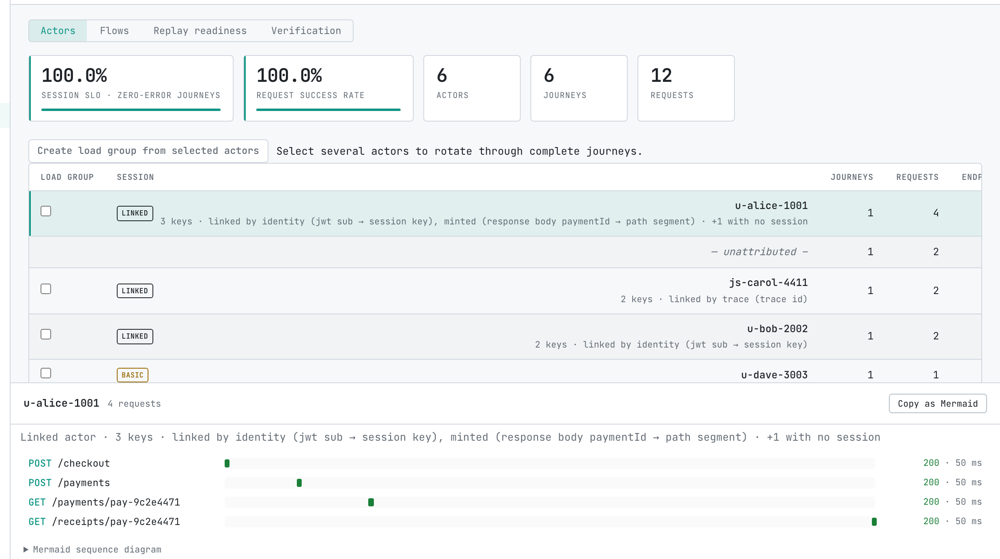

# Linked Sessions

Speedscale groups traffic into sessions by one value per request, the session ID. Real systems change that value as a request moves through them. A service keys its inbound requests by a user ID, forwards that user's JWT to its dependencies, and gets back a payment ID that the user's browser sends later. Each of those values is recorded as its own session, so one person can show up as several actors.

Linked sessions join those session keys back into one actor. Two keys are linked when their traffic shares a value that identifies one person, and links chain: if key A shares a value with key B, and key B shares a different value with key C, all three are one actor. This works like the Splunk `transaction` command when you give it several fields.

The recorded session ID never changes. Linking only changes how the Sessions views group traffic, so filters, session replay and load groups keep using the session IDs you recorded.

## How keys get linked {#evidence}

Speedscale links two session keys only when the same value appears in both keys' traffic. It reads three kinds of value.

| Kind | Shown as | Where Speedscale finds it |
|------|----------|---------------------------|
| Same identity | `same identity` | The user a key names: a JWT claim (the first of `email`, `preferred_username`, `username`, `upn`, `uid`, `sub`, `client_id` and `azp` that is set), a Basic auth username, or the session ID itself. Read from the session ID and from the `Authorization` header. |
| Same trace | `same trace` | A W3C `traceparent` or B3 trace ID, or the trace ID that a database statement carries in its SQL comment. |
| ID from an earlier response | `ID from an earlier response` | A value that a response created and a later request sent back: in a path segment, query parameter, header, cookie or JSON body. |

For example, Alice's inbound requests are keyed by her user ID `u-alice-1001`. Her service calls a payment service with a JWT whose `sub` claim is `u-alice-1001`, so the inbound key and the JWT key have the same identity. The payment service returns `pay-9c2e4471`, and her browser later requests `/payments/pay-9c2e4471` with only a `jsessionid`. That ID links the browser's key to the JWT key, so all three keys become one actor.

An ID from an earlier response only counts when it looks like an ID: at least six characters, a single token that contains a digit, and not a timestamp, URL, path or decimal number. Headers that describe the client or the connection, such as `User-Agent`, `Accept` or `Host`, are never read as IDs.

Timing never links keys. A dependency call made while an inbound request was in flight is often part of that request, but under load many requests overlap, and linking on timing would merge unrelated people.

## Limits that keep people apart {#limits}

Some values are shared by everyone, such as a tenant ID or a configuration version. Two rules stop those values from merging everyone into one actor.

- A value that appears under more than four session keys is treated as shared state and links nothing.
- An actor stops growing at 50 session keys, or at a tenth of the session keys in the recording when that is smaller, and never below 8. When a link would pass that limit, Speedscale keeps the two actors apart and marks each one as **possibly the same as** the other.

## Requests with no session {#no-session}

A request with no session ID joins an actor only when every value it carries points to that one actor. For example, a receipt request for `/receipts/pay-9c2e4471` with no credential joins Alice's actor. A request that names both Alice's and Bob's payments stays unattributed. These requests are counted as requests with no session, and their session ID stays empty.

## What Speedscale stores {#privacy}

Speedscale keeps each linking value only as a one-way fingerprint, together with where it was found, such as `jwt sub` or `response body paymentId`. Tokens, claim values and IDs are never stored as part of a link. The member session keys of an actor are the same session IDs that the snapshot already lists.

## In a snapshot {#dashboard}

Open a snapshot, select **Traffic**, then **Sessions**. Each entry on the left is one actor, and the count on the tab is the number of actors.

Select an actor to see:

- Every member session key. Basic auth keys are named by their username and never shown in full.
- **+N requests with no session**, when the actor picked up requests with no session ID. They are counted here and are not drawn in the timeline.
- **Linked by**, one line per link. Each line names the two keys, how they were linked, and where the shared value was found on each side, for example `JWT u-alice-1001 ↔ Session ID u-alice-1001 · same identity (jwt sub → session key)`.
- **Possibly the same as**, when a size limit kept this actor apart from another one. Select the name to open that actor.

**Show in Requests** filters the request list to every member key of the actor.

The snapshot lists up to 100 actors, the ones with the most requests first, and it links keys across all of the snapshot's traffic before taking those 100. A snapshot analyzed before linked sessions existed keeps its earlier grouping until you reanalyze it.

## In proxymock web {#proxymock}

proxymock web links the session keys of the selected run when you open the **Sessions** tab. In the **Actors** view, a linked actor has a **LINKED** badge and one row, with its member keys, what linked them and any requests with no session folded into its counts.

Select a linked actor to see one journey with the requests of every member key in time order, including the requests with no session that it picked up. A session key that a size limit kept apart from a linked actor keeps its own row, marked **possibly the same as** that actor.

**Inspect JWT** and **Create snapshot** work on one recorded session ID, so they appear only on rows for a single key. When you add a linked actor to a load group, the group selects all of its member keys.

To walk through the Sessions tab end to end, see [Explore and replay sessions locally](/proxymock/guides/sessions.md).

## When keys are not linked {#troubleshooting}

If two keys that belong to one person show up as separate actors, their traffic shares no value that Speedscale reads as evidence. Common reasons are:

- The shared value appears under more than four session keys, so it counts as shared state.
- The shared value is too short, or has no digit, to count as an ID.
- The link would have passed the size limit. Both actors then say **possibly the same as**.

You can give the traffic one session ID that both sides carry by tagging it, as described in [Identify a session or ID](./identify-session.md).

If two different people are linked, the **Linked by** line for that link names the field that joined them, which tells you which value they shared.
