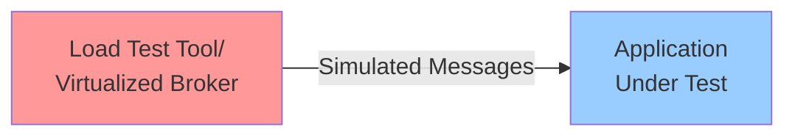
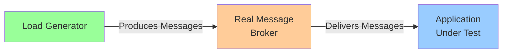

## Overview

Message brokers are a critical component of modern distributed systems, facilitating asynchronous communication between services. Load testing message broker integrations requires special considerations since the interaction patterns differ from traditional HTTP-based APIs.

Speedscale helps you test applications that integrate with message brokers by:

- Capturing message broker traffic at the network level
- Mocking the broker from the recording, so the app runs without one
- Turning the messages a consumer received into publishes to a real broker, so the consumer receives them again
- Replaying realistic message patterns with their recorded timing and ordering

The [message brokers](../../proxymock/message-brokers/index.md) section of the proxymock docs covers recording, mocking, testing and credentials for each broker, with a [support table](../../proxymock/message-brokers/index.md#what-is-supported). The guides in this section cover replays in your cluster from Speedscale snapshots.

## Load Testing Approaches

There are two fundamental approaches to load testing applications that use message brokers, and Speedscale supports both for Kafka, RabbitMQ (AMQP 0.9.1), Amazon MQ for RabbitMQ, Google Pub/Sub and Redis Pub/Sub. For brokers with an HTTP API, such as Amazon SQS, the broker is mocked like any other API.

### Approach 1: Virtualized Message Broker

In this approach, the application connects to a simulated or virtualized message broker. The virtualization layer provides incoming messages directly to the service under test without involving a real broker.

**Pros:**
- The message broker does not impact the performance of the application under test
- Simpler test environment setup
- Lower resource requirements

**Cons:**
- Not realistic because message brokers and services interact in unpredictable ways that only a real load test can expose
- No virtualized broker can completely simulate the real behavior of production brokers like Kafka or RabbitMQ (AMQP)
- Gives testers a false sense of security by narrowing the problem scope too much
- Misses real-world issues like network latency, broker backpressure, connection pooling, and rebalancing

With Speedscale, this is a replay with the broker mocked. See [Mock a broker](../../proxymock/message-brokers/mock-a-broker.md) for what each mock does and does not simulate.

### Approach 2: Real Message Broker with Load Generator

In this approach, a load generator sends messages through a real message broker to the client application, simulating production conditions as closely as possible.

**Pros:**
- Results are as realistic as possible
- Exposes real interactions between the broker and application
- Tests actual broker behavior including [partitioning, rebalancing, backpressure, and connection handling](./performance-issues.md)
- Identifies performance bottlenecks that only occur with real broker infrastructure

**Cons:**
- Requires running a message broker in the test environment or CI pipeline
- More complex test environment setup
- Higher resource requirements

With Speedscale, this is a replay that publishes the recorded deliveries to the broker. See [Test a consumer](../../proxymock/message-brokers/test-a-consumer.md).

### Speedscale's Approach

Use Approach 2 when you can, because it gives more realistic results. By using real message brokers during load testing, you can:

- Uncover real-world [performance issues](./performance-issues.md) before they reach production
- Test how your application handles broker-specific behaviors like consumer group rebalancing or partition reassignment
- Validate that your application can handle the actual network latency and overhead of broker communication
- Ensure your monitoring and observability work correctly with real broker metrics

Use Approach 1 for fast, repeatable tests in development and CI, where a broker would be slow or impossible to run.

## Supported Message Brokers

| Broker | Guide | How it is supported |
| --- | --- | --- |
| Kafka | [Kafka](./kafka.md) | Recorded, mocked, and replayed by producing recorded `Fetch` responses |
| RabbitMQ (AMQP 0.9.1) | [RabbitMQ](./rabbitmq.md) | Recorded, mocked, and replayed by publishing recorded deliveries |
| Amazon MQ for RabbitMQ | [Amazon MQ](./amazon-mq.md) | As RabbitMQ, over AMQPS on 5671. Amazon MQ for ActiveMQ is not supported yet. |
| Google Pub/Sub | [Google Pub/Sub](./google-pubsub.md) | Recorded and mocked as gRPC, with subscribers mocked from their messages, and replayed by republishing them |
| Redis Pub/Sub | [Redis Pub/Sub](../../proxymock/message-brokers/record/redis-pubsub.md) | Recorded, mocked, and replayed with `PUBLISH` |
| Amazon SQS | [AWS SQS](./aws-sqs.md) | HTTP API: recorded, mocked and replayed as HTTP |
| Amazon SNS | [AWS SNS](./aws-sns.md) | HTTP API: recorded, mocked and replayed as HTTP |
| Amazon Kinesis Data Streams | [AWS Kinesis](./aws-kinesis.md) | HTTP API: recorded, mocked and replayed as HTTP |
| Amazon Data Firehose | [AWS Kinesis Data Firehose](./aws-kinesis-data-firehose.md) | HTTP API: recorded, mocked and replayed as HTTP |
| Azure Event Hubs | [Azure Event Hubs](./azure-event-hubs.md) | Through its Kafka endpoint, as Kafka. The AMQP 1.0 SDKs are not supported yet. |
| Azure Service Bus | [Azure Service Bus](./azure-service-bus.md) | Not supported yet: its SDKs use AMQP 1.0 |
| Apache Pulsar | [Apache Pulsar](./apache-pulsar.md) | Not supported yet: the Pulsar binary protocol is not decoded |
| Apache ActiveMQ | [Apache ActiveMQ](./apache-activemq.md) | Not supported yet: OpenWire, AMQP 1.0, STOMP and MQTT are not decoded |

## Key Concepts

### Network-Level Observation

Message brokers typically use long-lived connections and polling patterns rather than simple request-response cycles. Understanding these patterns is essential for effective load testing:

- **Polling vs Push**: Kafka and SQS clients poll for messages, while RabbitMQ, Pub/Sub `StreamingPull` and Redis subscribers have them pushed on an open connection
- **Protocol Complexity**: Broker protocols include heartbeats, metadata requests, and other internal operations
- **Direction**: the client opens the connection, so even the messages a consumer receives are outbound traffic, which a replay mocks unless you [choose them as tests](../../proxymock/guides/choose-replay-tests.md)
- **Message Ordering**: Maintaining proper message ordering during replay may require special handling

### Load Testing Strategy

When load testing message broker integrations:

1. **Replay natively** for Kafka, RabbitMQ, Amazon MQ, Google Pub/Sub and Redis: choose the consumer's recorded deliveries as the replay's tests, and the replay publishes them to the broker at the recorded pace or faster. See [Pace and load](../../proxymock/message-brokers/test-a-consumer.md#pace-and-load).
2. **Use standard replay** for brokers with an HTTP API, such as Amazon SQS: capture traffic, create a snapshot, and run a replay, with no custom scripts.
3. **Write a custom load driver** when you need full control over pacing or message content: extract the recorded messages with `speedctl extract data` and publish them with a small producer. See [Write your own load driver](../../proxymock/message-brokers/write-your-own-load-driver.md).

## Getting Started

To begin load testing your message broker integrations:

1. Install [speedctl](/reference/glossary.md#speedctl)
2. [Create a snapshot](/guides/creating-a-snapshot.md) of your application traffic
3. Follow the broker-specific guide for your message broker, from the table above
4. Start a replay, or build and run your load driver if you use the custom approach

## Need Help?

If you're working with a message broker not listed here or need assistance with your load testing strategy, please contact Speedscale support.
