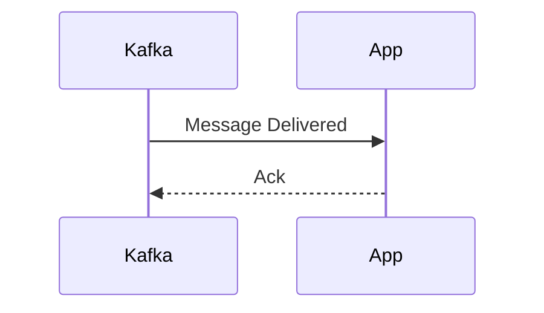
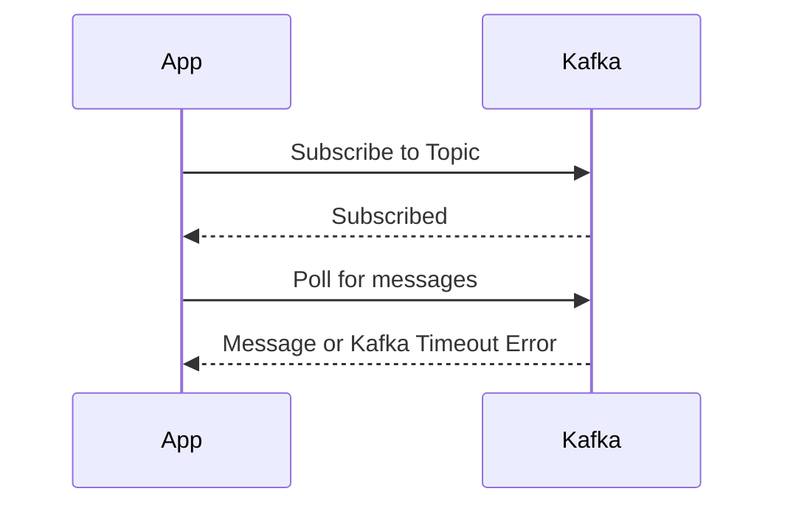
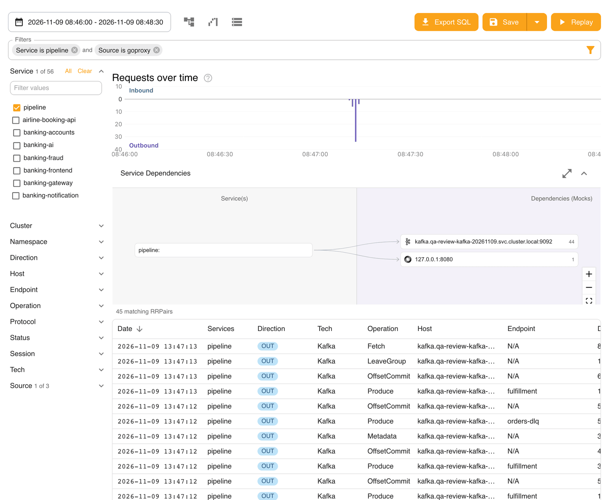

## Background

This guide covers replaying Kafka traffic from a Speedscale snapshot, in your cluster or with proxymock. To record Kafka locally, mock the broker, test a consumer or a producer, or set up credentials, see [Message brokers](../../proxymock/message-brokers/index.md) in the proxymock docs. Kafka's network level modelling does not match most people's mental model which leads to confusion and an undesirable replay scenario. Most people view their app interacting with Kafka like this.

For more information about Apache Kafka, see the [official Kafka documentation](https://kafka.apache.org/).



when the reality looks more like this



This is why when observed in Speedscale, you see something like this that has a lot of internal Kafka calls along with the most important `Produce` and `Fetch` calls.



This sort of outbound traffic would typically be part of a mock when running a replay. In the case of Kafka however, we can simplify the replay process by simply turning `Fetch` calls made by our app into `Produce` calls.

## Prerequisites

1. [speedctl](/reference/glossary.md#speedctl) is installed
1. [Create a snapshot](/guides/creating-a-snapshot.md) containing the traffic you need.

## Replay in your cluster

The generator replays a consumer's recorded `Fetch` responses as records produced to the broker the consumer read from, so the consumer reads the same records again. A consumer's `Fetch` traffic is outbound, so a replay mocks it by default. Choose it as the replay's tests first.

**1. Choose the Fetches to replay** when you create the snapshot. This filter replays the records the consumer read from the `orders` topic:

```bash
speedctl create snapshot --name orders-consumer --service orders-consumer --tests-filter '(command IS "Fetch") AND (location IS "orders")'
```

In the dashboard, open the snapshot's **Traffic** tab and use **Choose replay tests** instead. [Choose What a Replay Tests](../../proxymock/guides/choose-replay-tests.md) covers the filter syntax.

**2. Replay the snapshot.** Each record is produced to the broker its `Fetch` came from, with its recorded key, value, headers, partition, CreateTime and compression codec:

```bash
speedctl infra replay orders-consumer --snapshot-id <snapshot-id> --test-config-id <test-config-id> --no-mocks
```

To produce to a different broker, add `--test-against '<recorded broker>=<broker host>:<port>'`.

To replay a local proxymock recording in your cluster without Speedscale cloud, pass the same filter to `proxymock cluster replay start`. Add `--test-config <id>` to use a workspace test config, such as one with the SASL settings below:

```bash
proxymock cluster replay start -n orders --workload orders-consumer --no-mocks --tests-filter '(command IS "Fetch") AND (location IS "orders")'
```

### Brokers that require SASL

Add `generator.kafka` to the test config with the user, password and SASL mechanism the replay authenticates with, and a `tlsMode` for a TLS listener. When a replay mocks Kafka, the mock answers your app's SASL handshake itself: it accepts PLAIN with any credentials, and SCRAM needs `responder.kafka` with the password your app uses. [Connect to the broker](../../proxymock/message-brokers/connect-to-the-broker.md#kafka) lists every field and TLS mode.

Use secret references for passwords, because a literal value is stored with the test config. Speedscale mounts every secret the test config references into the generator and the mock, so the secret only has to exist in the namespace of the workload you replay:

```json
{
  "generator": {
    "kafka": {
      "username": "${{secret:kafka-credentials/username}}",
      "password": "${{secret:kafka-credentials/password}}",
      "saslMechanism": "PROTOCOL_SASL_MECHANISM_SCRAM_SHA_512"
    }
  },
  "responder": {
    "kafka": {
      "username": "${{secret:kafka-credentials/username}}",
      "password": "${{secret:kafka-credentials/password}}",
      "saslMechanism": "PROTOCOL_SASL_MECHANISM_SCRAM_SHA_512"
    }
  }
}
```

:::note
The latency reported on the report is the time to produce messages to the broker, not the full latency for downstream applications to consume them.
:::

## Replay with proxymock

The [**proxymock**](/proxymock/) CLI tool can be used to replay recorded Kafka traffic directly into a Kafka broker using the `proxymock replay` command.

### Pull a Snapshot

First, download the snapshot from Speedscale cloud:

```bash
proxymock cloud pull snapshot <snapshot-id>
```

This will download the snapshot traffic to individual local files.

### Replay Traffic

```bash
proxymock replay --in <directory> --test-against <kafka-broker>
```

For example:

```bash
proxymock replay --in ./proxymock/snapshot-abc123 --test-against localhost:9092
```

To replay a local proxymock recording, choose the Kafka calls to replay with `--tests-filter`, such as `(command IS "Fetch") AND (location IS "orders")` for what a consumer read from `orders`. See [Test a consumer](../../proxymock/message-brokers/test-a-consumer.md#kafka).

[Test a consumer](../../proxymock/message-brokers/test-a-consumer.md#kafka) explains the latency table proxymock prints, pacing and load, and how to check a producer with Kafka mocked.

## Record, mock and test locally

- [Record Kafka traffic](../../proxymock/message-brokers/record/kafka.md) with proxymock, including the listener the broker needs and recording in a cluster
- [Mock a broker](../../proxymock/message-brokers/mock-a-broker.md#kafka) so the app runs without Kafka
- [Test a consumer or a producer](../../proxymock/message-brokers/test-a-consumer.md#kafka)
- [Kafka consumer-group health](../../proxymock/message-brokers/consumer-group-health.md)
- [Write your own load driver](../../proxymock/message-brokers/write-your-own-load-driver.md#kafka) from extracted records
