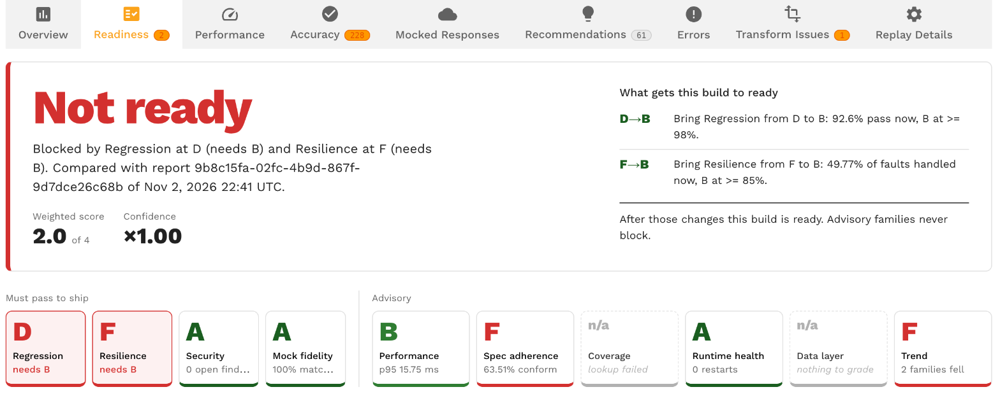

# Replay Readiness Scorecard

The readiness scorecard answers one question about a replay report: is this build ready for production?

Every report that finishes with the status Passed or Missed Goals is graded once by the Speedscale cloud analyzer.

The grade is a verdict word (Ready, Not ready or Still grading), a letter from A to F for each of ten metric families, a weighted score out of 4 and a confidence factor that says how much of production the replay vouches for.

The grade is frozen on the report, so the same report always shows the same verdict, and it can be re-graded on request when thresholds or acceptances change.

Use the scorecard when you want a replay to act as a release gate rather than a pile of metrics.

The test config decides which families block the verdict and at which letter, so a team can start with the Speedscale defaults and tighten them as the service matures.

Local proxymock replays and replays that never reach the Speedscale cloud are not graded; the scorecard needs the cloud analyzer.

## Where readiness appears



- **The Readiness tab of a replay report.** Right after Overview. The verdict, the score and confidence, a tile per family, "What gets this build to ready", the ledger of how each grade was earned and what fed the grades. See [How a report is graded](./how-grading-works.md).
- **The Readiness column on the reports grid.** The verdict word and score for each graded report. Hidden by default; switch it on in the column picker. The list cannot be sorted or filtered on it yet.
- **The Readiness view of the service page.** Every graded replay of a service over a date range, with the grading changes between them. See [Service trend](./service-trend.md).
- **The Readiness tab of the test config editor.** Roles, floors, weights, boundary overrides, the windows, the security probe, the chaos bounds and the acceptance policy, with a preview against recent reports. See [Readiness settings in the test config](./test-config-settings.md).

## In this section

- [How a report is graded](./how-grading-works.md): verdicts, letters, roles, floors, the weighted score, confidence and the default boundaries.
- [Core families](./core-families.md): Regression, Performance, Mock fidelity, Data layer, Runtime health and Trend.
- [Spec adherence](./spec-adherence.md): replayed traffic against the OpenAPI document attached to the service.
- [Security](./security.md): static checks over every replayed HTTP call and the opt-in auth probe.
- [Coverage](./coverage.md): the share of production traffic the replay exercised.
- [Resilience](./resilience.md): what the service did with the faults chaos rules injected.
- [Readiness settings in the test config](./test-config-settings.md): the Readiness tab of the test config editor and the JSON under `readiness`.
- [Acceptances](./acceptances.md): accept a finding with an owner, a reason and an end date, wildcard rules, baselines and the ledger.
- [Service trend](./service-trend.md): letters per family across every graded replay of a service.

## Builds and the SUT image tag

A report of a replay against a Kubernetes workload records the container image of the system under test.

The operator writes two tags on the report from the target workload's primary container: `sutImage` (the image reference) and `sutImageTag` (its tag, or its digest when the reference has no tag).

Sidecars are not the primary container, and replays against a custom URL or run locally with proxymock have no pod, so those reports carry no image tag.

The image tag matters to readiness in three places.

- **Trend.** The Trend family compares a report with the previous graded report of the same service and the same `sutImageTag`. A report with no tag compares with the previous untagged report of the service.
- **Acceptances.** An acceptance is keyed on the service and the `sutImageTag` of the report it was made from, unless it is made service-wide. A tag-keyed acceptance stops applying on the next build. See [Acceptances](./acceptances.md).
- **Service trend.** The Build filter narrows the trend to one tag, and without a filter the trend marks where the build changed. See [Service trend](./service-trend.md).

The reports grid has an Image tag column and a filter on it, and the CLI lists the replays of one build:

```bash
speedctl get reports --image-tag=v1.4.131
```

## Reading the verdict with speedctl

A graded report carries its scorecard in the report JSON under `report.readiness`.

The verdict is the enum name, so a CI step can read it after the replay finishes:

```bash
speedctl get report <report ID> | jq -r '.report.readiness.verdict'
```

The value is `READINESS_VERDICT_READY`, `READINESS_VERDICT_NOT_READY` or `READINESS_VERDICT_STILL_GRADING`.

The same block carries `score`, `confidence`, `summary` and a `families` list with each family's `letter`, `measured`, `threshold` and `detail`.

The block is absent while the replay runs, on reports that ended in Error or Canceled, and on reports analyzed before the scorecard existed.

The verdict does not change the report status.

Goals still decide between Passed and Missed Goals, and the [CI/CD guide](../integrations/cicd/cicd.md) still applies as written; the readiness verdict is a second, configurable gate you can read from the same report.
