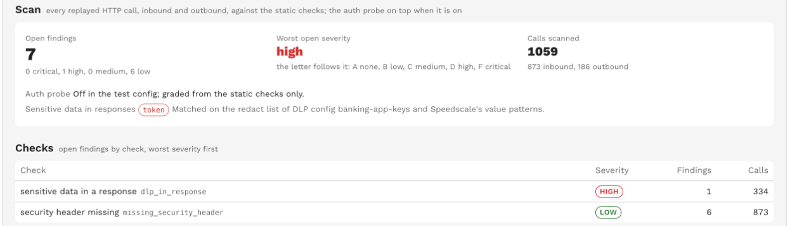
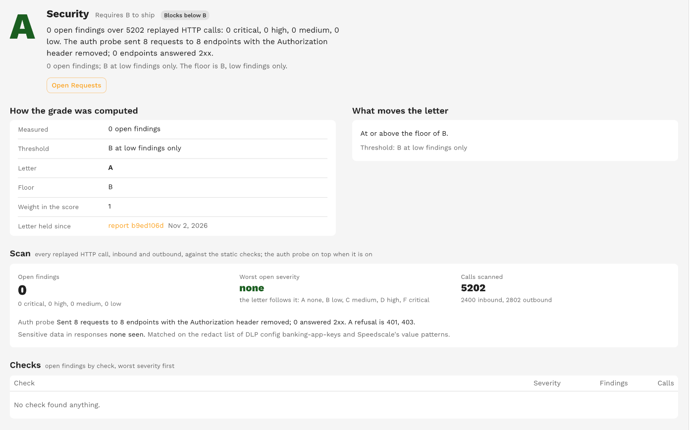
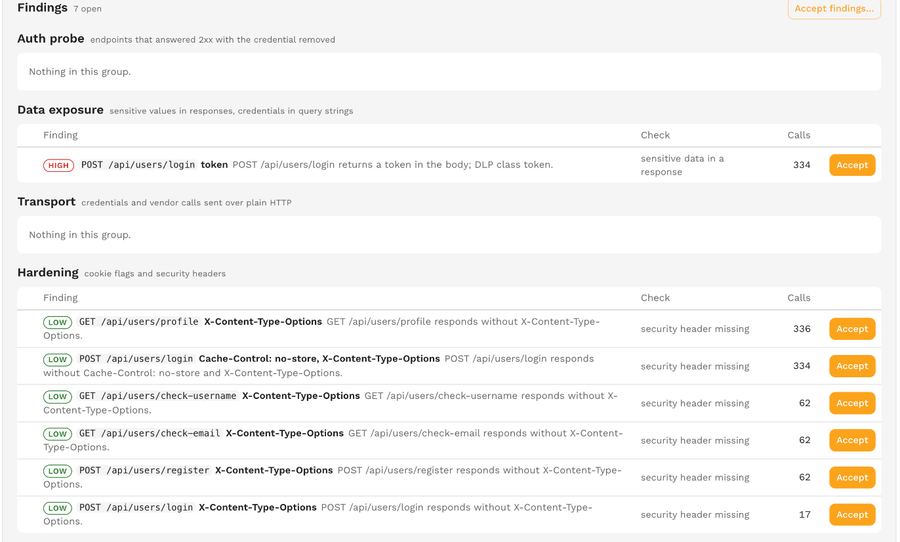
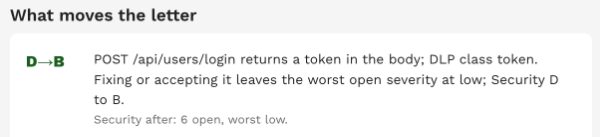

# Security

Security grades what the replay revealed about the service's handling of credentials, sensitive data and transport.

Every replayed HTTP call, inbound and outbound, goes through a fixed set of static checks, and an opt-in probe re-sends authenticated endpoints with the credential removed.

The default role is Off.

## The letter is the worst open severity

Security is not a rate.

One leaked credential is a leak however many clean responses surround it, so the letter follows the worst severity among the open findings.

| Letter | Open findings |
|---|---|
| A | None |
| B | Low only |
| C | Nothing above medium |
| D | Nothing above high |
| F | A critical finding is open |

The scale is fixed; the test config cannot move it.

The threshold sentence reads "A at no open findings", "B at low findings only", "C at nothing above medium" or "D at nothing above high".

The family grades n/a with "No HTTP calls were replayed to scan for the Security checks." when nothing was scanned and the probe sent nothing; the tile reads "no calls scanned".

Accepting a finding takes it out of the open findings; the counts and the worst severity are recomputed without it.

## Checks and severities

Every check has a fixed severity.

| Check id | Severity | What it means | Scope |
|---|---|---|---|
| `auth_not_enforced` | Critical | An endpoint answered 2xx with the credential removed. The field path names what was removed ("the Authorization header" or "the sid cookie"); the count is the probe requests that answered 2xx. | Auth probe, inbound |
| `dlp_in_response` | High | A response carries a sensitive value. The field path is the DLP class: `ssn`, `credit_card`, `token` (JWTs and API keys), `private_key`, `bank_account` (IBAN and ABA routing numbers), `national_id`, or a key the workspace's DLP redact list blocks, such as `password`. | Inbound |
| `credential_in_query` | High | A request carries a credential in the query string: a parameter named like `access_token`, `api_key`, `password`, `session` or `jwt`, or any parameter whose value looks like a JWT, an API key or a private key. The field path lists the parameter names. | Inbound and outbound |
| `basic_auth_cleartext` | High | A request sends Basic authorization over plain HTTP. | Inbound and outbound |
| `plaintext_vendor_egress` | High | The service calls a known vendor API over plain HTTP. The endpoint is "host METHOD /path" and the field path the vendor. | Outbound |
| `cookie_flags` | Medium | A response sets a cookie without HttpOnly or Secure. The field path reads "`<cookie>`: HttpOnly, Secure". | Inbound |
| `missing_security_header` | Low | A response lacks `X-Content-Type-Options: nosniff`, lacks `Strict-Transport-Security` over TLS, or returns sensitive data without `Cache-Control: no-store`. The field path lists the absent headers. | Inbound |

Email addresses, UUIDs, IP addresses, URLs and dates are not sensitive classes on their own; an email field is a finding only when the workspace's redact list names it.

The redact list comes from the test config's inline DLP rule, else from the DLP config the test config names, else only Speedscale's value patterns apply; the detail says which.

Basic authorization applies to inbound calls too.

In a cluster the inbound hop is the generator's own URL scheme, so a service behind a TLS-terminating ingress that still takes Basic auth over plain HTTP inside the cluster shows here; that is a candidate for an [acceptance](./acceptances.md).

The family detail groups the findings: **Auth probe** (`auth_not_enforced`), **Data exposure** (`dlp_in_response`, `credential_in_query`), **Transport** (`basic_auth_cleartext`, `plaintext_vendor_egress`), **Hardening** (`cookie_flags`, `missing_security_header`) and **Accepted**.

Each finding carries a severity chip.

## The auth probe

The probe is off unless the test config switches it on, because it changes what the replay sends.

After the load, the generator takes a sample of the recorded inbound HTTP requests that carried the credential and were answered 2xx, one per endpoint up to the cap, and sends them once more with the credential removed.

The request header is deleted, or when a cookie is named the cookie's value is blanked instead.

Redirects are not followed, so a bounce to a login page does not read as a 200.

| Probe result | Meaning |
|---|---|
| An expected status (401 or 403 by default) | The endpoint enforces authentication. |
| Any 2xx | A critical `auth_not_enforced` finding. |
| No response | A failed probe request, counted in the detail. |
| Any other status | Neither. |

Probe requests are tagged `readinessProbe=auth_strip` and kept out of assertions, latency, coverage and spec checks.

A probe that fails to run never fails the replay; the detail says why it did not run.

The probe's settings live on the [Readiness tab of the test config](./test-config-settings.md#security-auth-probe): on or off, the header to remove (default `Authorization`), an optional cookie to blank instead, the statuses that count as a refusal (default 401 and 403) and the most endpoints to probe (default 25).

A changed probe between two consecutive reports shows as an "Auth probe" mark on the [service trend](./service-trend.md).

## What the detail shows

The measure reads "0 open findings" or "7 open, worst high".

The detail sentence is "N open findings over M replayed HTTP calls: a critical, b high, c medium, d low." followed by the DLP classes seen in responses and one sentence about the probe:

- "The auth probe is off in the test config; graded from static checks only."
- "The auth probe was on but no replayed request carried Authorization header."
- "The auth probe did not run: `<error>`."
- "The auth probe sent 12 requests to 12 endpoints with the Authorization header removed; 2 endpoints answered 2xx."

The detail page shows the open findings by severity, the worst open severity, the calls scanned inbound and outbound, the auth probe line with the statuses it treats as a refusal, the sensitive data classes with the rule that decided them, and a Checks table of the checks that found something, worst severity first.

## What moves the letter

Up to two steps, worst severity first, each naming one finding: "`<finding>` Fixing or accepting it leaves the worst open severity at high; Security F to D."

A step that leaves another finding of the same severity open ends "Security stays D" and is marked Stays D, so you can see that it needs the next step too.

When two findings share the worst severity, the first step leaves the letter where it is and the second moves it.

The Requests action opens the Accuracy tab, which lists the scanned calls and the probe's own requests.
