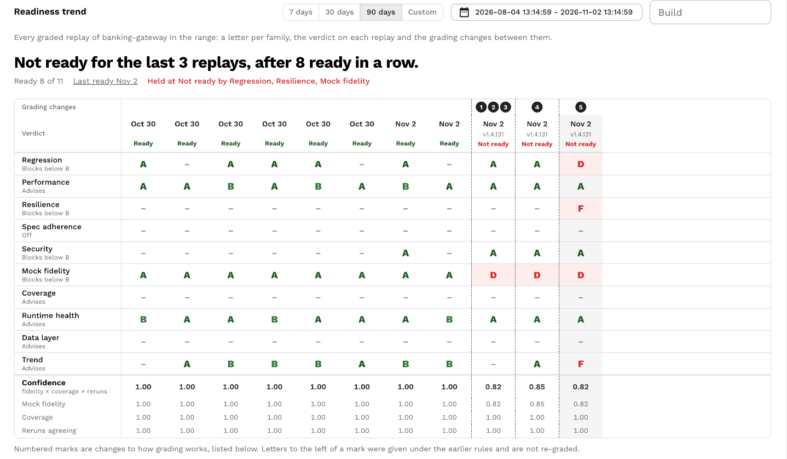
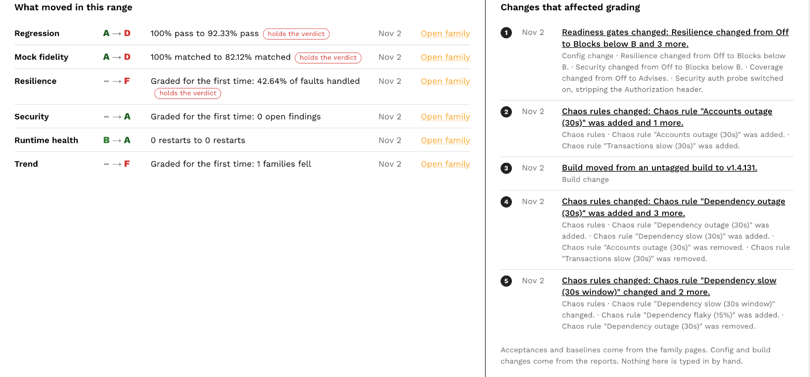

# Service Trend

The Readiness view of the service page shows how a service's letters moved across its graded replays.

Open a service and switch the view to **Readiness**, or use the Service trend link on the Trend family of any report.

## Range and build

The **Range** picker offers 7, 30 or 90 days (the default) or a custom range.

The **Build** filter takes a SUT image tag.

Empty shows every build and marks where the build changed; a tag shows that build's replays alone, plus the service-wide acceptances that applied to them.

Only graded reports appear as columns.

Running, errored, canceled and never-graded reports are left out.

A range with a single graded replay says "One graded replay in this range, so there is no trend yet."

A range with more than the newest 120 graded replays shows the newest ones and says from when.

## The headline

One sentence sums up the range, for example "Not ready for the last 2 replays, after 8 ready in a row." or "Ready for all 12 replays in this range."

Beside it: how many replays were Ready, when the last Ready replay ran and at which build, and which families hold the latest report at Not ready.

**What moved in this range** lists each family whose letter changed between two consecutive columns, with the measure before and after, when the final letter began its run and whether the move was lifted by an acceptance rather than a code fix.

## The grid

Columns are replays, oldest on the left.

Rows are the grading changes (numbered marks), the verdict on each replay, a letter per family in scorecard order, then confidence and its three factors (mock fidelity, coverage, reruns agreeing).

A blocking letter below its floor is marked as holding the verdict at Not ready; a lifted letter and a baselined column are marked too.

Clicking a column opens the Readiness tab of that replay; clicking a letter opens that family on it.

A column stored before confidence and measures were kept shows letters only, with a dash in the confidence rows.

## Marks

Numbered marks are changes to how grading works, so letters to the left of a mark were given under the earlier rules and are not re-graded.

Marks come from the reports and the acceptance ledger; nothing is typed in by hand.

| Mark | What produced it |
|---|---|
| Acceptance | A finding or rule was accepted. The detail gives the reason, the end date and the family's letter before and after on the report it was accepted on. Opens the acceptance ledger at that acceptance. |
| Acceptance reopened | An acceptance was revoked; the finding counts again. |
| Baseline | A baseline accepted every current finding of a family. |
| Config change | The readiness section of the test config changed between two consecutive reports: a role, floor, weight or boundary, the trend window, or the Resilience bounds. One line per change, for example "Regression changed from Blocks below B to Advises." Opens the first report graded under the new config. |
| Build change | The SUT image tag changed between two consecutive reports: "Build moved from v1.4.130 to v1.4.131." Only when no build filter is set. |
| Auth probe | The Security auth probe was switched on, switched off or changed between two consecutive reports. |
| Chaos rules | A chaos rule was added, changed or removed between two consecutive reports, so the later report was faulted differently. A rename alone is not a change. |

A "Spec replaced" mark is reserved for the Spec adherence family and is not produced yet.

## Behind the letters

For each family whose letter moved in the range, a chart draws the measure under the letter against its floor: the pass rate, the match rate, the latency in milliseconds, the restarts.

The dashed line is the floor in the measure's own unit, and the caption says which way is better, for example "Dashed line is the B floor, 95% matched. Higher is better. B to C over 11 replays."

Trend has no measure of its own and never gets a chart.
