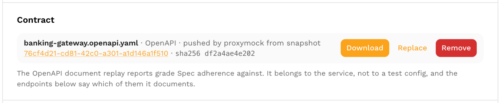
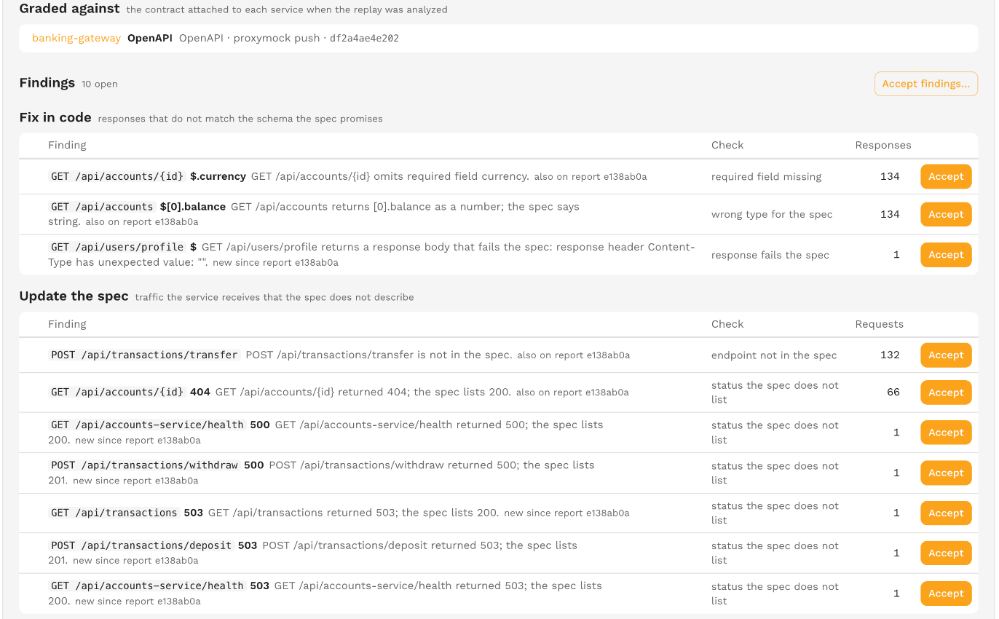
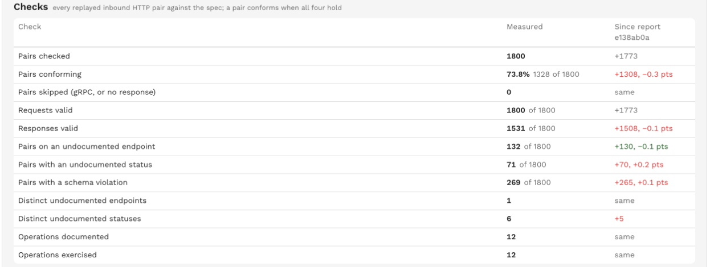
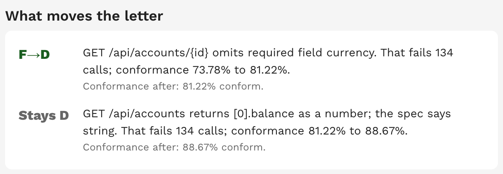

# Spec Adherence

Spec adherence grades how well the replayed traffic matches the service's own API contract.

Every replayed inbound HTTP call is checked against the OpenAPI document attached to the service, and the family's measure is the share of checked calls that conform.

The default role is Off; switch it on in the [test config](./test-config-settings.md) once a spec is attached.

## Attaching a spec

The spec belongs to the service, not to a test config, because one test config can replay several services.

Open the service page and use the **Contract** section above Endpoints.

An admin can attach an OpenAPI 3.x document (`.yaml`, `.yml` or `.json`, 3 MiB or smaller), replace it, download it or remove it.

A document that is not valid OpenAPI 3.x is refused.

Protocol buffer and GraphQL contracts are not checked yet; the upload is refused with "proto and GraphQL are not checked yet; attach an OpenAPI 3.x document".

Replays analyzed from then on grade against the new document.

Reports already graded keep their grade, and every stored version stays available under its hash.

A spec pushed with a snapshot by proxymock shows as version 0 with the snapshot it came from.

Pushing a snapshot with `proxymock cloud push snapshot --spec <file> --workload <service>` attaches the document to the service itself, so it replaces the current contract for every later replay of that service, not only for that snapshot.

## What counts as conforming

A call conforms when all four checks hold: its method and path match an operation in the spec, its status code is documented for that operation, its request validates against the operation's request schema and its response validates against the response schema.

Standard OpenAPI semantics apply, so extra response fields are allowed, and the spec's server base paths are stripped before matching.

Security requirements in the spec are not checked.

gRPC calls under an OpenAPI document and calls with no response are skipped and are not in the checked count.

## When the family is n/a

| Sentence on the report | Cause |
|---|---|
| "No spec attached to `<service>`. Attach an OpenAPI document to the service to grade Spec adherence." | The service has no contract. The tile reads "no spec attached" and links to the service's Contract section. |
| "The attached spec could not be used (`<service>`: `<error>`)." | The document could not be loaded or has an unsupported format. |
| "No replayed HTTP call could be checked against the spec (N calls the spec cannot speak to were left out)." | Every call was skipped. |

## Findings and check ids

| Check id | Meaning | Field path |
|---|---|---|
| `undocumented_endpoint` | The method and path are not in the spec. | Empty |
| `undocumented_status` | The operation exists but the spec does not list the status the service returned. | The status code |
| `type_mismatch` | A field has the wrong type, for example "GET /v2/orders/\{id\} returns total as a string; the spec says number." | The field, or the sorted fields |
| `missing_required_field` | A required field is absent from the response, or the request was sent without it. | The missing fields |
| `response_schema` | The response fails the schema for another reason; the detail quotes it. | The field |
| `request_schema` | The request fails the schema. Request-side paths start with `request.body.`, `request.query.`, `request.path.`, `request.header.` or `request.cookie.`. | The field |

The endpoint pattern of a finding is the spec's own path template when the call matched an operation.

The family detail groups the open findings by who has to act.

**Fix in code** holds type mismatches, missing required fields and response schema failures on the response side: the service does not return what the spec promises.

**Update the spec** holds undocumented endpoints, undocumented statuses and request-side findings: the service receives traffic the spec does not describe.

**Accepted** holds the findings an [acceptance](./acceptances.md) covers; accepting a finding counts its calls as conforming.

## What the detail shows

The headline reads like "97.5% conform; B at >= 97%. The floor is B at 97%."

The detail sentence is "N of M replayed calls conform to `<spec>`: X hit an undocumented endpoint, Y returned an undocumented status, Z failed a schema check."

A **Checks** table lists the pair counts behind the measure: pairs checked, conforming, skipped, with valid requests, with valid responses, on an undocumented endpoint, with an undocumented status, with a schema violation, the distinct undocumented endpoints and statuses, and the operations the spec documents against the ones the replay exercised.

Each row shows the change since the previous graded report, judged on the share of pairs checked.

A **Graded against** table names the contract each service was checked with: filename, version or proxymock push, hash and upload date.

Findings are marked "new since report X" or "also on report X" by comparing with the previous graded report's findings.

## What moves the letter

The detail ends with up to two cumulative steps, each taking the highest-count open findings out of the measure.

A step reads like "GET /v2/orders/\{id\} returns total as a string; the spec says number. That fails 184 calls; conformance 91% to 97%." followed by the letter it buys and whether it clears the floor.

Accepted findings are already out of the measure and never appear in a step.

The Requests action opens the Accuracy tab, where the replayed calls the spec was checked against are listed.
