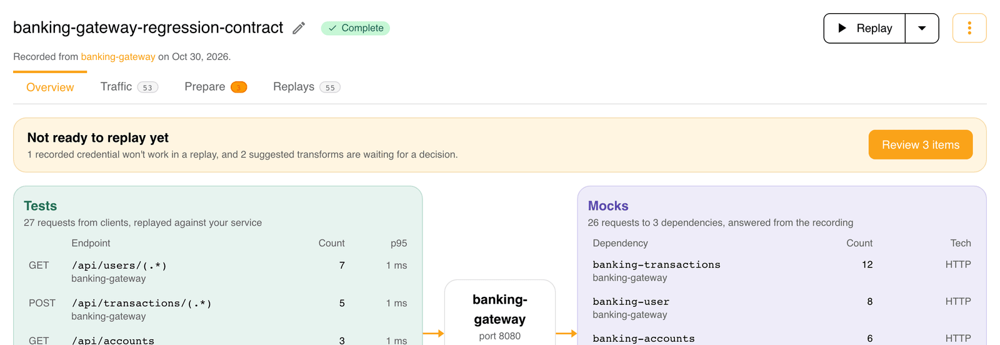
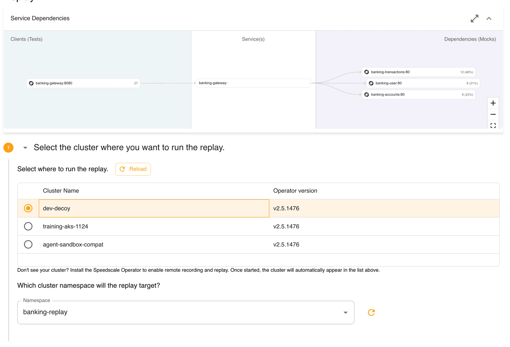
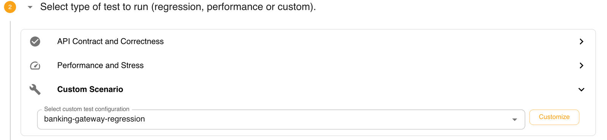
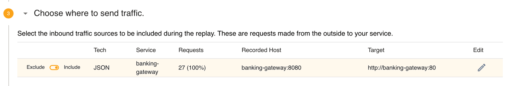
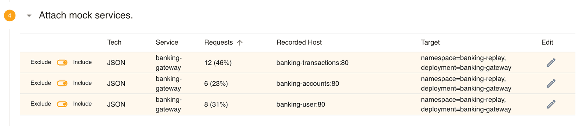
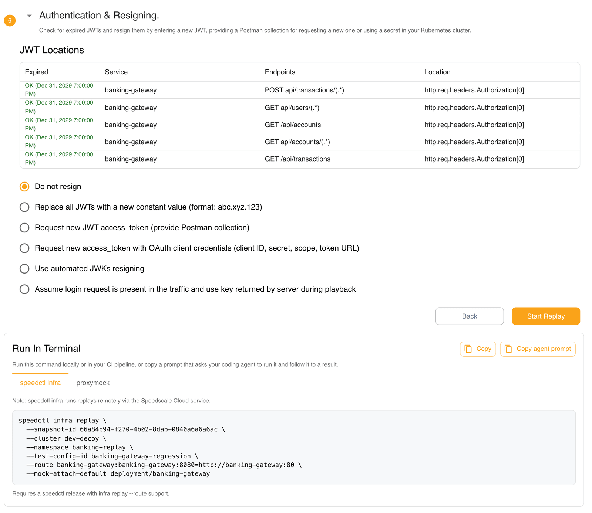
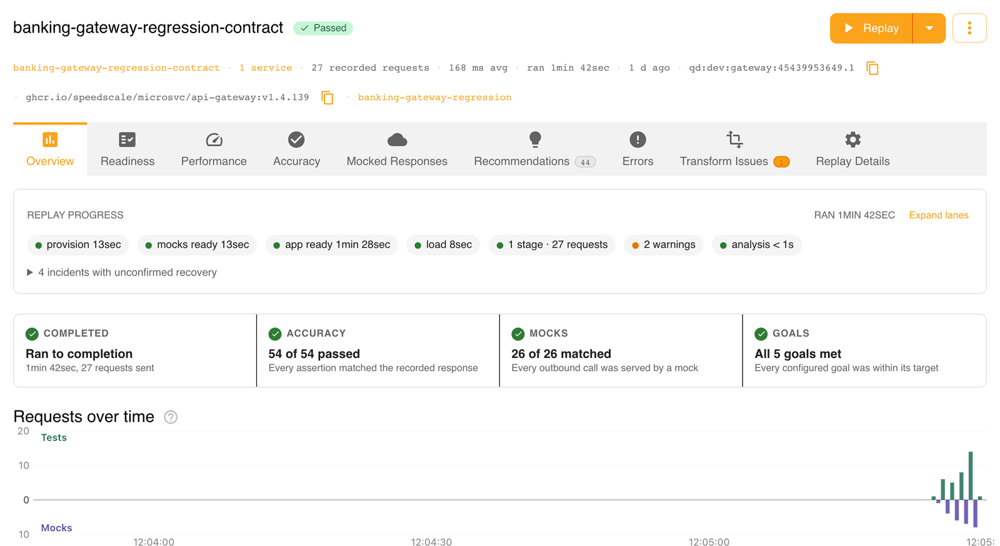

import useBaseUrl from '@docusaurus/useBaseUrl';

# Dashboard

## Run your first dashboard replay

Once your service has recorded traffic, open a snapshot and select **Replay** at the top right. The **Replay** button in the Traffic viewer opens the same page for the traffic you selected.

Start with a saved snapshot, choose the requests and mocks to use, and follow the run to its report.

<video controls playsInline preload="none" aria-label="Run your first dashboard replay" style={{width: '100%', maxWidth: 800, aspectRatio: '16 / 9'}}>
  <source src={useBaseUrl('/videos/guides/speedscale-first-dashboard-replay.mp4')} type="video/mp4" />
  <track kind="captions" src={useBaseUrl('/videos/guides/speedscale-first-dashboard-replay.en.vtt')} srcLang="en" label="English" />
  <a href={useBaseUrl('/videos/guides/speedscale-first-dashboard-replay.mp4')}>Download the video</a>
</video>

The replay page shows the snapshot's service dependency map above numbered steps.

1. Select the **cluster** where the replay will run, then the **namespace** that holds a copy of your service. This may be the workload where the traffic was recorded, or a newer version of the same application you want to test against.

2. Select the type of test. **API Contract and Correctness** offers regression tests at 1x traffic, with or without service mocks. **Performance and Stress** offers load tests. **Custom Scenario** uses a test config you choose. If you are unsure, start with a regression test.

3. Choose where to send traffic. Each inbound traffic source holds the requests replayed against your service. Include or exclude it, and use the pencil to change its target.

4. Attach mock services. Each outbound dependency is answered by a mock instead of your real dependency. Include or exclude it, and use the pencil to change which workload the mock attaches to.

5. Optionally add a **build tag** to identify the version under test.

6. **Authentication & Resigning** lists the JWTs in the recorded traffic and when they expire. Choose how to handle expired tokens, then select **Start Replay**. **Run In Terminal** shows the same replay as a `speedctl` or `proxymock` command you can run locally or in CI.

## Replay traffic your service sent {#replay-outbound}

By default a replay sends your service's inbound traffic to it and mocks everything it calls. To test a dependency instead, such as the database your service uses, open the snapshot's **Traffic** tab and select **Choose replay tests**. Pick the dependency under **Outbound dependencies** and save. The snapshot is reanalyzed and the dependency becomes a service you can replay against. See [Choose What a Replay Tests](../../proxymock/guides/choose-replay-tests.md) and [Load and Regression Test a Database](../../proxymock/databases/load-and-regression-testing.md).

## Replace expired credentials {#replace-credentials}

If your service checks tokens, the recorded ones have probably expired, and replayed requests would get 401s. Open the snapshot's **Prepare** tab and select **Replace credentials** on the credential's row before you replay, so every replay of that traffic sends valid credentials. See [Replace Recorded Credentials](./replace-credentials.md).

## View Report

Once the replay is started you will be redirected to the replay report.  The page will automatically update as the report is run, eventually showing a summary of the replay.

You can also access the report later from the reports page.

