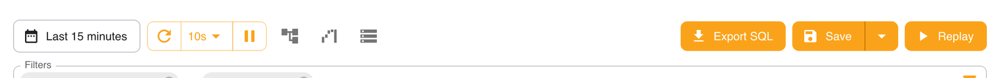
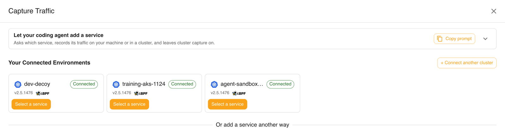
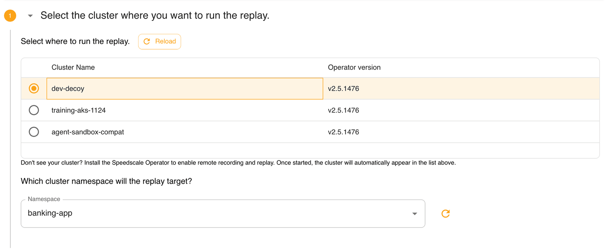

# Replay Traffic in a Different Cluster

One great use of Speedscale is to record traffic in one cluster and replay it another cluster. For example, record real user requests in production and then replay that traffic in a test cluster. Or, record traffic in production and use it to create realistic mocks running in [minikube](https://minikube.sigs.k8s.io/docs/start/) for local development.

#### Before you begin

* Ensure that you have a working version of your service under test (SUT) already running in your 2nd cluster. It is not necessary to have working versions of downstream APIs that you intend to mock with Speedscale (since it will be doing the mocking), you just need to make sure your SUT starts successfully and isn't erroring out.

#### Select traffic for replay

1. Open **Traffic** and isolate the traffic you want to replay. Select your service under **Service** and set a reasonable time range with the time picker.

2. Create filters to narrow down the traffic to only the incoming requests and outgoing mocks you want to include. The Speedscale cloud engine can handle very large snapshots but it may cause you to wait unnecessarily. Common traffic that slows things down includes monitoring heartbeats and liveness probes. For more information on filtering check out the [docs](/reference/filters/README.md).

### Replay traffic in a 2nd cluster

1. Make sure the Speedscale operator is installed in the cluster you would like to replay in. Select **Add...** in the navigation to see your connected clusters under **Your Connected Environments**, and select **Connect another cluster** to install the operator in a new one.

2. Now, select **Replay** at the top right of the Traffic viewer.

3. Step 1 of the replay page asks where the replay will run. Select your second cluster and the namespace where your service is running. Every connected cluster is listed with its operator version.

4. Finish the remaining steps. In **Choose where to send traffic**, use the pencil to point each service at a Kubernetes service, workload or custom URI in the new cluster. Workloads can be deployments, statefulsets, replicasets or daemonsets. Jobs are not currently supported.

5. View your report!
