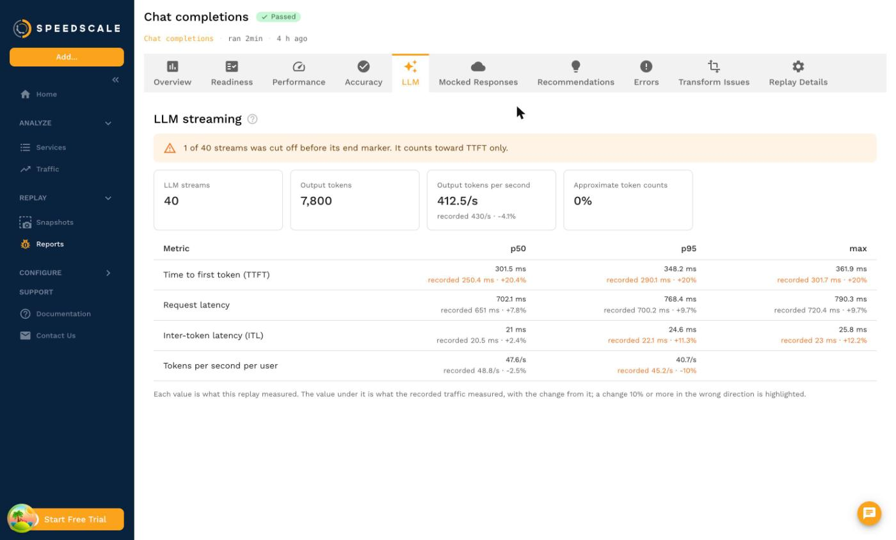
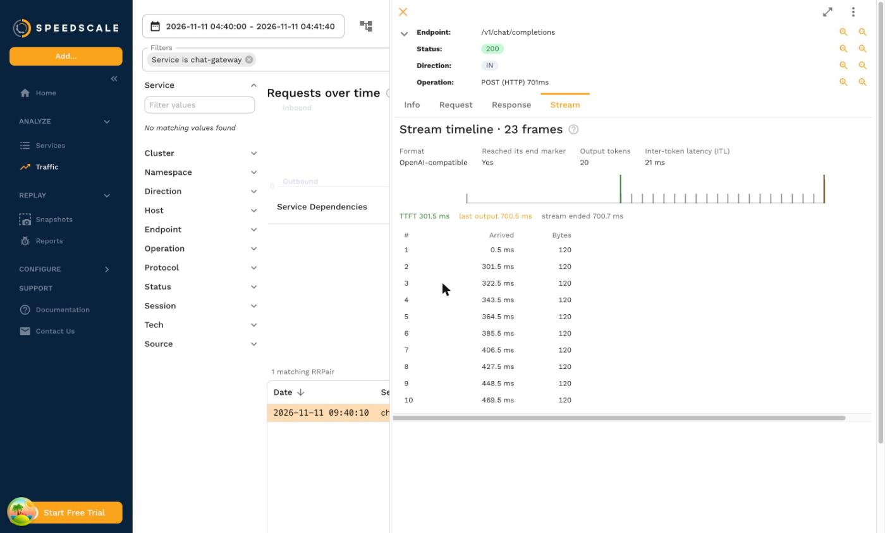

# LLM Streaming Metrics

When a replay sends requests to a model server and the responses stream back token by token, Speedscale measures the numbers teams use to judge LLM serving performance: time to first token (TTFT), inter-token latency (ITL), request latency and token throughput. The definitions match [NVIDIA AIPerf](https://github.com/ai-dynamo/aiperf), the benchmarking tool in NVIDIA's NIM guides, so a Speedscale number means the same thing as the AIPerf number with the same name.

The difference is the prompts. AIPerf sends synthetic prompts at a model server. A Speedscale replay sends the prompts your users really sent, recorded from your own traffic, so the token counts, prompt lengths and request mix are the ones your service sees in production.

## Supported streams

Speedscale reads four response formats. It recognizes the format from the stream itself, so the endpoint path does not matter.

| Format | Content type | Examples |
|---|---|---|
| OpenAI-compatible | `text/event-stream` | OpenAI, Azure OpenAI, NVIDIA NIM, vLLM, TGI, and the OpenAI-compatible endpoints of Ollama and other servers. Chat completions and text completions. |
| Anthropic Messages | `text/event-stream` | The Anthropic API `/v1/messages` with `stream: true`. |
| Ollama native | `application/x-ndjson` | Ollama `/api/chat` and `/api/generate`. |
| Amazon Bedrock | `application/vnd.amazon.eventstream` | `ConverseStream` for any model, and `InvokeModelWithResponseStream` for Anthropic models. |

Other streams in these framings, such as a server-sent event feed of notifications, are timed frame by frame and produce no LLM metrics. A response with a `Content-Encoding` other than `identity` is not split into frames, so it is not measured either.

## Metrics

Every duration is in milliseconds and runs from the moment the request was sent.

| Metric | Definition |
|---|---|
| Time to first token (TTFT) | Until the first frame that carries output: text, reasoning or tool-call arguments. A frame that only names the role, a keepalive or a usage report is not output. |
| Request latency | Until the last frame that carries output. Usage reports and end markers that follow it do not count. |
| Inter-token latency (ITL) | (request latency - TTFT) / (output tokens - 1): the decode time after the first token, spread over the remaining tokens. A stream with one token has none. |
| Tokens per second per user | 1 / ITL: the output rate one user saw. |
| Output tokens per second | All output tokens divided by the run's LLM window, from the first LLM request sent to the last output token received. |
| Output tokens | Output tokens across finished streams. |
| LLM requests | Streams recognized as LLM output. |
| Incomplete streams | Streams that ended before their own end marker. |
| Approximate token counts | The share of finished streams whose token count is an estimate. |

A stream is **finished** when the connection ended cleanly and the format's own end marker arrived: `[DONE]` for OpenAI-compatible streams, `message_stop` for Anthropic, `done: true` for Ollama and `messageStop` or the final chunk for Bedrock. TTFT counts every stream that produced output. Request latency, ITL and the token rates count only finished streams, because a stream cut off part way would make the server look faster than it was.

A stream longer than 8,192 frames is stored up to that limit and counts as incomplete.

### Token counts

The output token count comes from the server's usage report when the stream has one: `usage.completion_tokens` for OpenAI-compatible servers, `usage.output_tokens` for Anthropic, `eval_count` for Ollama and `outputTokens` or `outputTokenCount` for Bedrock. OpenAI-compatible servers send usage in a stream only when the request sets `stream_options.include_usage`, and vLLM can send it on every chunk with `continuous_usage_stats`.

When a stream has no usage report, each output frame counts as one token and the stream is marked approximate. Servers that send several tokens per frame then show fewer tokens, a longer ITL and a lower token rate than they really had. The **Approximate token counts** metric tells you how many finished streams this applies to.

## Capture

The metrics come from the replay, which times every frame it receives, so any recording of LLM requests can be replayed and measured.

To compare the replay with the recording, the recording itself needs frame timing. `proxymock record` and the Speedscale sidecar record the arrival time of each frame for HTTP/1.1 and HTTP/2 responses. Traffic captured by the eBPF-based nettap capture, imported from a HAR or other file, or generated from a spec has its frames but not their timing, so a replay of it shows replayed values only.

## Run it locally with proxymock

Replay a recording against your model server, or against a service that calls one, and gate on the LLM metrics with `--fail-if`:

```bash
proxymock replay --in ./proxymock/recorded-llm \
  --test-against http://localhost:8000 \
  --fail-if 'llm.ttft-p95 > 800' \
  --fail-if 'llm.itl-p95 > 40' \
  --fail-if 'llm.incomplete > 0'
```

The command prints the measured value of each condition and exits `1` when one is true. LLM metrics are also reported with `--load-test`.

These are the LLM names `--fail-if` accepts, with the matching goal name for a test config:

| `--fail-if` name | Goal metric | Unit |
|---|---|---|
| `llm.ttft-p50` | `llmTtftP50` | ms |
| `llm.ttft-p95` | `llmTtftP95` | ms |
| `llm.ttft-max` | `llmTtftMax` | ms |
| `llm.e2e-p50` | `llmE2eP50` | ms, request latency |
| `llm.e2e-p95` | `llmE2eP95` | ms, request latency |
| `llm.e2e-max` | `llmE2eMax` | ms, request latency |
| `llm.itl-p50` | `llmItlP50` | ms |
| `llm.itl-p95` | `llmItlP95` | ms |
| `llm.itl-max` | `llmItlMax` | ms |
| `llm.user-tokens-per-sec-p50` | `llmUserTokensPerSecP50` | tokens per second |
| `llm.user-tokens-per-sec-p95` | `llmUserTokensPerSecP95` | tokens per second |
| `llm.output-tokens-per-sec` | `llmOutputTokensPerSec` | tokens per second |
| `llm.output-tokens` | `llmOutputTokenCount` | tokens |
| `llm.requests` | `llmRequestCount` | streams |
| `llm.incomplete` | `llmIncompleteCount` | streams |
| `llm.token-count-approx-pct` | `llmTokenCountApproxPct` | percent |

A replay that sent no LLM stream reports none of these metrics, and a percentile with no samples is left out rather than reported as zero.

## Goals in a test config

In a [test config](../../reference/configuration/goals.md), add a goal on any goal metric in the table above. Use **too high** for durations and counts such as `llmTtftP95` or `llmIncompleteCount`, and **too low** for rates such as `llmUserTokensPerSecP50`. LLM goals apply to the whole run, so leave the location empty; they cannot be scoped to an endpoint or a load stage. The replay launcher shows them with labels such as **LLM TTFT p95**.

## Read the results

A report from a replay that sent LLM streams has an **LLM** tab. It shows TTFT, request latency, ITL and tokens per second per user at p50, p95 and max, with the number of streams, output tokens, output tokens per second and the share of approximate token counts. Alerts above the table explain cut-off streams and approximate counts when there are any.

When the recording had frame timing, each value has the recorded value under it with the change from it. A change of 10% or more in the wrong direction is highlighted, such as a slower TTFT or a lower token rate. Smaller changes are usually run-to-run variation.



Open any streamed response in the traffic viewer or a report and select the **Stream** tab to see its frames on a time axis from the moment the request was sent, with a list of every frame's arrival time and size. For a replayed LLM stream the tab also marks TTFT and the last output, and shows the format, the output token count and the request's ITL. These come from tags on the replayed request: `llmFormat`, `llmFinished`, `llmTtftMs`, `llmLatencyMs`, `llmItlMs`, `llmOutputTokens` and `llmTokensApproximate`.



## Limits

- **Mocked LLMs answer at once.** When the service under test calls an LLM and a replay mocks that call, the mock sends the recorded stream in one write. The metrics above describe the service that streamed the response, so measure a model server by replaying traffic against it, not by mocking it. To stop paying for model calls during tests instead, see [LLM Simulation](../mocking/llm-simulation.md).
- **Run-wide only.** Metrics cover the whole replay. There are no per-stage values and no concurrency sweep table like AIPerf's; to compare concurrency levels, run one replay per level.
- **Calibrated definitions, not calibrated hardware.** The formulas match AIPerf, but results depend on where the replay runs and how far it is from the model server.
