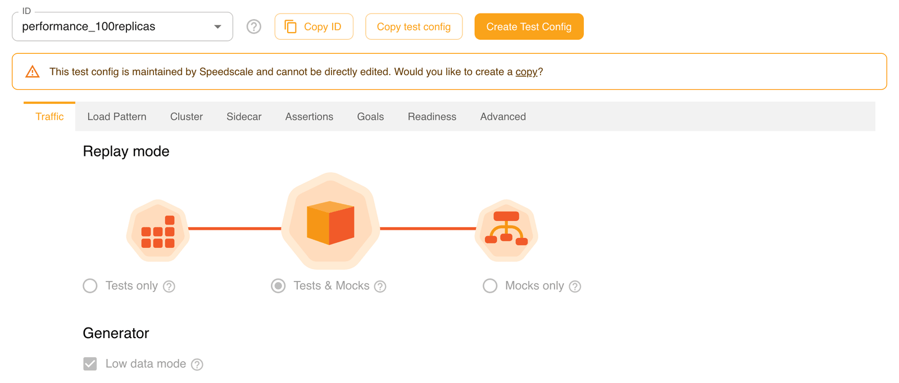
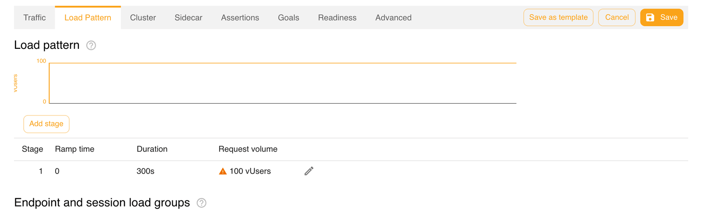
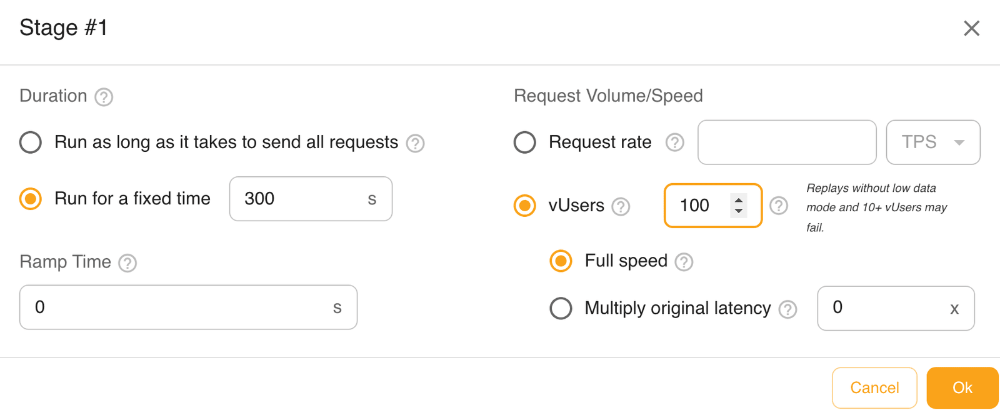
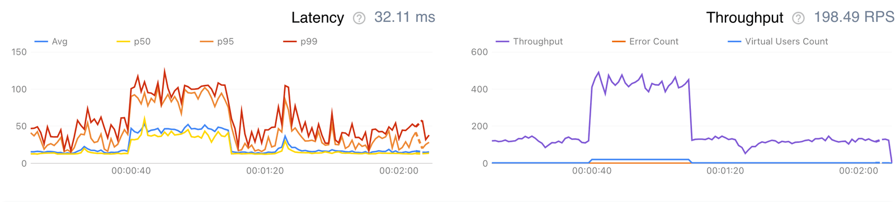

# Load Testing

Load testing shows how your service behaves as traffic increases. You can scale an entire recording, target selected endpoints, or replay complete user journeys with separate schedules and goals.

## Choose a load test

| What you want to test | Start here |
| --- | --- |
| Increase traffic across an entire recording | [Configure replay stages](#load-test-an-entire-recording) below. |
| Increase one endpoint's load while keeping another steady | Follow [Test one endpoint while stressing another](./endpoint-load-how-to.md). |
| Replay complete user journeys, including login and transaction steps | Use [session load groups](./endpoint-session-load-plans.md#rotate-complete-banking-journeys). |
| Look for problems that appear under sustained load | Run a [soak test](#soak-test). |
| Find a load-plan field, unit, or compatibility limit | Read the [load-plan reference](../../reference/configuration/endpoint-load-plans.md). |

## Independent endpoint and session workloads

Use [endpoint and session load plans](./endpoint-session-load-plans.md) when each workload needs its own schedule and goals. For example, ramp statement requests while holding transaction posting steady, then check posting latency during the busiest part of the test.

Select endpoints with URL filters, adding an HTTP method filter when reads and writes share a route. A request group replays those requests independently. A session group selects recorded users with a matching request and replays their complete journeys, including login and other steps.

In the dashboard, open **Test Config > Load Pattern** to add request or session groups. Set each group's filter, schedule, and goals, then use **Preview against a recording** to check selected endpoints, request ownership, and session population before running. For local replay and **Run in cluster**, use **Replay > Load plan** in `proxymock web`.

The [banking walkthrough](./endpoint-load-how-to.md) takes you through endpoint selection, rotating sessions, latency goals, and report interpretation. The [feature guide](./endpoint-session-load-plans.md) explains scheduling choices, shared arrival rates, budgets, and Kubernetes setup.

## Load test an entire recording

Use a [test config](/reference/glossary.md#test-config) to define the load pattern for your test. Built-in test configs cannot be modified, so start by opening [performance_100replicas](https://app.speedscale.com/config/performance_100replicas) and clicking **Copy test config**.



Notice the existing settings on the test config like [**low data
mode**](/reference/glossary.md#low-data-mode).

:::info
In low data mode only sampled response data of failures will not be sent to
Speedscale for analysis.  This limits the number of
[RRPairs](/reference/glossary.md#rrpair) that will be collected and processed
with [assertions](/reference/glossary.md#assertion), defined on the
**Assertions** tab, but enables much higher throughput than can be achieved
otherwise.  Status codes will be compared in low data mode which determines the
overall accuracy of the replay report.
:::


Now click on the **Load Pattern** tab to configure load for the [replay](/reference/glossary.md#replay). From this screen you can edit and add replay stages, and the chart above the stages table previews the pattern.



A replay may have one or more stages and each stage may have a different configuration. Let's break down the settings in a stage. Click the pencil on stage 1.



The left side sets the **Duration** and determines how long the stage will last. Select **Run as long as it takes to send all requests** to replay each request in the [snapshot](/reference/glossary.md#snapshot) once per vUser. Alternatively, select **Run for a fixed time** to cycle traffic from the snapshot until the time is reached. The **Ramp Time** moves traffic from the previous stage's level to this stage's target over the time given, and cannot exceed the stage duration.

The right side sets the **Request Volume/Speed** and determines how fast requests will be made. Select **Request rate** to set the number of [requests per second](/reference/glossary.md#requests-per-second) this stage will target, in TPS, or per minute with TPM. While the replay is running the [generator](/reference/glossary.md#generator) monitors the current rate and increases or decreases load accordingly, holding load once the target is reached. A request rate stage needs a fixed time, and the rate must be a positive whole number. Select **vUsers** instead to set the number of concurrent traffic copies, sent at **Full speed** or with the recorded delay between requests scaled by **Multiply original latency**.

Let's look at an example with multiple stages using a request rate to control load.

| Stage | Ramp time | Duration  | Request Volume |
|-------|-----------|-----------|----------------|
| 1     | 0s        | 120s      | 50 TPS         |
| 2     | 0s        | 180s      | 100 TPS        |
| 3     | 30s       | 300s      | 200 TPS        |
| 4     | 45s       | 45s       | 1 TPS          |

This load pattern would result in a replay that looks like this:

```
| stage 1  |   stage 2  |     stage 3        |stage 4|
|---120s---|----180s----|-30s-|-----270s-----|--45s--|
     ^           ^         ^         ^           ^
     |           |         |         |           |
 stage 1         |         |         |           |
targets 50 TPS   |         |         |           |
                 |         |         |           |
              stage 2      |         |           |
            immediately    |         |           |
          targets 100 TPS  |         |           |
                           |         |           |
                     stage 3 spends  |           |
                    30s ramping from |           |
                     100 to 200 TPS  |           |
                                     |           |
                               stage 3 spends    |
                                the remaining    |
                               270s at 200 TPS   |
                                                 |
                                   stage 4 spends all of its 45s
                                   ramping down from 200 TPS to 1
```

A report's **Performance** tab shows each stage in its throughput chart. This report ran three stages: 2 vUsers for 30 seconds, a 5 second ramp to 20 vUsers held for 30 seconds, then 2 vUsers for 60 seconds.



There are several performance oriented test configs available by default to get you started.

## Soak Test

A common use case is to use a small amount of traffic to create a high
throughput or long running replay.  Some issues are only exposed after
sustained load exhausts a resource, which can take time.  Extend your traffic
with the test config **Duration** setting.  This will run your traffic in a
loop for the entirety of the duration.
