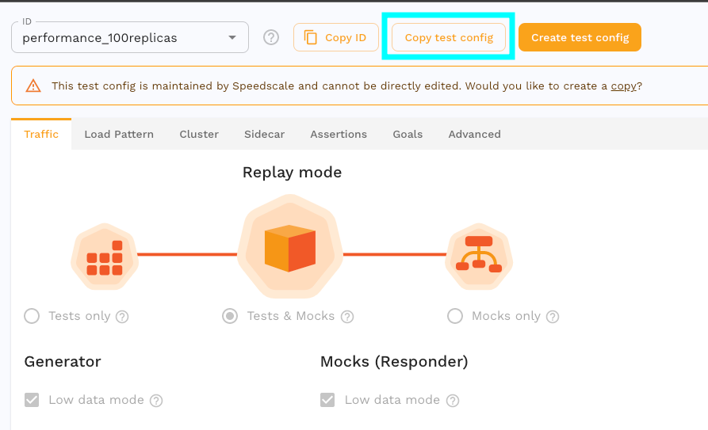
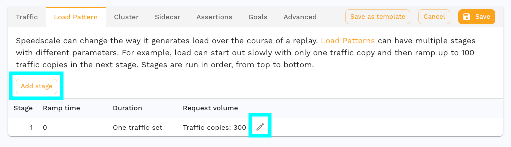
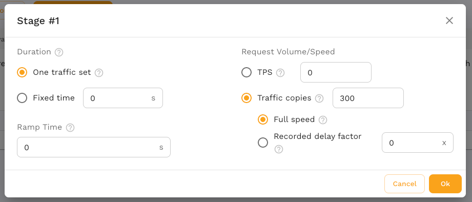
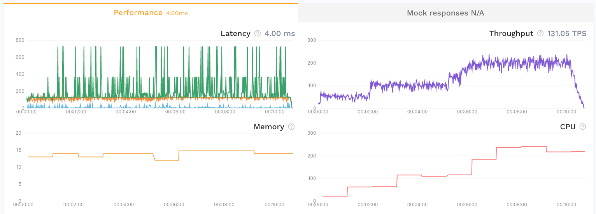

# Load Testing

Load testing shows how your service behaves as traffic increases. You can scale an entire recording, target selected endpoints, or replay complete user journeys with separate schedules and goals.

## Choose a load test

| What you want to test | Start here |
| --- | --- |
| Increase traffic across an entire recording | [Configure replay stages](#load-test-an-entire-recording) below. |
| Increase one endpoint's load while keeping another steady | Follow [Test one endpoint while stressing another](./endpoint-load-how-to.md). |
| Replay complete user journeys, including login and transaction steps | Use [session load groups](./endpoint-session-load-plans.md#rotate-complete-banking-journeys). |
| Look for problems that appear under sustained load | Run a [soak test](#soak-test). |
| Find a load-plan field, unit, or compatibility limit | Read the [load-plan reference](../../reference/configuration/endpoint-load-plans.md). |

## Independent endpoint and session workloads

Use [endpoint and session load plans](./endpoint-session-load-plans.md) when each workload needs its own schedule and goals. For example, ramp statement requests while holding transaction posting steady, then check posting latency during the busiest part of the test.

Select endpoints with URL filters, adding an HTTP method filter when reads and writes share a route. A request group replays those requests independently. A session group selects recorded users with a matching request and replays their complete journeys, including login and other steps.

In the dashboard, open **Test Config > Load Pattern** to add request or session groups. Set each group's filter, schedule, and goals, then use **Preview against a recording** to check selected endpoints, request ownership, and session population before running. For local replay and **Run in cluster**, use **Replay > Load plan** in `proxymock web`.

The [banking walkthrough](./endpoint-load-how-to.md) takes you through endpoint selection, rotating sessions, latency goals, and report interpretation. The [feature guide](./endpoint-session-load-plans.md) explains scheduling choices, shared arrival rates, budgets, and Kubernetes setup.

## Load test an entire recording

Use a [test config](/reference/glossary.md#test-config) to define the load
pattern for your test.  Start by making a copy of the test config
[performance-100replicas](https://app.speedscale.com/config/performance_100replicas)
since the built in test configs cannot be modified.



Notice the existing settings on the test config like [**low data
mode**](/reference/glossary.md#low-data-mode).

:::info
In low data mode only sampled response data of failures will not be sent to
Speedscale for analysis.  This limits the number of
[RRPairs](/reference/glossary.md#rrpair) that will be collected and processed
with [assertions](/reference/glossary.md#assertion), defined on the
**Assertions** tab, but enables much higher throughput than can be achieved
otherwise.  Status codes will be compared in low data mode which determines the
overall accuracy of the replay report.
:::


Now click on the **Load Pattern** tab to configure load for the
[replay](/reference/glossary.md#replay).  From this screen we can edit and add
replay stages.



A replay may have one or more stages and each stage may have a different
configuration.  Let's break down the settings in a stage.  Click the edit
button on stage 1.



The left side sets the **Duration** and determines how long the stage will last.
Select **One traffic set** to replay each request in the
[snapshot](/reference/glossary.md#snapshot) only once, per traffic copy.
Alternatively, set a **Fixed time** to cycle traffic from the snapshot until
the time is reached.  The **Ramp time** will ramp traffic up to the **Request
Volume/Speed** over the duration given.

The right side sets the **Request Volume/Speed** and determines fast requests
will be made.  Selecting a **RPS** sets the number of [requests per
second](/reference/glossary.md#requests-per-second) this stage will
target.  While the replay is running the
[generator](/reference/glossary.md#generator) monitors the current RPS and
increases or decreases load accordingly, holding load once the target is
reached.

Let's look at an example with multiple stages using RPS to control load.

| Stage | Ramp time | Duration  | Request Volume |
|-------|-----------|-----------|----------------|
| 1     | 0s        | 120s      | 50 RPS         |
| 2     | 0s        | 180s      | 100 RPS        |
| 3     | 30s       | 300s      | 200 RPS        |
| 4     | 45s       | 45s       | 0 RPS          |

This load pattern would result in a replay that looks like this:

```
| stage 1  |   stage 2  |     stage 3        |stage 4|
|---120s---|----180s----|-30s-|-----270s-----|--45s--|
     ^           ^         ^         ^           ^
     |           |         |         |           |
 stage 1         |         |         |           |
targets 50 RPS   |         |         |           |
                 |         |         |           |
              stage 2      |         |           |
            immediately    |         |           |
          targets 100 RPS  |         |           |
                           |         |           |
                     stage 3 spends  |           |
                    30s ramping from |           |
                     100 to 200 RPS  |           |
                                     |           |
                               stage 3 spends    |
                                the reamining    |
                               270s at 200 RPS   |
                                                 |
                                   stage 4 spends all of its 45s
                                   ramping down from 200 RPS to 0
```

The graph for this load pattern might look something like this:



There are several performance oriented test configs available by default to get you started.

## Soak Test

A common use case is to use a small amount of traffic to create a high
throughput or long running replay.  Some issues are only exposed after
sustained load exhausts a resource, which can take time.  Extend your traffic
with the test config **Duration** setting.  This will run your traffic in a
loop for the entirety of the duration.
