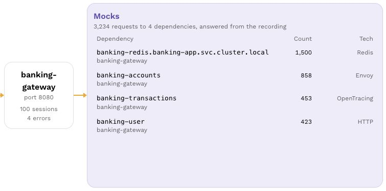
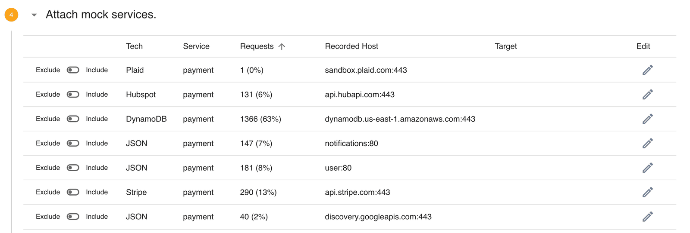
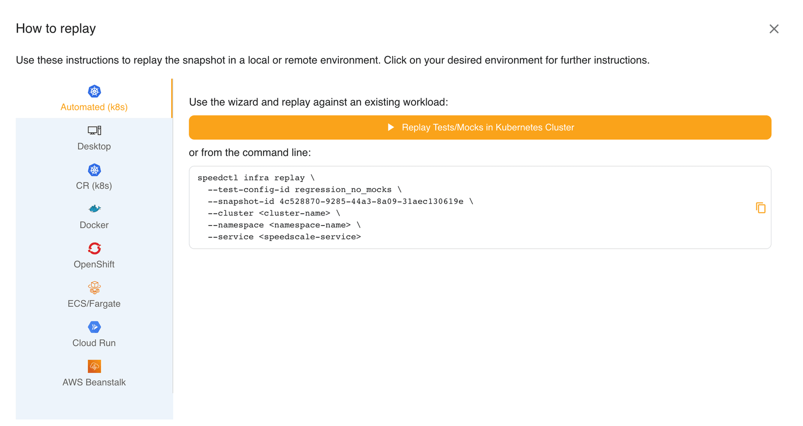
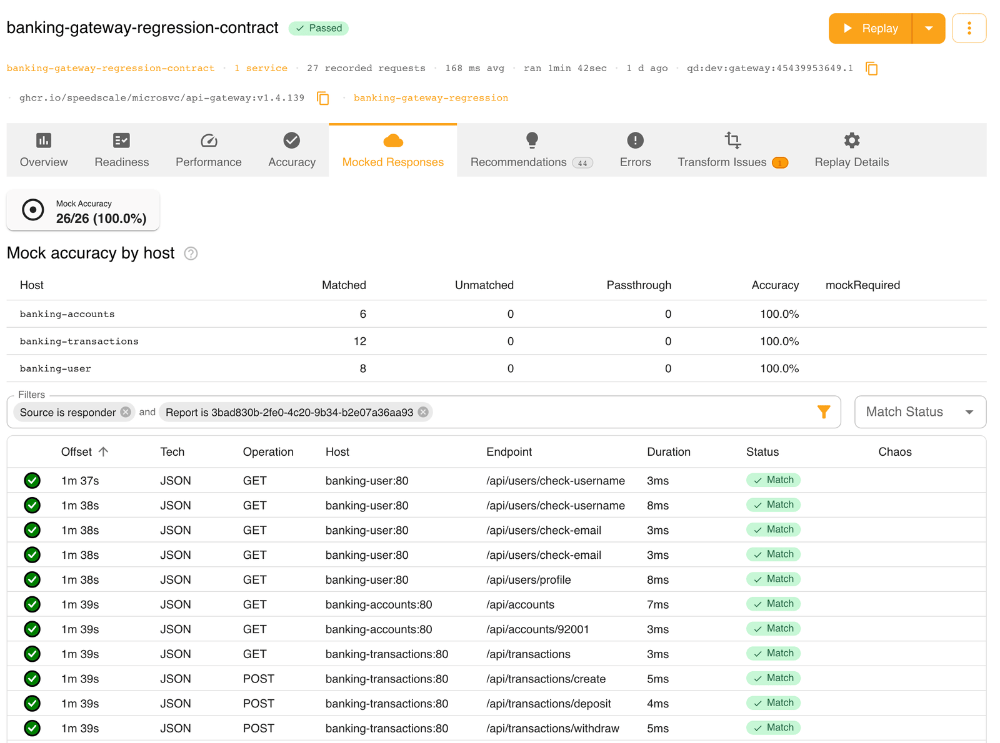
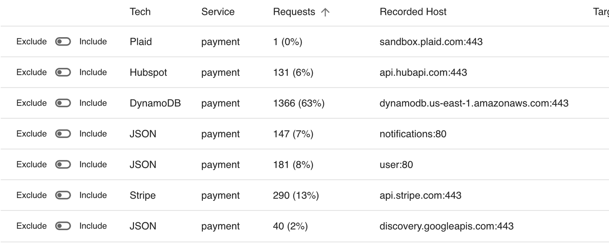
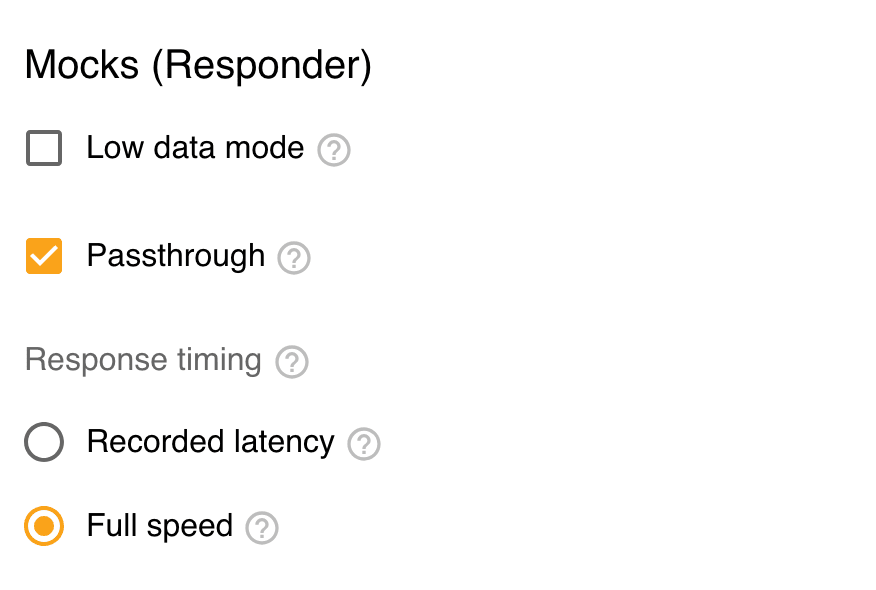
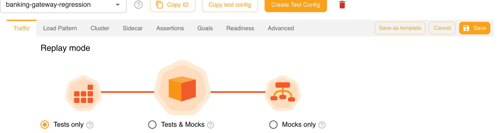

import OverviewMocksImage from './responders/overview-mocks.jpg';

# Mocking Backends

During a replay

Mocks, backed by [responders](/reference/glossary.md#responder), can be turned on and off before a replay, or from the snapshot.  This page describes the basic interaction with mocks.

## Viewing the snapshot

Open the snapshot's **Overview** tab to inspect its **Mocks** card. In **Traffic**, select **Mocks** or one dependency to inspect the recorded calls and responses. See [View Snapshot](../../creating-a-snapshot.md#view-snapshot) for the snapshot layout.

<a href={OverviewMocksImage}>Open screenshot full size</a>

This banking example records calls to Redis, accounts, transactions and user services. The Mocks card shows the number of recorded requests and detected technology for each dependency. [Responders](/reference/glossary.md#responder) use that recorded traffic to answer the application during a replay. See [supported technologies](/reference/technology-support.md).

### Choose mocks for a replay

The following replay-setup example uses a different `payment` service with DynamoDB, Stripe, Hubspot, Plaid, Google discovery and internal `user` and `notifications` dependencies. Click **Replay** on the snapshot to open the replay wizard. Step 4, **Attach mock services**, controls which dependencies are mocked for that replay.

We can also see here that Speedscale has identified the type of backends these are in the **Tech** column, for example Hubspot, Stripe, Plaid and DynamoDB. Set a dependency to **Include** to mock it; Speedscale then asks which workload serves its mock responses. Leave it at **Exclude** to send those calls to the real dependency. For example, you might keep DynamoDB real because you have a dev instance set up, and mock Stripe so the replay never makes actual credit card transactions.

## Run a replay

Now we can run a replay with the **Replay** button, or open the menu beside it and choose **How to replay** for the other ways shown here. Note that by default, both inbound and outbound traffic is generated and mocked respectively. If you want to run a workload with just the mocked backend for development but not run a full test replay, skip to [responder only mode](#responder-only).

After the replay is done, we can see the corresponding report. In this banking-gateway example the report passed and, more importantly, the **Mocked Responses** tab shows a Mock Accuracy of 26/26 (100%). This means that we were successfully able to match all the requests made by the service under test via our signature matching algorithm. We can inspect the request and response pairs seen by the responder the same way we would with our general traffic capture.

## Responder Only

If we want to mock our backends indefinitely and not run a test, we can do this using responder only mode. Depending on your method of choice you can set the mode either via the annotation `replay.speedscale.com/mode: responder-only` or if you're using the TrafficReplay CRD, by setting the field `mode: responder-only`. This is a great way to develop services with external dependencies that:

* Have a cost associated with each API call. For eg. certain information APIs can cost a few cents per request which can add up quickly during development.
* Have disruptive side effects. For eg. we do not want to ever make real credit card charges and always want to mock out Stripe's API.
* Have low rate limits. Many public APIs such as Github's has strict rate limits which can be irritating to face when doing rapid iteration.

## Disabling some mock responses

Sometimes you don't want to mock everything in the environment. There are three ways to accomplish this:

1. *Disable an entire mock* - You can accomplish this by setting the dependency to **Exclude** in step 4 of the replay wizard:

2. *Allow passthrough requests* - If you want to mock known requests but allow unrecognized transactions to continue to the original destination you can use `passthrough` mode. Just check **Passthrough** in the **Mocks (Responder)** section of your test config's **Traffic** tab:

3. *Disable the responder* - If you want all mocks to be disabled, regardless of snapshot configuration, select **Tests only** under **Replay mode** on your test config's **Traffic** tab.

