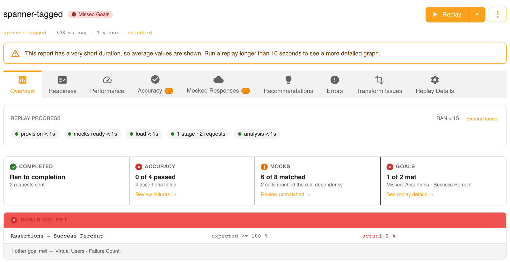
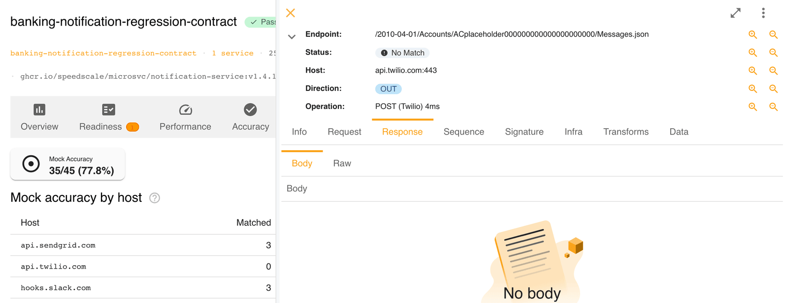
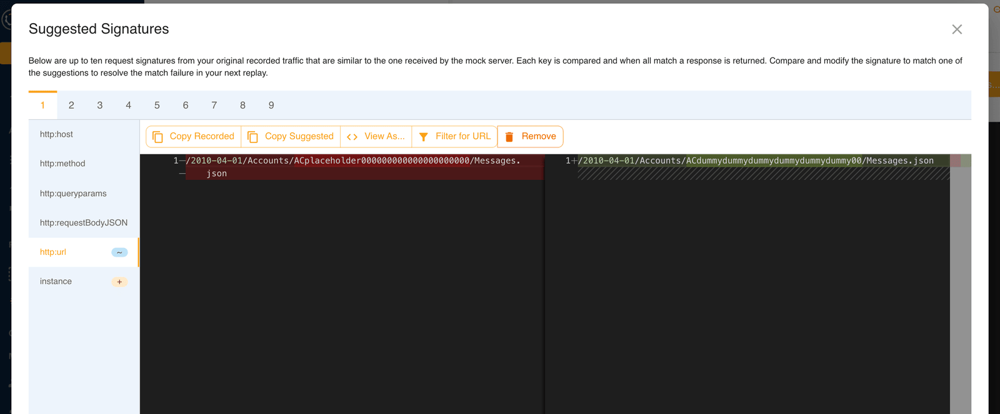
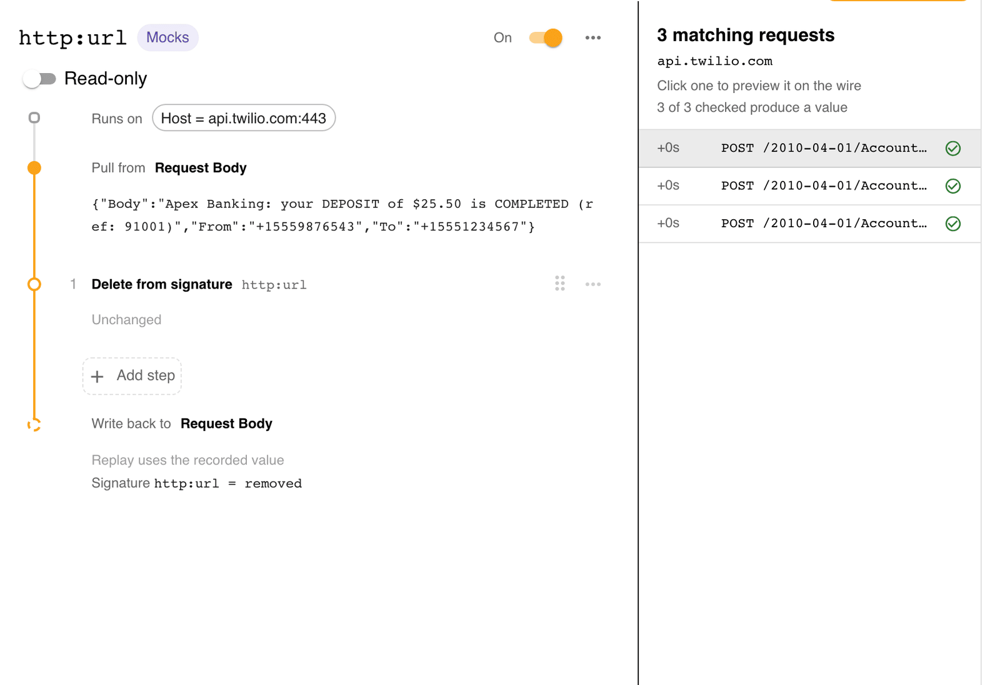

# Using Transforms for better Mocks

## Prerequisites
1. You have [created a snapshot](../../creating-a-snapshot.md)
2. You know how to [run a replay](../../)

## Replay without Transforms

For this guide, we use a snapshot of a `banking-notification` service. Its tests are calls to `/notifications` and `/health`, and its mocks answer the JSON APIs it calls to send messages: SendGrid, Slack and Twilio.

We run a replay with this snapshot and no special settings. Every assertion passes, but the **Mocks** card shows that only 35 of 45 outbound calls matched a mock. The rest reached the real dependency or got no match.

On the **Mocked Responses** tab, **Mock accuracy by host** shows that none of the three calls to `api.twilio.com` matched. Selecting one shows `No Match` for `POST /2010-04-01/Accounts/AC.../Messages.json`.

Open the call's **Signature** tab and select **Suggestions...** to compare it with the closest recorded requests. The method, host and JSON body match. Only `http:url` differs: the Twilio account ID in the path was `ACdummy...` when the traffic was recorded, and the test environment uses a different account.

We could transform the account ID in both the recording and the replay to the same constant. But the account ID tells the mock nothing about which response to return, since the message body already identifies the request. It is simpler and safer to leave the URL out of the signature for these calls.

## Transform

Open the snapshot's **Prepare** tab, select **Mocks** and then **New**. Set **Runs on** to `Host is api.twilio.com:443` so the change only applies to the Twilio calls. Pull from **Request Body**, then select **Add step** and pick **Delete from signature** with the key `http:url`. The preview shows `Signature http:url = removed` for all three matching requests.

Select **Save and reanalyze**. The responder applies the same chain to each incoming request before it looks for a match, so both sides of the comparison now ignore the URL.

On the **Traffic** tab, open one of the Twilio mocks, select **Signature** and choose **Compare**. `http:url` is now marked **Removed**.

## Replay with Transforms

Now we run another replay with the transformed snapshot, with the same cluster, namespace and test config.

All three Twilio calls now match a mock, and Mock Accuracy rises from 35 of 45 to 37 of 44. The remaining misses are Kafka consumer-group calls, which are a separate fix. The Twilio calls behave as they did when we recorded them, and we didn't have to call the real Twilio API or share an account between environments.

Transforms are extremely powerful for parameterizing and modifying dynamic data. Lots of data that we use in our apps is static but there are always things like timestamps, session ids, environment tags, etc. that we need to control for in tests and Transforms help us do exactly that on the inbound and outbound side.
