import useBaseUrl from '@docusaurus/useBaseUrl';

# Multi-Service Replay

Some applications require communication between multiple services to work correctly.  For example, imagine an API server which requires an authentication token.  In production a client might make a request to an auth service to get a token, then send that token to the API server.  In this guide we will configure Speedscale to run a [replay](/reference/glossary.md#replay) simulating this example.

## Replay two services from one snapshot

Append a snapshot and map each recorded service to its test workload.

<video controls playsInline preload="none" aria-label="Replay two services from one snapshot" style={{width: '100%', maxWidth: 800, aspectRatio: '16 / 9'}}>
  <source src={useBaseUrl('/videos/guides/speedscale-replay-two-services-from-one-snapshot.mp4')} type="video/mp4" />
  <track kind="captions" src={useBaseUrl('/videos/guides/speedscale-replay-two-services-from-one-snapshot.en.vtt')} srcLang="en" label="English" />
  <a href={useBaseUrl('/videos/guides/speedscale-replay-two-services-from-one-snapshot.mp4')}>Download the video</a>
</video>

## Create Snapshot

### Select Traffic

To start we will need to create two [snapshots](/reference/glossary.md#snapshot) and merge them together.

The first snapshot contains only the authentication request and response. In this banking example, the `banking-user` service provides the token we need from `POST /api/users/login`.

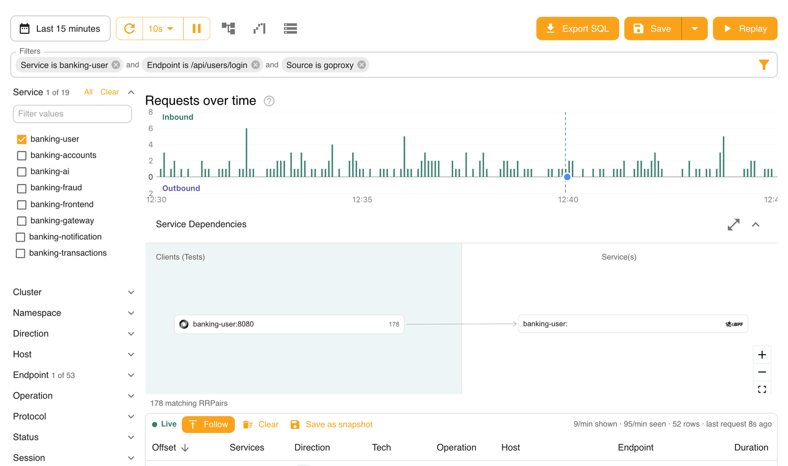

The second snapshot contains traffic to the API server we want to test, `banking-accounts` in this case.

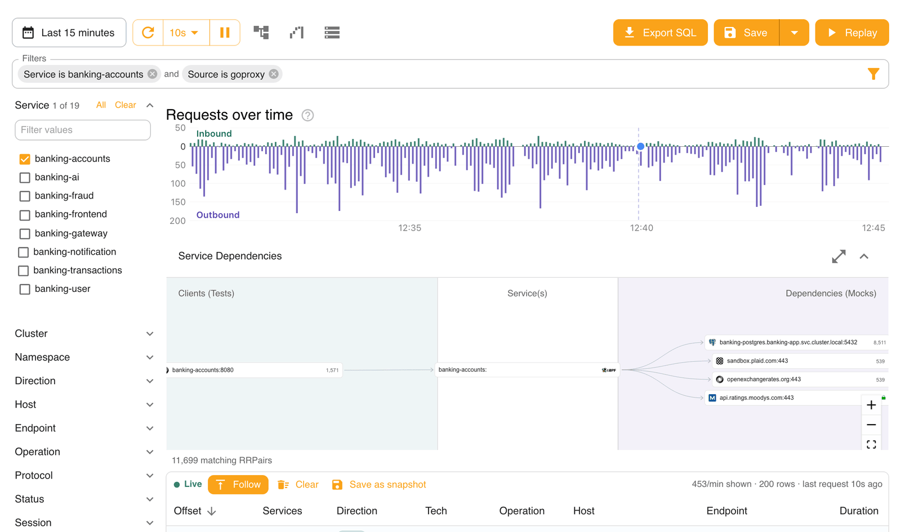

### Merge Snapshots

From the first snapshot containing the authentication request, open the menu at the top right and choose **Append snapshot**.

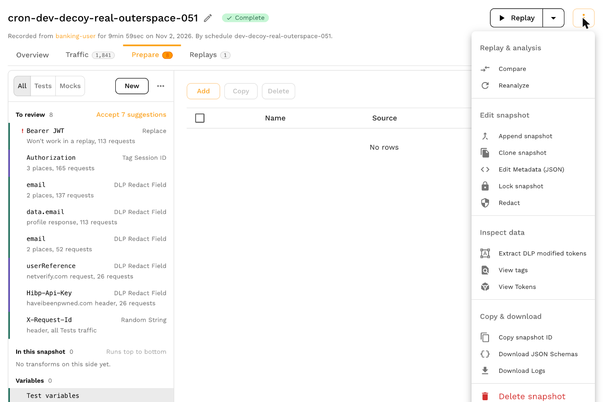

Then select the second snapshot and select **Append**. By default **Create a new merged snapshot instead of modifying this snapshot** is checked, so the merge is saved as a new snapshot and the first one does not change.

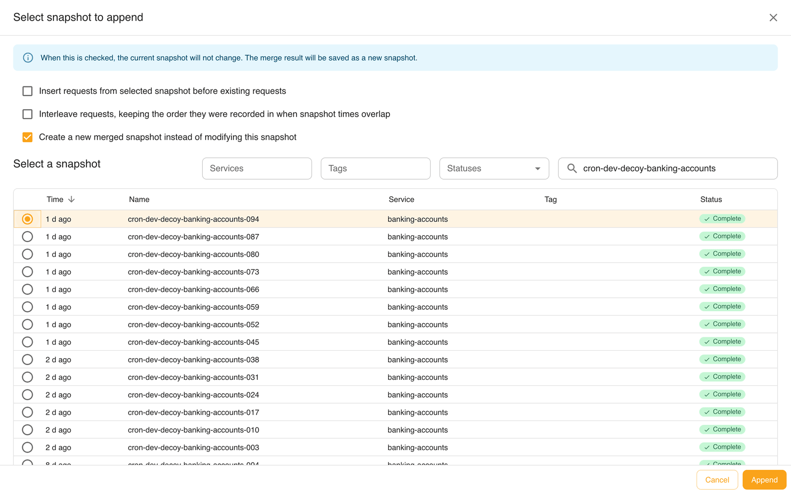

Now the merged snapshot contains traffic from both services.

Just to be sure we can investigate the snapshot traffic to verify by pulling the snapshot files and looking at the `resource` fields in the [action file](/reference/glossary.md#action-file):

```shell
$ speedctl pull snapshot $SNAPSHOT_ID
$ cat ~/.speedscale/data/snapshots/$SNAPSHOT_ID/raw.jsonl | head -n 5 | jq '.resource'
"banking-user"
"banking-accounts"
"banking-accounts"
"banking-accounts"
"banking-accounts"
```

The first request is from `banking-user` and the rest are from `banking-accounts`.  The **Overview** tab of the new snapshot shows the inbound and outbound [traffic](/reference/glossary.md#traffic) from both services.

### Transforms

The snapshot now contains the `/api/users/login` request, which means that request will be made again during the replay to retrieve a new token, but this is not enough. We need to configure Speedscale to pass the `token` from the login response to the `Authorization` header in subsequent requests.

We will create [Transforms](/reference/glossary.md#transform) to [store](/guides/transformation/transforms/variable_store) the `token` from the login response body and [load](/guides/transformation/transforms/variable_load) it into the header field later. Transforms for the snapshot are created on its **Prepare** tab.

Store the token by selecting the `/api/users/login` [RRPair](/reference/glossary.md#rrpair) on the **Traffic** tab, opening **Response**, clicking the pencil by the `token` field and choosing **Modify token**.

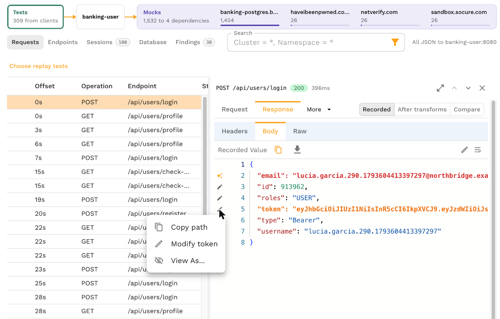

On the **Prepare** tab, select **Add step**, pick `Store Variable` and enter a variable name.

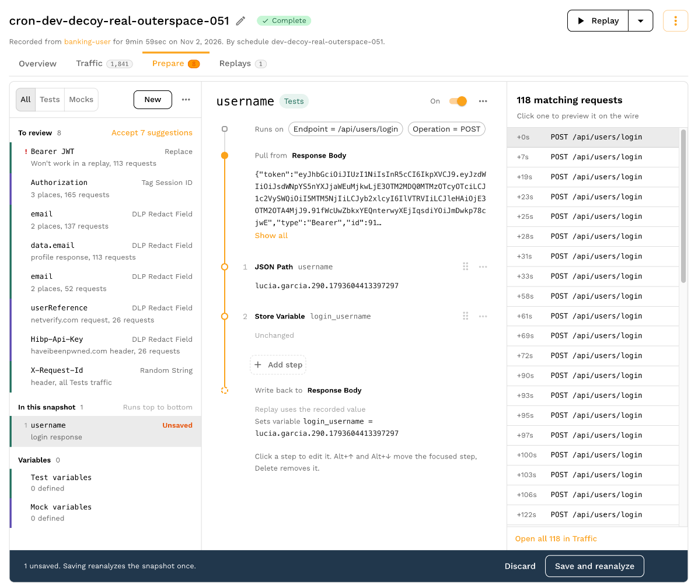

Now we can manually create a new transform by clicking **New** at the top of the Prepare list.  The new transforms will:

- Match all requests EXCEPT those with endpoint `/api/users/login`
- Target the HTTP Request Header `Authorization`
- Load the stored variable into the header field at index 1, since the full header string is `Bearer [token]`

Now during replay the `Authorization` header for all requests, except the login itself, will contain the `token` from the response of the `/api/users/login` request which gives us the flexibility to test with our real service with real, valid authentication.

## Replay

The merged snapshot now has traffic from both services and transforms to route to different locations. Let's replay it by clicking the **Replay** button.

### Cluster / Namespace

The replay page shows the service dependency map with both services, then numbered steps. In step 1, select the cluster and namespace where the replay will run. Make sure both target workloads are running there.

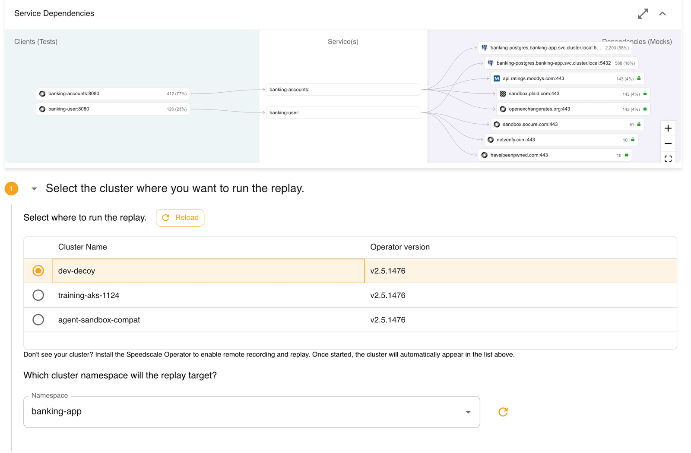

### Test Config

In step 2, select the type of test. The [test config](/reference/glossary.md#test-config) behind it sets details like load and duration. Pick a regression test, or select **Custom Scenario** to choose a saved config. Test configs are edited under **Test Configs** in the navigation.

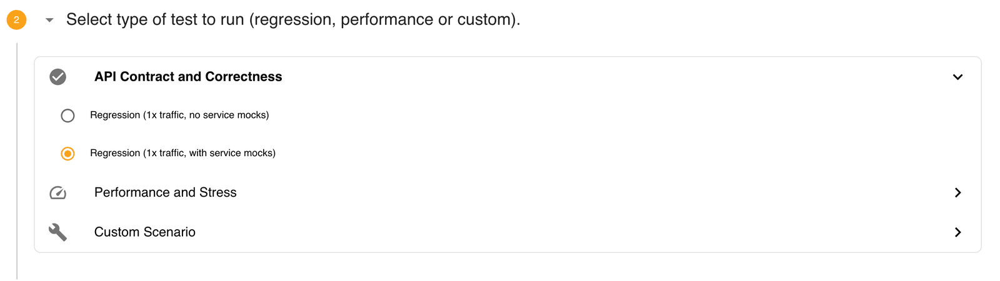

### Tests

Step 3, **Choose where to send traffic**, has one row for each recorded service. Each row's target can be set separately.

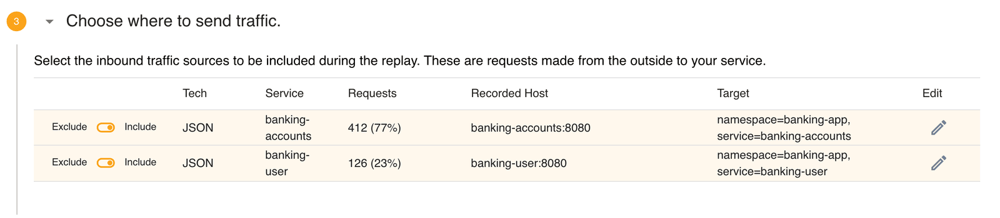

Select the pencil on the `banking-accounts` row and pick where its recorded traffic should go. Here we select the `banking-accounts` Kubernetes service.

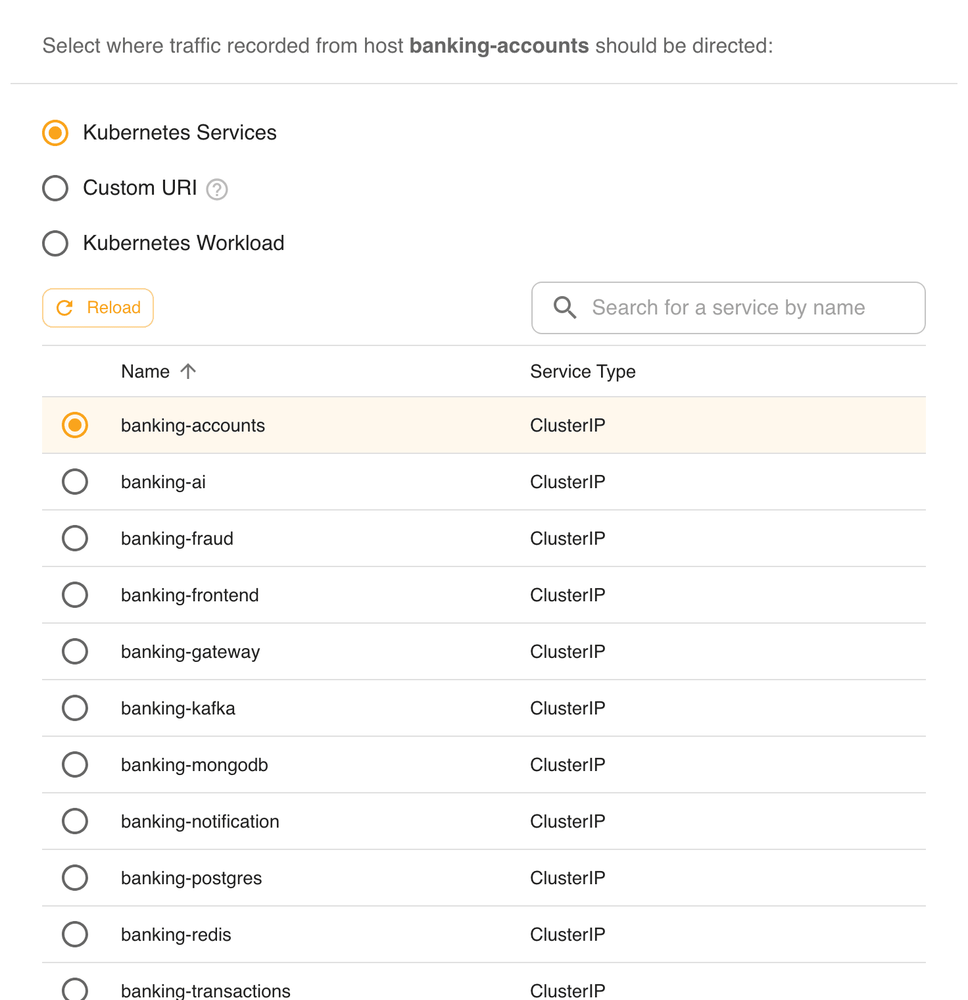

Do the same for `banking-user` and select the `banking-user` service.

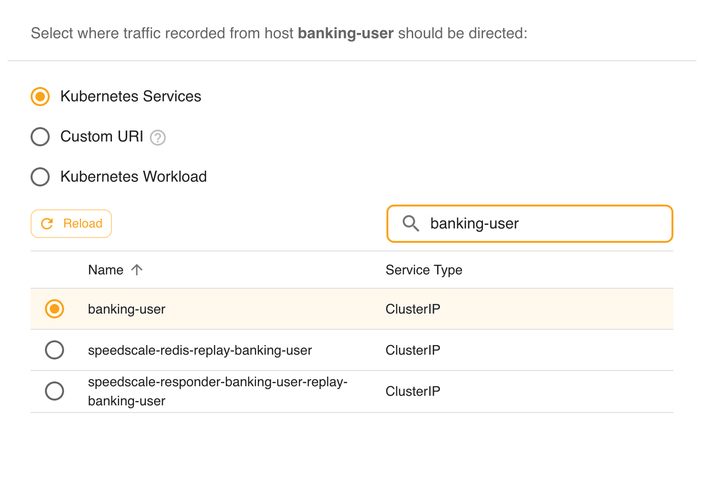

Step 4 lists the dependencies each service called. Each one is mocked unless you exclude it.

### Start

Review the targets and mocks, then select **Start Replay**. **Run In Terminal** shows the same replay as a `speedctl infra replay` command, with one `--route` for each service.

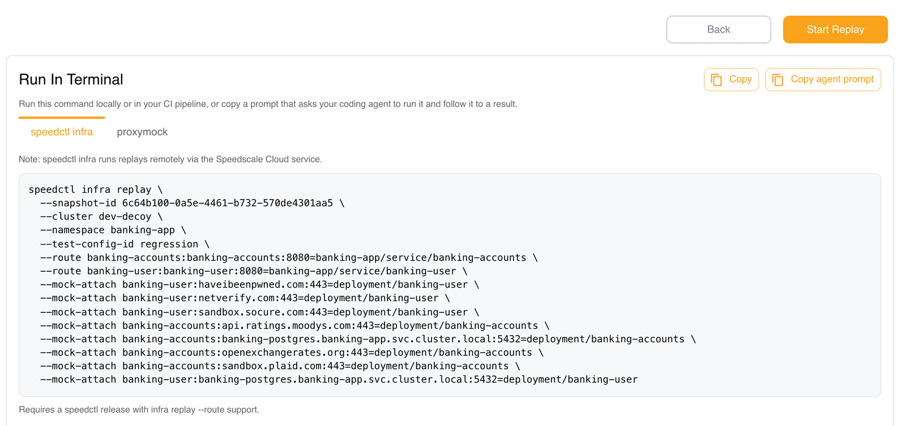

