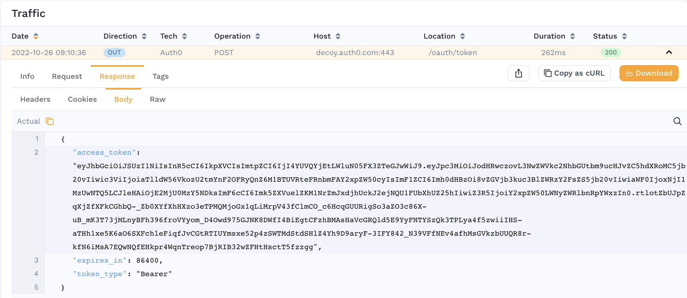

# Re-signing JWTs

Most real-world APIs require authentication. The most common type of authentication we see is JWT/OAuth2. This guide shows you how to train Speedscale to automatically re-sign JWTs for your Service Under Test (SUT).

:::tip
To fix expired credentials once for every replay of a snapshot, from the dashboard, schedules and CI, use [Replace credentials](/guides/replay/replace-credentials.md). It re-signs JWTs, fetches fresh tokens or pastes a replacement from the snapshot's **Credentials** tab. This page covers re-signing with a transform you edit yourself, and the one-off options the replay wizard applies to a single replay, including JWKS re-signing.
:::

## How do I know my app needs to resign JWTs?

1. Your application complains of invalid JWTs from the mocked service
1. When replaying traffic, you get lots of unauthenticated requests (401/403s)
1. Your application complains of being unable to authenticate with the mocked service
1. You see an outbound login-style transaction with a response payload containing the JSON key `access token`. For example:



## Prerequisites

* Find secret used to sign JWTs. Your application and the Speedscale responder must share the same secret for JWT re-signing to work.
* For this example we will assume your [secret](https://kubernetes.io/docs/concepts/configuration/secret/) is mounted in Kubernetes. Technically, the Speedscale responder is just looking for a file so you can adapt these instructions easily to run outside of Kubernetes.
* [Create a snapshot](/guides/creating-a-snapshot.md) containing the traffic you need to re-sign

## Configure your transform

You must tell Speedscale which JWTs you want to re-sign. This is accomplished with a traffic transform.
1. Open the transform editor for your Snapshot
2. Select the Responder or Generator tab
3. Add a "JWT Resign" transform
4. Set the "path" to the correct file path so Speedscale can find it. If you are running in Kubernetes you can use this format to specify a secret in the cluster: `${{secret:secret_name/key_inside_the_secret}}`. You can find more information in the Kubernetes [docs](https://kubernetes.io/docs/concepts/configuration/secret/). Whether you specify a secret or a direct file location the secret must match the algorithm of the JWT. For example, if the JWT is signed using HS512 then the secret or file must contain 64 bytes as a key. If RS512 it must be a certificate and so on.
5. (optional) Select a subet of traffic to apply the transform to. Remember, if "access_token" is not found in an RRPair then the transform system will just skip it. This means there should be little issue with not configuring fine grained filters unless you have many `access_token`s that need to be treated differently.

When you're done, you should be able to click on the "Advanced" tab and see JSON resembling the following:
```JSON
{
  "id": "jwt-test",
  "responder": [
    {
      "filters": {
        "filters": [
          {
            "include": true
          }
        ]
      },
      "extractor": {
        "type": "http_res_body"
      },
      "transforms": [
        {
          "type": "json_path",
          "config": {
            "path": "access_token"
          }
        },
        {
          "type": "jwt_resign",
          "config": {
            "secretPath": "${{secret:jwt-demo/tls.key}}"
          }
        }
      ]
    }
  ]
}
```

Now, run your replay and you're ready to go!

## Request a new token with OAuth client credentials

Re-signing only works when you hold the key that signs your tokens. When your service accepts tokens from an identity provider you do not control, such as Microsoft Entra ID, Okta, Auth0 or Keycloak, the replay can request a fresh token from that provider instead. The replay launcher and the replay wizard build an [`oauth_client_credentials`](/guides/transformation/transforms/oauth_client_credentials.md) transform for you: the generator requests a token with the OAuth 2.0 client credentials grant and sends it as the `Authorization: Bearer` header to the services you choose. This option applies to one replay. To request a fresh token in every replay of the snapshot, save a [Replace credentials](/guides/replay/replace-credentials.md#fetch-a-fresh-token) blueprint with **Fetch a fresh token** instead.

### Recognize the problem

- The **JWT Locations** table for the snapshot shows the recorded tokens as expired, and the launcher summary reports expired JWTs that are not resigned.
- The replay gets 401 responses where the recording had 2xx responses, and misses its goals.
- The tokens were issued by a third-party identity provider, and the request that obtained them is not in the snapshot.

### Prerequisites

- Speedscale v2.5.1184 or later for the cloud, operator and generator, and dashboard v0.10.253 or later. The operator in the replay cluster must be at least v2.5.1184 so the generator it starts includes the transform.
- A client ID and client secret for an app registration (client) that is allowed to request tokens for your API with the client credentials grant.
- The client secret stored in a Kubernetes Secret in the namespace the replay runs in:

```bash
kubectl create secret generic entra-oauth --from-literal=client_secret='<client secret>' -n <replay namespace>
```

- Network access from the generator pod to the token URL. If egress from the replay namespace is restricted, allow the token endpoint's host.

### Configure the replay

The option appears when the snapshot has JWT locations, in the **Advanced** section of the replay launcher and in the **Authentication & Resigning** step of the replay wizard.

1. Select **Request new access_token with OAuth client credentials (client ID, secret, scope, token URL)**.
2. Fill in the form:

| Field | What to enter |
|---|---|
| Client name | A label for you. It is not sent to the token endpoint. |
| Token URL | The token endpoint, for example `https://login.microsoftonline.com/<tenant-id>/oauth2/v2.0/token`. Required. |
| Client ID | The OAuth client ID. Required. |
| Secret name and Key | The Kubernetes Secret and key that hold the client secret, for example `entra-oauth` and `client_secret` (the default key). Only the reference `${{secret:entra-oauth/client_secret}}` is sent to Speedscale; the secret value stays in your cluster. |
| Scope | The scope to request. For Microsoft Entra ID this is usually the API's application ID URI followed by `/.default`, for example `api://orders-api/.default`. |
| Token field in the response | The JSON path of the token in the token response. Defaults to `access_token`. |
| Send the new token to these services | The services the recorded tokens were sent to, taken from the snapshot's JWT locations. All are selected to start with; choose at least one. |

When a recorded token was issued by Microsoft Entra ID, the form fills in the token URL (`https://login.microsoftonline.com/<tid>/oauth2/v2.0/token`, keeping the authority host of a sovereign cloud), the scope (`<aud>/.default`) and the client ID (`azp` or `appid`) from its claims. Check them before you start.

3. Start the replay. The launcher and the wizard keep the replay from starting until the token URL is an `http` or `https` URL, the client ID, secret name and key are filled in, and at least one service is selected.

### What to expect

- For the run, Speedscale adds one transform chain per selected service to the snapshot. Each chain extracts the `Authorization` header from requests to that service and replaces a `Bearer` value with the new token. Requests without an `Authorization` header, and headers with another scheme such as `Basic`, keep their recorded values.
- The operator mounts the Secret into the generator pod. If the Secret is missing from the replay namespace, the generator pod cannot start.
- The generator requests a token when the first request needs one, shares it across its vUsers, and requests a new one shortly before it expires.
- Replayed requests to the selected services get the responses a valid token gets, and the 401s from the baseline replay go away.
- When the replay completes, the snapshot's original transforms are restored. If the replay fails before it completes, open the snapshot's transforms and remove the `oauth_client_credentials` chains before the next run.

### Troubleshooting

When the token request fails, each affected request keeps its recorded token and carries an error event that starts with `transform chain failed:`. The message names the token URL, the HTTP status and the provider's OAuth error, and never includes the client secret.

| Symptom | Likely cause | Fix |
|---|---|---|
| `returned HTTP 401 (invalid_client: ...)`, for example `AADSTS7000215: Invalid client secret provided` | The client ID or secret is wrong or expired | Check the client ID, then update the Secret: `kubectl create secret generic entra-oauth --from-literal=client_secret='<client secret>' -n <replay namespace> --dry-run=client -o yaml \| kubectl apply -f -` |
| `returned HTTP 400 (invalid_scope: ...)` | The scope is wrong or the client may not request it | Correct the scope. For Entra ID, use the API's application ID URI followed by `/.default` |
| `oauth token endpoint ... unreachable: ...` | The generator cannot reach the token URL: DNS, a NetworkPolicy, a firewall or a missing egress proxy | Allow egress from the replay namespace to the token endpoint. The token request honors the generator's `HTTPS_PROXY`, `HTTP_PROXY` and `NO_PROXY` settings |
| The generator pod stays in `ContainerCreating` with a `FailedMount` event, or requests fail with `failed to read secret ${{secret:...}}` | The Secret, or the key in it, is missing from the replay namespace | Create the Secret in the namespace the replay runs in, with the key you entered |
| `oauth client_secret must be a ${{secret:name/key}} reference to a Kubernetes secret in the replay namespace` | An API call passed a plaintext client secret | Pass a `${{secret:name/key}}` reference instead |
| Requests still get 401 with no token errors | The service was not selected, the recorded header is not a `Bearer` header, or the token is for a different audience | Select the service, check the recorded header, and check that the scope matches the audience your service expects |

## Request a token with a Postman collection

The **Request new JWT access_token (provide Postman collection)** option imports your Postman collection into the snapshot and uses the token from it for the replay:

- Speedscale finds the token field in the collection's saved example response, preferring an `access_token` field, and during the replay takes the token from that field of the live response. Save a successful token response as an example in the collection before you upload it.
- A token written to the `Authorization` header is sent as `Bearer <token>`.
- Postman requests are imported as inbound traffic that the replay sends to your service. This suits a login endpoint that the system under test serves. For a third-party identity provider, use [OAuth client credentials](#request-a-new-token-with-oauth-client-credentials) instead.
