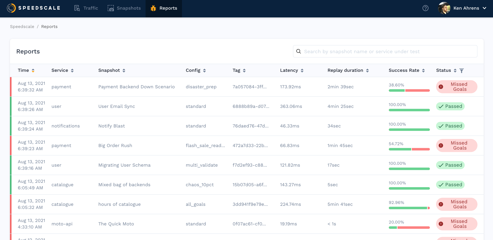
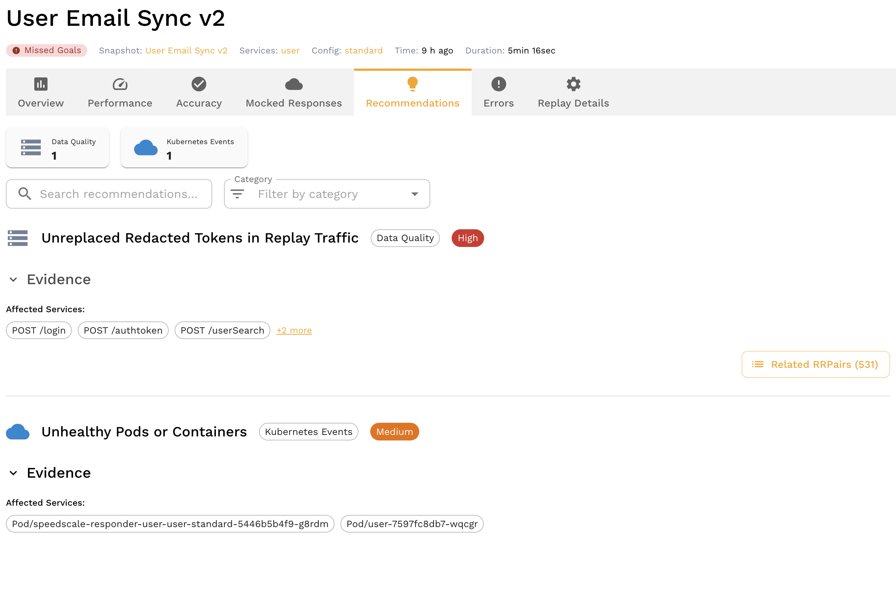
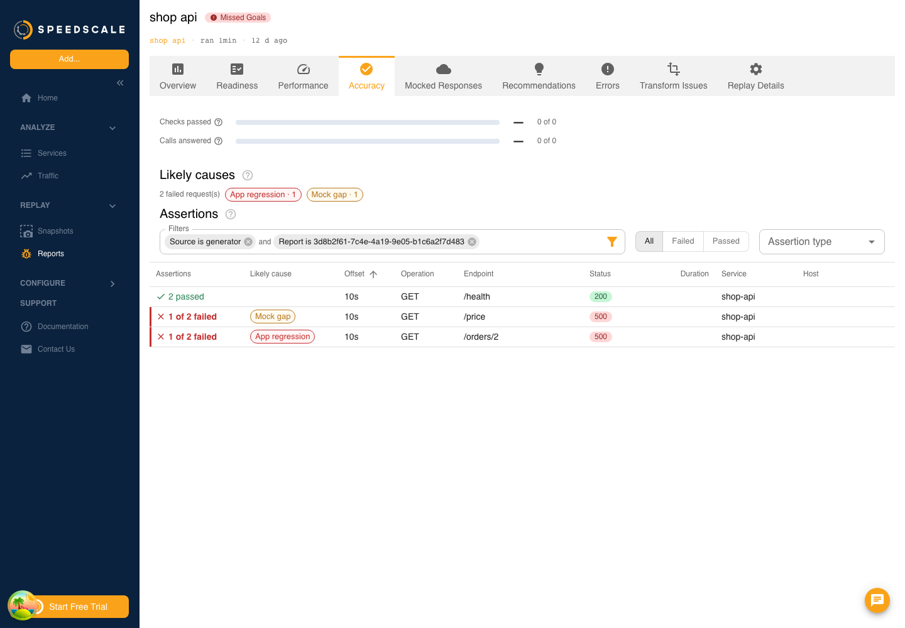
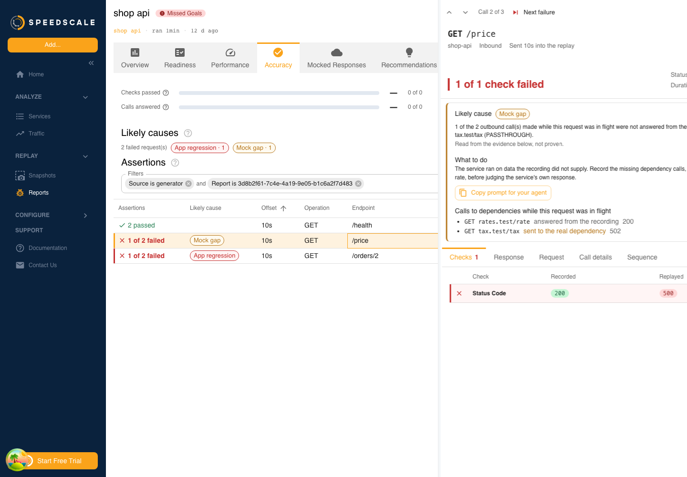

# Reports

Reports are an artifact of replays and a new report is created for every one.

After a replay is run the associated report will detail how successful the

replay was. Starting at the [reports page](https://app.speedscale.com/reports)

you can find reports sorted with the most recent at the top.

Use search to find a specific report:

Click into any report to see more detailed information.

## Which version ran

Every report records the container image the system under test was running, so you can tell which build a replay exercised without asking whoever launched it. At replay start the operator reads the target workload's pod template and records the image, then fills in what the pods actually ran once one is up.

The report list filters and sorts on two tags:

| Tag | Value |
| --- | --- |
| `sutImage` | The primary container's image repository, for example `ghcr.io/acme/orders` |
| `sutImageTag` | The primary container's image tag, or its digest when the reference is pinned by digest alone |

The report itself carries a structured `sutBuild` for the primary container and a `sutContainers` list with one entry per application container in the pod, in pod order. Each entry has the container name, image repository, tag, digest when the reference pins one, and the CPU and memory requests and limits. The primary container's entry also records:

| Field | Value |
| --- | --- |
| `imageDigest` | The registry digest of the image the container actually ran, read from the pod's container status, so two rollouts of a reused tag such as `latest` can be told apart. Empty for an image that was never pulled from a registry, such as one built on the node |
| `podTemplateHash` and `node` | The running pod's template hash and node, read from the first pod on the stamped image |
| `version` | The pod template's `app.kubernetes.io/version` label when set |
| `revision` | The Deployment or Argo Rollout revision annotation when set |
| `replicas` | The replica count the workload asked for |
| `configHash` | A hash over the container's command, args, environment, envFrom sources, volume mounts and their sources, and any `checksum/*` annotation on the pod template. The same image with a different `configHash` is a configuration change. Only the hash is stored, never a value |

The primary container is the first container in the pod that is not a known sidecar. Speedscale's own proxy and the Istio and Linkerd sidecars are recognized by image and container name and left out of `sutContainers`. A Job with an app container and an exporter lists both, with the app container as the primary.

The image tag appears beside the build tag in the report list and on the report page, where hovering it shows the containers, digest, revision, replicas, node and config hash. The report list can be filtered by image tag. From the CLI, `speedctl get report <report-id>` prints `sutBuild` and `sutContainers` with the rest of the report and `speedctl get reports --image-tag <tag>` lists the replays that ran that tag.

Captured traffic carries the same identity. Every RRPair recorded through the sidecar or through nettap is tagged with `sutImage`, `sutImageTag` and, when the pod status reports a registry digest, `sutImageDigest` for the container that served it, so a snapshot says which build it was recorded from and a report says which build it tested. nettap resolves that container from the process on the eBPF path and from the container name the operator injects beside the Java agent, so a pod with several application containers tags each request with the container that served it.

The fields stay empty when there is no pod to read: a replay against a `customURL` target, and a local proxymock replay. Reports and snapshots created before this was added are not backfilled. The `buildTag` on the replay is still yours to set, so you can record a commit hash or pipeline id next to the image the cluster actually ran.

## AI-Generated Summary

Each replay report includes an AI-generated summary at the top that highlights the most important findings. The summary provides a plain-language overview of what happened during the replay, calls out key failures or regressions, and suggests where to focus your attention. This is the fastest way to understand replay results without reading through every detail.

## Readiness

The Readiness tab, right after Overview, grades the replay for production readiness: a Ready or Not ready verdict, a letter from A to F for each metric family, a weighted score and a confidence factor.

The test config decides which families block the verdict and at which letter.

See the [Readiness guide](../readiness/index.md).

## Low data mode

When a replay runs in [low data mode](/reference/glossary.md#low-data-mode), a notice above the report tabs says so and explains what is missing.

The generator keeps only a sample of failed requests, so assertions, the error summary, transform issues and recommendations cover only that sample. The responder keeps only totals, so individual mocked calls are not listed. Latency, throughput, request counts and mock counts still cover everything sent.

The Accuracy card on the Overview tab counts responses in this mode, not assertions. On the Readiness tab, the notice names the families that could not see every request or mocked call, so read those letters with care.

To turn the mode off, select **Change in test config** on the notice. The change applies to the next replay.

## LLM

A replay that sent streamed LLM requests gets an LLM tab with time to first token, inter-token latency, request latency and token rates, next to the recorded values when the recording had frame timing. See [LLM Streaming Metrics](../replay/llm-streaming-metrics.md#read-the-results).

## Recommendations

The Recommendations panel surfaces automated insights about issues detected during the replay. Recommendations identify problems like memory growth, unreplaced tokens, latency regressions, error rate deviations, and more — along with suggested actions to fix them. See the [Traffic Recommendations guide](../recommendations.md) for a full reference of all recommendation types.

## Latency Percentiles

The performance section includes latency percentile graphs showing P50, P75, P90, P95, and P99 response times. These graphs help you understand the distribution of response times rather than just the average, making it easier to spot tail latency issues that affect a small percentage of requests.

## Throughput Timeslice Graphs

Throughput graphs show request volume over time during the replay, broken into timeslices. Use these to identify whether traffic was evenly distributed or whether there were bursts and gaps that might explain performance anomalies.

## Kubernetes Event Overlay

When replaying in a Kubernetes environment, the report can overlay cluster events (pod restarts, OOMKills, scheduling failures) on the performance timeline. This correlation makes it easy to see whether infrastructure issues coincided with performance regressions or errors during replay.

## Read the outcome checks

The report **Overview** opens with four checks:

| Check | What to inspect |
| --- | --- |
| Completed | Whether the replay completed its execution |
| Accuracy | Whether inbound replay responses matched expectations |
| Mocks | Whether outbound requests matched the configured mocks |
| Goals | Whether configured performance and validation goals passed |

Each check links to the report view that explains it. Completion alone does not prove response correctness. If no goals are configured, a green status does not prove that performance thresholds were checked.

When goals fail, the Overview shows their metric, expected value, and actual value. Use this evidence to distinguish a missed latency or throughput target from a replay setup problem. See [Report Status](./status.md) and [Performance Details](./performance-details.md).

## Likely cause of a failed request

The **Accuracy** tab names the likely cause of every replayed request that did not answer the way its recording did. A count of failed requests by cause sits above the list, and each failed row has a **Likely cause** column.

| Cause | Evidence | What to do |
| --- | --- | --- |
| App regression | The status changed, or a response field that was stable in the recording changed | Fix the code that handles the request, or record again if the change is intended |
| Mock gap | A call the service made to a dependency while the request was in flight was not matched by a mock, or passed through to the real service | Record the missing calls, or [improve the mock match rate](/proxymock/guides/mock-match-rate.md) |
| Changing value | The service refused the recorded credential with `401` or `403`, or every changed field holds an id, a timestamp or a token | Apply a [recommendation](../recommendations.md) that keeps the value current |
| Environment | No response came back | Check that the workload is running and reachable |

Open a failed request to see its cause above the checks: the evidence, what to do, and the calls the service made to its mocked dependencies while the request was in flight, each marked as answered from the recording, with no recorded answer, or sent to the real dependency.

A cause is read from the evidence, not proven. Requests on one endpoint that failed with the same statuses and the same changed fields share a cause.

**Copy prompt for your agent** copies a prompt for a coding agent that names the request, the report and the cause. The agent pulls the report with the [analyze-replay-report skill](/proxymock/agent-skills.md), confirms the cause against the recorded and replayed requests, and fixes the code when the cause is in it.

A call is tied to a request by its trace id when the service propagates one, and otherwise by the request in flight when the call was made. With many virtual users and no trace ids, a call can be tied to a neighbouring request.

The causes are also in the report artifact `failure-causes.json`, which `proxymock cloud pull report` downloads. `proxymock replay` names causes the same way for a local replay. See [Failure bundles](/proxymock/guides/replay-verdicts.md#failure-bundles).

The list and the counts appear for reports analyzed after causes were added. A report in [low data mode](#low-data-mode) counts only the failures it kept, and a report whose responder kept no calls cannot show a mock gap.

## Outbound HTTP calls

When the test config has an [`httpOutput`](/reference/configuration/assertions/httpoutput.md) assertion, the **Accuracy** tab shows **Outbound HTTP calls** next to the Kafka output and [SQL output](/reference/configuration/assertions/sqloutput.md) results.

A summary says whether the app's outbound calls matched the recording, with the recorded and replayed call counts and how many times the replay ran the recorded tests. If the comparison could not run, an error says why, and a warning appears when the list of differences was truncated.

The table lists each difference with its kind, host, method, endpoint, field, expected and actual values, and how many calls it covers.

## Mock accuracy by host

The **Mocked Responses** tab shows a **Mock accuracy by host** table under the Mock Accuracy cards. For each dependency host the app called, it lists the calls the mocks matched, did not match, and passed through to the live service, and the host's accuracy.

Hosts named in an `httpOutput` assertion's `mockRequired` are marked as required. A required host with any unmatched or passthrough calls is marked as not mocked and listed first.

The table appears for reports analyzed after per-host counts were added.

## Chaos rules

When the test config has chaos rules, the **Mocked Responses** tab shows a **Chaos rules** table. For each rule it lists its configured percent and expected share, the requests that matched it while it was active, the responses it perturbed, and how those responses were sent: completed, withheld, reset, partial or write-failed.

With a [`chaosFired`](/reference/configuration/assertions/chaosfired.md) assertion, the table also shows each rule's allowed fired range and verdict: within band, out of band, not exercised, or required and not exercised. If the rules could not be judged, an error says why.
