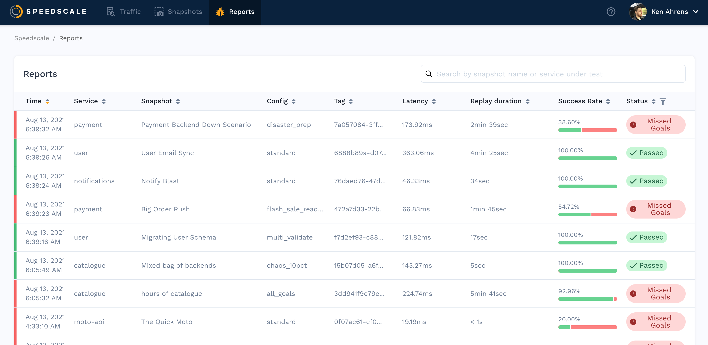
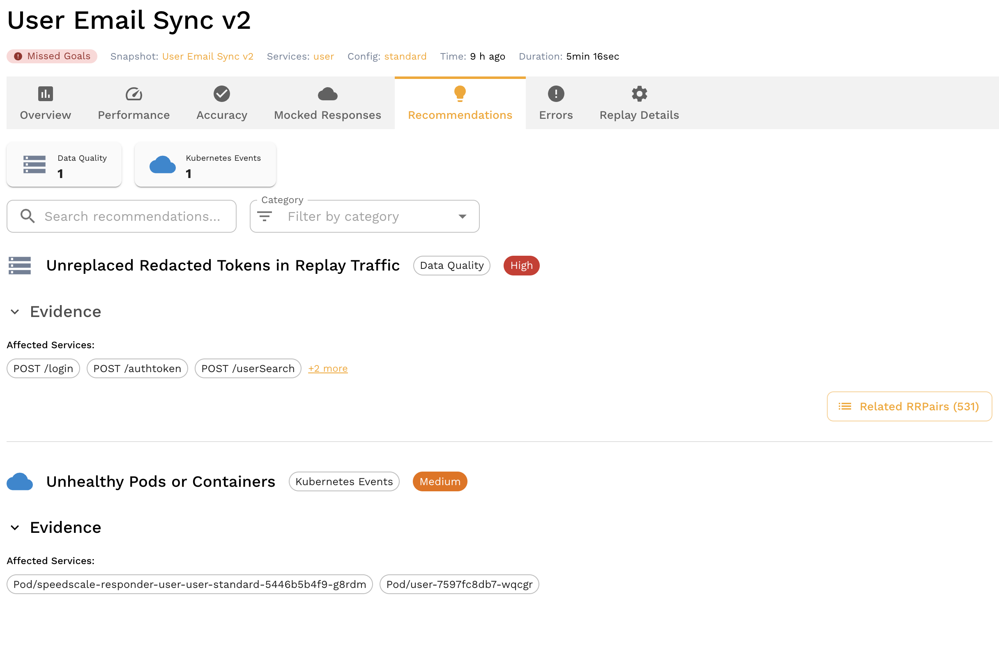

# Reports

Reports are an artifact of replays and a new report is created for every one.
After a replay is run the associated report will detail how successful the
replay was. Starting at the [reports page](https://app.speedscale.com/reports)
you can find reports sorted with the most recent at the top.

Use search to find a specific report:

Click into any report to see more detailed information.

## Which version ran

Every report records the container image the system under test was running, so you can tell which build a replay exercised without asking whoever launched it. At replay start the operator reads the target workload's pod template and stamps the image on the report tags.

| Tag | Value |
| --- | --- |
| `sutImage` | The primary container's image repository, for example `ghcr.io/acme/orders` |
| `sutImageTag` | The primary container's image tag, or its digest when the reference is pinned by digest alone |
| `sutContainers` | A JSON array with the `name`, `image` and `tag` of every application container in the pod, in pod order |

The primary container is the first container in the pod that is not a known sidecar. Speedscale's own proxy and the Istio and Linkerd sidecars are recognized by image and container name and left out of `sutContainers`. A Job with an app container and an exporter lists both, with the app container as the primary.

The image tag appears beside the build tag in the report list and on the report page, and the report list can be filtered by it. From the CLI, `speedctl get report <report-id>` prints the tags with the rest of the report and `speedctl get reports --image-tag <tag>` lists the replays that ran that tag.

The tags stay empty when there is no pod to read: a replay against a `customURL` target, and a local proxymock replay. Reports created before this was added are not backfilled. The `buildTag` on the replay is still yours to set, so you can record a commit hash or pipeline id next to the image the cluster actually ran.

## AI-Generated Summary

Each replay report includes an AI-generated summary at the top that highlights the most important findings. The summary provides a plain-language overview of what happened during the replay, calls out key failures or regressions, and suggests where to focus your attention. This is the fastest way to understand replay results without reading through every detail.

## Recommendations

The Recommendations panel surfaces automated insights about issues detected during the replay. Recommendations identify problems like memory growth, unreplaced tokens, latency regressions, error rate deviations, and more — along with suggested actions to fix them. See the [Traffic Recommendations guide](../recommendations.md) for a full reference of all recommendation types.

## Latency Percentiles

The performance section includes latency percentile graphs showing P50, P75, P90, P95, and P99 response times. These graphs help you understand the distribution of response times rather than just the average, making it easier to spot tail latency issues that affect a small percentage of requests.

## Throughput Timeslice Graphs

Throughput graphs show request volume over time during the replay, broken into timeslices. Use these to identify whether traffic was evenly distributed or whether there were bursts and gaps that might explain performance anomalies.

## Kubernetes Event Overlay

When replaying in a Kubernetes environment, the report can overlay cluster events (pod restarts, OOMKills, scheduling failures) on the performance timeline. This correlation makes it easy to see whether infrastructure issues coincided with performance regressions or errors during replay.

## Read the outcome checks

The report **Overview** opens with four checks:

| Check | What to inspect |
| --- | --- |
| Completed | Whether the replay completed its execution |
| Accuracy | Whether inbound replay responses matched expectations |
| Mocks | Whether outbound requests matched the configured mocks |
| Goals | Whether configured performance and validation goals passed |

Each check links to the report view that explains it. Completion alone does not prove response correctness. If no goals are configured, a green status does not prove that performance thresholds were checked.

When goals fail, the Overview shows their metric, expected value, and actual value. Use this evidence to distinguish a missed latency or throughput target from a replay setup problem. See [Report Status](./status.md) and [Performance Details](./performance-details.md).

## Outbound HTTP calls

When the test config has an [`httpOutput`](/reference/configuration/assertions/httpoutput.md) assertion, the **Accuracy** tab shows **Outbound HTTP calls** next to the Kafka output and SQL results.

A summary says whether the app's outbound calls matched the recording, with the recorded and replayed call counts and how many times the replay ran the recorded tests. If the comparison could not run, an error says why, and a warning appears when the list of differences was truncated.

The table lists each difference with its kind, host, method, endpoint, field, expected and actual values, and how many calls it covers.

## Mock accuracy by host

The **Mocked Responses** tab shows a **Mock accuracy by host** table under the Mock Accuracy cards. For each dependency host the app called, it lists the calls the mocks matched, did not match, and passed through to the live service, and the host's accuracy.

Hosts named in an `httpOutput` assertion's `mockRequired` are marked as required. A required host with any unmatched or passthrough calls is marked as not mocked and listed first.

The table appears for reports analyzed after per-host counts were added.

## Chaos rules

When the test config has chaos rules, the **Mocked Responses** tab shows a **Chaos rules** table. For each rule it lists its configured percent and expected share, the requests that matched it while it was active, the responses it perturbed, and how those responses were sent: completed, withheld, reset, partial or write-failed.

With a [`chaosFired`](/reference/configuration/assertions/chaosfired.md) assertion, the table also shows each rule's allowed fired range and verdict: within band, out of band, not exercised, or required and not exercised. If the rules could not be judged, an error says why.
