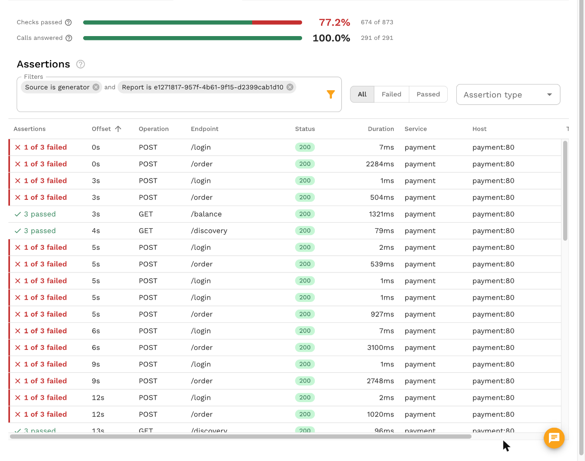
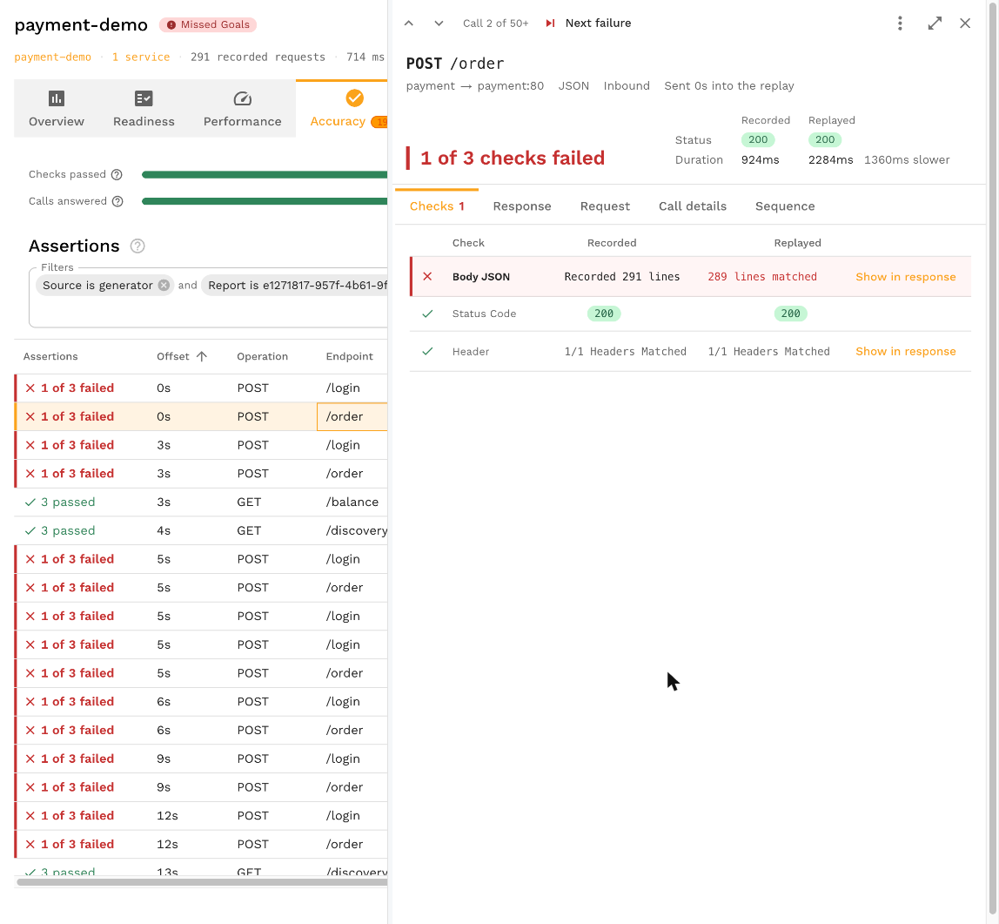
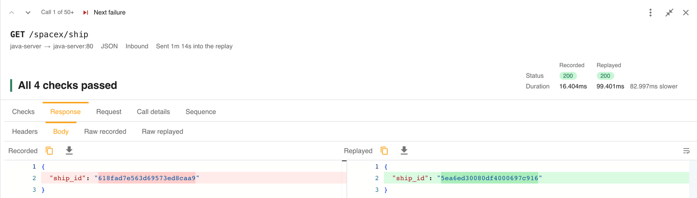

# Accuracy

The **Accuracy** tab of a report shows how the replayed calls compared with the traffic snapshot. Use it to find the calls that did not match the recording and see why.

## Accuracy at a glance

Two bars open the tab:

* **Checks passed** is the share of assertions that matched the recording, out of every assertion evaluated in the replay. The red part of the bar is the share that failed.
* **Calls answered** is the share of replayed calls that got a response from the service. Errors here usually mean the service was not ready or the cluster is misconfigured, rather than a difference in the responses.

When the test config has an [`httpOutput`](/reference/configuration/assertions/httpoutput.md), Kafka output or [`sqlOutput`](/reference/configuration/assertions/sqloutput.md) assertion, its results appear below the bars. See [Outbound HTTP calls](./README.md#outbound-http-calls).

## Find the failed calls

The list below shows every replayed call and its assertions. The first column reads as a verdict, such as **1 of 3 failed** or **3 passed**, and failed calls carry a red line at their left edge.

* Use **All**, **Failed** and **Passed** to show only the calls with that result. With a filter on, the verdict counts only the matching assertions.
* Use **Assertion type** to show calls with one kind of check, such as Status Code or Body JSON.
* Use **Filters** to narrow the list by service, endpoint or any other traffic field.

In low data mode, only a sample of failed calls is collected, so the list is titled **Failed assertions (sampled)** and may be empty when nothing failed.

## Review a call

Click a call to open it in the sidebar.

The top of the sidebar names the call, says how many of its checks failed, and compares the recorded and replayed status and duration.

Use the up and down arrows to move to the previous or next call, and **Next failure** to jump to the next failed call, without closing the sidebar. Expand gives the sidebar the whole page, and Escape returns it to its usual width.

The **Checks** tab opens first. It lists every assertion that ran on the call, failures first, with the recorded value beside the replayed value. For body, header and cookie checks, **Show in response** opens the part of the response that the check compared.

The other tabs hold the evidence:

* **Response** and **Request** compare the recorded and replayed headers, cookies and body side by side. Lines that differ are red, and the margin is red beside the parts of the body that do not match.
* **Call details** lists the call's fields, such as host, endpoint and duration.
* **Sequence** shows the calls around this one as a sequence diagram.
* **Log** lists the events the replay recorded for the call, when there are any.

A body check compares each line of the body, including delimiters such as curly braces, so its replayed value reads like "4 lines matched" when the bodies differ. Assertions can be configured in the [test config](/reference/glossary.md#test-config) to ignore fields that should not affect the comparison.

Ignored fields still have red lines in the margin to show they differ, but the line itself is grey with a crossed eye icon to show that it was ignored. See the [assertions reference](../../reference/configuration/assertions/README.md) for more information.

## Fix expected differences

If a replay has an unexpectedly low success rate, inspect the failed checks and the response differences before changing the configuration. For expected differences such as credentials or dates, open the snapshot's **Prepare** tab to review and edit transform chains. Use the chain editor to preview changes against a recorded request, save the configuration, and replay again to check the result. See [Traffic Transformation](/guides/transformation/overview.md) for the workflow. For help with your configuration, ask in the [Speedscale Slack community](https://slack.speedscale.com) or [email support](mailto:support@speedscale.com).
