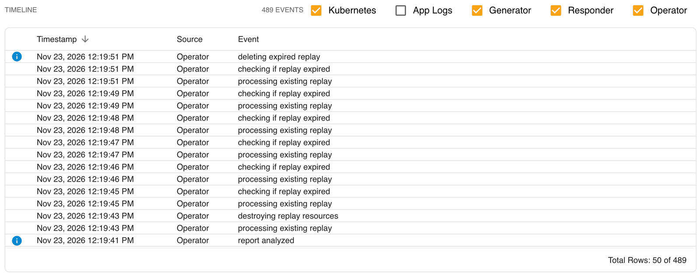

# Logs

See the sequence of calls from each of the Speedscale components.

During the traffic replay there are several moving parts. The **Timeline** at the bottom of a report's **Overview** tab lists the events and logs from each of them, newest first. Use the checkboxes above the list to choose which sources to show:

* **Kubernetes** shows cluster events for the replay workloads.
* **App Logs** shows the logs of the service under test, when they were collected.
* **Generator** performs the traffic replay, you may want to review the specific log statements as it ran
* **Responder** is used to create a stable environment, you may want to review the exact settings used
* **Operator** from the cluster orchestrates the initialization of the responder and generator, records when the report is analyzed, and cleans up the environment at the end.

The **Replay Details** tab shows the settings recorded for the replay, such as the cluster, namespace, workload and test config.
