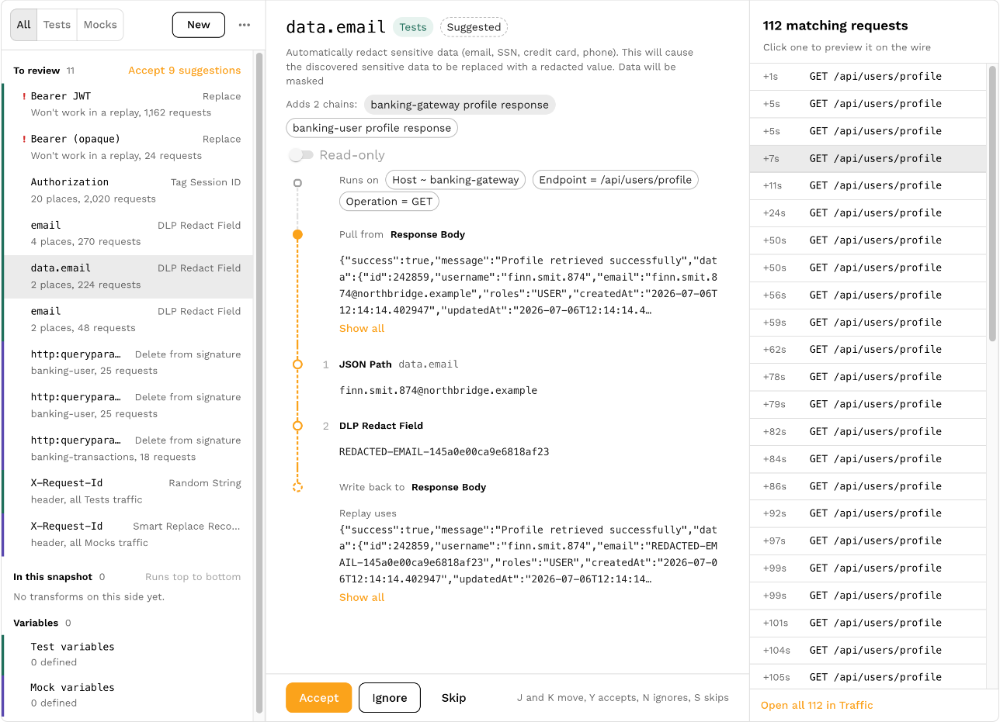
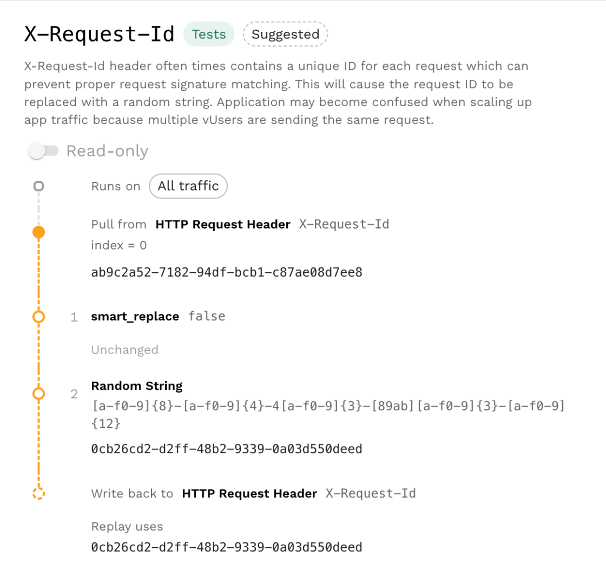

# Traffic Transformation

Transforms adapt recorded traffic for replay: [replace credentials](/guides/replay/replace-credentials.md), shift dates, or carry a value from one response into a later request. They can also adjust outbound requests and responses used by mocks.

## Choose your workflow

| Environment | Saved configuration | Start here |
| --- | --- | --- |
| Speedscale Cloud | Traffic Transform Template | Configure snapshot tuning, then save a reusable template |
| proxymock | Blueprint | [Create and Verify Blueprints](/proxymock/guides/blueprints.md) |
| Local JSON authoring | Bare transform configuration | [Test and apply local rules](/proxymock/guides/local-rules.md) |

These workflows use the same [transform engine](/concepts/transforms.md), [extractors](./extractors/README.md), and [transforms](./transforms/README.md). A blueprint wraps the transform configuration with local metadata; it is not the same JSON document as a bare Cloud template.

## Tune a Cloud snapshot

1. Run a small replay against your test application.
2. Inspect inbound accuracy failures and outbound mock misses separately. Open the relevant request to understand which value changed.
3. Open the snapshot's **Prepare** tab. Review a recommendation, the transform chains it proposes, and the traffic affected by each chain.
4. Apply a targeted change, then replay again to check the result.

Use **Traffic** to inspect requests and responses, selecting inbound or outbound traffic as needed. A chain that matches no traffic cannot fix the replay. Check its filter and execution side before adding more transforms.

Correctness failures may require an application fix or a new recording. Change transforms only when the difference is an expected consequence of replaying in a different context. For a complete local iteration loop, see [Replay Tuning](/proxymock/guides/replay-tuning.md).

## Preview a chain on real traffic

The chain editor on a snapshot's **Prepare** tab runs the selected chain against one recorded request. It shows the value pulled from the source, the output of each step, and what a replay uses after the value is written back. The preview works on a suggestion before you accept it, and it updates as you edit, before you save or reanalyze the snapshot.

The sample comes from the list of matching requests beside the chain. A chain you start with the pencil next to a value on the **Traffic** tab opens on the request you clicked, which is listed first when it falls past the end of the list. Any other chain starts on the first request in the list where the source has a value. Click another request to preview the chain on it. Chains filtered by service have no list, so they have no preview.

Each request in the list carries a mark that says whether the chain produces a value on it. A check means every step produced a value. Otherwise hover the mark to see why: the chain's filters leave the request out, the source has nothing to read, a step selected nothing, or a step failed. The header counts how many listed requests produce a value. A `json_path` such as `items.7.name` selects nothing on a response with fewer than eight items, so look for a checked request before deciding that the path is wrong.

Chains above the one you are editing run first, as they do during a replay, so a chain that rewrites the same value changes what this chain receives. A suggestion runs after every chain already on its side, which is where accepting it puts it. A chain above that fails does not stop the preview, because a replay carries on past it too.

What a replay uses can differ from the last step's output. Writing back runs each step's inverse in reverse order, so in the example above `json_path` puts the redacted email back into the response body. A `base64` chain re-encodes the value, and `var_load` applies its variable only at this point. A [read-only chain](/concepts/transforms.md#read-only-chains) writes nothing back.

A few transforms only act during a replay. [`token_fetch`](./transforms/token_fetch.md) does not call the token endpoint in a preview, so the value passes through that step unchanged. The preview does not show `smart_replace` mappings or signature matching, because those take effect across a whole request after every chain has run.

A step that fails shows its error on that step, and the steps after it show as not run. A step can also succeed with an empty value, such as a `json_path` whose path is absent when `create` is left on, and the editor flags that too.

## Extractors and Transforms

Each chain extracts a value, applies its transforms in order, then writes the result back. See [Basic Principles](/concepts/transforms.md#basic-principles) for the execution model and [Where to Transform Traffic](/concepts/transforms.md#where-to-transform-traffic) for generator and responder placement.

Use [`json_path`](./transforms/json_path.md) for JSON, [`xml_path`](./transforms/xml_path.md) for XML, and [`graphql`](./transforms/graphql.md) for GraphQL values addressed by [semantic path](../graphql/semantic-paths.md).

## Where to Transform Traffic

Generator request chains change what the app receives. Generator response chains can store values returned by the app. Responder request chains affect mock matching; responder response chains affect what the mock returns. The extractor selects the request or response field.

Initialize reusable values with generator or responder variables. Generator variables are scoped to a virtual user. See [Variables](./variables.md) and [Embedded Syntax](./embedded-syntax.md) for storage and runtime references.

## Traffic Transform Templates

A Traffic Transform Template saves a Cloud transform configuration for use with later snapshots. Review templates in [Traffic Transforms](https://app.speedscale.com/trafficTransforms).

### How to Use Transform Templates

<iframe title="Traffic Transform Templates tutorial" src="https://www.youtube.com/embed/XSN8wG_-RO8?rel=0&modestbranding=1" width="640" height="360" frameborder="0" allow="autoplay; fullscreen; picture-in-picture" allowfullscreen></iframe>

1. Configure transforms for a snapshot and verify them with a replay.
2. Save the configuration as a template.
3. Select the saved template for another snapshot and review its filters, variables, and credentials before replaying.

The video shows an earlier dashboard layout. Current snapshot tuning is under **Prepare**, and requests are under **Traffic**.

For local reuse, save a [blueprint](/proxymock/guides/blueprints.md). A recording's snapshot ID does not bind a local blueprint; active rules can apply to other recordings in the workspace when their filters match.
