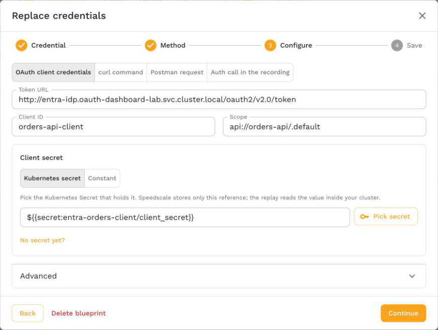

# oauth_client_credentials

The `oauth_client_credentials` transform requests a fresh access token from an OAuth 2.0 token endpoint with the client credentials grant, then replaces the extracted value, normally the recorded `Authorization` header, with `Bearer <token>`. Use it when the recorded tokens have expired and your service accepts tokens issued by an identity provider such as Microsoft Entra ID, Okta, Auth0 or Keycloak.

The generator sends the token request straight to the token URL. The identity provider does not have to appear in the recorded traffic, and the token does not have to be a JWT: any string the token endpoint returns is used as is.

- **Transform type name (config/API):** `oauth_client_credentials`, an alias of [`token_fetch`](./token_fetch.md) with `grant` set to `client_credentials`. Use `token_fetch` when the token request is not a client credentials call.
- **Shorthand format (display):** `oauth_client_credentials(tokenUrl=...,clientId=...,scope=...,tokenPath=...)`. The client secret is never shown.
- **Side:** request side, in generator chains.
- **Requires:** Speedscale cloud, operator and generator v2.5.1184 or later. The operator in the replay cluster must be at least that version so the generator it starts includes the transform.

## From the dashboard

Open the snapshot's **Credentials** tab, select **Replace credentials** on the credential, choose **Fetch a fresh token** and **OAuth client credentials**, and fill in the token URL, client ID, scope and client secret. For a recorded Microsoft Entra ID token, the token URL, scope and client ID are filled in for you. Speedscale saves a credential blueprint that requests a fresh token in every replay of matching traffic. See [Replace credentials](/guides/replay/replace-credentials.md#fetch-a-fresh-token).



## Quick Start

To write the chain yourself, extract the `Authorization` header and replace it with a token fetched from your identity provider. The client secret comes from a Kubernetes Secret named `entra-oauth` in the replay namespace:

```json
{
  "extractor": {
    "type": "http_req_header",
    "config": { "name": "Authorization" }
  },
  "transforms": [
    {
      "type": "oauth_client_credentials",
      "config": {
        "tokenUrl": "https://login.microsoftonline.com/<tenant-id>/oauth2/v2.0/token",
        "clientId": "<client-id>",
        "clientSecret": "${{secret:entra-oauth/client_secret}}",
        "scope": "api://orders-api/.default"
      }
    }
  ]
}
```

Create the Secret before you start the replay:

```bash
kubectl create secret generic entra-oauth --from-literal=client_secret='<client secret>' -n <replay namespace>
```

A recorded `Authorization: Bearer eyJ...` header goes out as `Authorization: Bearer <fresh token>`. Add a filter to the chain when only some services should receive the token. [Replace credentials](/guides/replay/replace-credentials.md#fetch-a-fresh-token) builds an equivalent chain for every replay of matching traffic, and the [Re-sign JWTs guide](/guides/replay/resign-jwt.md#request-a-new-token-with-oauth-client-credentials) covers the one-off option for a single replay.

## How It Works

The transform does its work in the first phase. The second phase is a no-op.

1. **Skip values that do not need a token.** An empty value is returned unchanged, so a request recorded without an `Authorization` header goes out without one and triggers no token request. When `prefix` is set (it is `Bearer ` by default), a value that does not start with it, compared without regard to case, is also left alone. A `Basic` header on the same host keeps its recorded value.
2. **Resolve the credentials.** `clientId` and `clientSecret` are used as literal values, or read from a secret when the value is a `${{secret:name/key}}` reference. See [Secrets](#secrets).
3. **Reuse a cached token.** Tokens are cached per credential set and shared by every vUser in the generator. A cached token is reused until shortly before it expires. See [Caching and Refresh](#caching-and-refresh).
4. **Request a token.** On a cache miss the generator sends `POST <tokenUrl>` with `Content-Type: application/x-www-form-urlencoded` and `Accept: application/json`. The form body carries `grant_type=client_credentials`, `client_id`, `client_secret` and, when set, `scope`. Values are form encoded, so a secret containing `&`, `+`, `=`, `%` or spaces is sent correctly.
5. **Read the token.** The response must be JSON. The token is read at `tokenPath` (default `access_token`) and `expires_in`, when present, sets the token's lifetime.
6. **Replace the value.** The extracted value becomes `prefix + token`, for example `Bearer eyJ0eXAi...`.

In analysis mode the transform returns the recorded value unchanged and never calls the token endpoint, so analyzing a snapshot does not reach your identity provider.

## Configuration

```json
"type": "oauth_client_credentials",
"config": {
    "tokenUrl": "<absolute http or https token endpoint>",
    "clientId": "<client ID or ${{secret:name/key}}>",
    "clientSecret": "<client secret or ${{secret:name/key}}>",
    "scope": "<optional scope>",
    "tokenPath": "access_token",
    "prefix": "Bearer ",
    "name": "<optional label>"
}
```

| Parameter | Required | Default | Description |
|---|---|---|---|
| `tokenUrl` | **Yes** | none | The token endpoint. Must be an absolute `http` or `https` URL with a host. |
| `clientId` | **Yes** | none | The OAuth client ID. A literal value or a `${{secret:name/key}}` reference. |
| `clientSecret` | **Yes** | none | The OAuth client secret. A literal value or a `${{secret:name/key}}` reference. Use a secret reference anywhere other than a short local test. |
| `scope` | No | not sent | Sent as the `scope` form field exactly as written, for example `api://orders-api/.default`. Separate several scopes with spaces. |
| `tokenPath` | No | `access_token` | JSON path of the token in the token response, for example `data.token` for a nested field. |
| `prefix` | No | `Bearer ` | Written before the token. When set, only values that already start with it are replaced. Set it to an empty string to replace every non-empty value with the bare token. |
| `name` | No | none | A label for people reading the config. The transform ignores it and never sends it. |

Chain initialization fails with `tokenUrl is required`, `tokenUrl must be an absolute http or https URL, got "..."`, `clientId is required` or `clientSecret is required` when a required field is missing or invalid.

## Caching and Refresh

- **One token per credential set.** The cache key is the combination of token URL, client ID, client secret, scope and token path. All vUsers and all chains in a generator that use the same combination share one token, so a generator with many vUsers sends one token request instead of one per vUser. Each generator replica keeps its own cache.
- **Refresh before expiry.** A token is refreshed before its `expires_in` runs out, by a margin of 60 seconds or half the token's lifetime, whichever is smaller. A token that lives 3600 seconds is refreshed after 3540 seconds; a token that lives 10 seconds is refreshed after 5 seconds.
- **Default lifetime.** When the response has no `expires_in`, the token is treated as valid for 5 minutes.
- **Failure backoff.** When a token request fails, the error is held for 10 seconds. Requests in that window fail with the same error without contacting the token endpoint again, then the next request retries. An unreachable token endpoint does not stall every request for its own timeout.
- **Timeouts and limits.** Each token request times out after 15 seconds. The response body is read up to 1 MiB.

When the transform cannot get a token, the request keeps its recorded value and the transform reports an error. The service under test then usually rejects the stale token with a 401.

## Errors

Error messages name the token URL with its query string and any user information removed, the HTTP status, and the provider's OAuth `error` and `error_description` fields. They never include the client secret or a token: if the provider echoes the secret back, it is replaced with `[redacted]`. A long description is cut at 300 characters.

Each replayed request the error affects carries an error event that starts with `transform chain failed:` followed by the message, so you can find it in the request's log in the replay results.

For example, a wrong client secret sent to Microsoft Entra ID produces:

```
oauth token endpoint https://login.microsoftonline.com/<tenant-id>/oauth2/v2.0/token returned HTTP 401 (invalid_client: AADSTS7000215: Invalid client secret provided. ...); check the client ID, secret, scope and token URL
```

| Error | Likely cause | Fix |
|---|---|---|
| `oauth token endpoint <url> returned HTTP 401 (invalid_client: ...)` | Wrong client ID or client secret, or an expired secret | Check the client ID, and the value stored in the Secret or local secret file |
| `oauth token endpoint <url> returned HTTP 400 (invalid_scope: ...)` | The scope does not exist or the client is not allowed to request it | Correct `scope`. For Microsoft Entra ID it is usually the API's application ID URI followed by `/.default` |
| `oauth token endpoint <url> returned HTTP 400 (unauthorized_client: ...)` or `(unsupported_grant_type: ...)` | The client is not allowed to use the client credentials grant | Enable the client credentials grant for the client in your identity provider |
| `oauth token endpoint <url> unreachable: ...` | DNS failure, timeout or connection refused from the generator | Check that the generator can reach the token URL. See [Network access](#network-access) |
| `oauth token response from <url> is not JSON` | The URL points at a login page or a proxy error page | Use the token endpoint itself, usually ending in `/token` |
| `oauth token response from <url> has no "access_token" field` | The token is under a different field | Set `tokenPath` to the field that holds the token |
| `oauth client credentials: failed to read secret ${{secret:name/key}}: ...` | The secret is not mounted, or the local secret file is missing | Create the Secret in the replay namespace, or the file under the proxymock secrets directory |
| `oauth client credentials: invalid secret reference ...` | The reference is not in the form `${{secret:name/key}}` | Fix the reference |

### Network access

The generator calls the token URL from inside your cluster (or from your machine when you replay with proxymock). The token request uses the generator's standard `HTTPS_PROXY`, `HTTP_PROXY` and `NO_PROXY` settings, so a generator that reaches the internet through an egress proxy sends it through that proxy. If a NetworkPolicy or firewall restricts egress from the replay namespace, allow the token endpoint's host and port (443 for an `https` URL).

## Secrets

`clientId` and `clientSecret` each accept a literal value or a `${{secret:name/key}}` reference. The reference must be the whole value: text around it is sent as part of a literal value. Trailing line endings in the secret value are removed, so a secret file that ends in a newline still works.

| Where the replay runs | Where `${{secret:name/key}}` is read from |
|---|---|
| In a Kubernetes cluster | Key `key` of the Kubernetes Secret `name` in the replay namespace. The analyzer reports the reference as a required secret and the operator mounts the Secret into the generator pod. If the Secret does not exist, the generator pod cannot start and Kubernetes reports a `FailedMount` event. `speedctl infra replay --pre-flight-check` checks that the Secret and key exist before the replay starts. |
| proxymock on your machine | The file `<workspace>/proxymock/secrets/<name>/<key>`, or `<workspace>/secrets/<name>/<key>`. See [proxymock Secrets](/proxymock/guides/secrets.md#oauth-client-credentials). |

The secret value is read by the generator at replay time. It is never stored in the snapshot, the transform config or the replay report.

## Examples

### Example 1: Microsoft Entra ID

A service accepts tokens issued by Microsoft Entra ID for the API `api://orders-api`. The calling app registration has the client ID `11111111-2222-3333-4444-555555555555` and a client secret stored in the Kubernetes Secret `entra-oauth`:

```json
"type": "oauth_client_credentials",
"config": {
    "name": "orders-api client",
    "tokenUrl": "https://login.microsoftonline.com/<tenant-id>/oauth2/v2.0/token",
    "clientId": "11111111-2222-3333-4444-555555555555",
    "clientSecret": "${{secret:entra-oauth/client_secret}}",
    "scope": "api://orders-api/.default"
}
```

You can read these values from a recorded token. Decode one in the dashboard's JWT details panel or another JWT decoder:

- `tid` is the tenant ID that goes in the token URL. Sovereign clouds use a different authority host, which the `iss` claim of a v2 token shows (for example `login.microsoftonline.us`).
- `aud` is the API. The scope is `aud` followed by `/.default`.
- `azp` (v2 tokens) or `appid` (v1 tokens) is the client ID of the app that requested the token.

The dashboard fills in the token URL, scope and client ID from these claims when it finds a recorded Entra ID token.

### Example 2: A token under a nested field

An internal token service replies with `{"data": {"token": "..."}, "expires_in": 900}`:

```json
"type": "oauth_client_credentials",
"config": {
    "tokenUrl": "https://auth.internal.example.com/oauth/token",
    "clientId": "${{secret:auth-client/id}}",
    "clientSecret": "${{secret:auth-client/secret}}",
    "tokenPath": "data.token"
}
```

Both the client ID and the secret are read from the `auth-client` Secret. The token is refreshed after 840 seconds.

### Example 3: Only for one service

Add a filter so the chain runs only for requests sent to one host. The dashboard builds one chain like this for each service you select:

```json
{
  "filters": {
    "filters": [
      { "include": true, "operator": "CONTAINS", "networkAddress": "orders.shop.svc.cluster.local" }
    ]
  },
  "extractor": { "type": "http_req_header", "config": { "name": "Authorization" } },
  "transforms": [
    {
      "type": "oauth_client_credentials",
      "config": {
        "tokenUrl": "https://login.microsoftonline.com/<tenant-id>/oauth2/v2.0/token",
        "clientId": "11111111-2222-3333-4444-555555555555",
        "clientSecret": "${{secret:entra-oauth/client_secret}}",
        "scope": "api://orders-api/.default"
      }
    }
  ]
}
```

## When to Use It

| Situation | Use |
|---|---|
| Your service accepts tokens from an identity provider you can request tokens from with a client ID and secret | `oauth_client_credentials` |
| You hold the key that signs the tokens your service accepts, and want to keep the recorded claims | [`jwt_resign`](./jwt_resign.md) |
| You have a long-lived token, or one you obtained by hand, that is valid for the length of the replay | [`constant`](./constant.md) |
| The recording contains the login or token request, and later requests should use whatever token the replayed login returns | [`smart_replace_recorded`](./smart_replace_recorded.md) |
| The token is an AWS SigV4 signature | [`aws_auth`](./aws_auth.md) |

`oauth_client_credentials` sends real token requests to your identity provider, so the tokens carry whatever claims the provider issues to that client. If your service authorizes on user-specific claims that a client credentials token does not carry, re-sign the recorded tokens with `jwt_resign` instead.

## Common Misconceptions

1. **"The token has to be a JWT."** No. Any string at `tokenPath` is used, including opaque tokens.
2. **"Every vUser fetches its own token."** No. One token per credential set is shared by every vUser in a generator and refreshed before it expires.
3. **"It adds an Authorization header to every request."** No. A request recorded without the header is left alone, and with the default `prefix` only `Bearer` values are replaced.
4. **"Analysis calls my identity provider."** No. Only the replay itself sends token requests.
5. **"The client secret is stored with the snapshot."** Only when you write a literal value into the config. With a `${{secret:name/key}}` reference, only the reference is stored. [Replace credentials](/guides/replay/replace-credentials.md#kubernetes-secret-or-constant) saves a secret reference unless you choose to save the client secret as a constant.

## Related

- [Replace credentials](/guides/replay/replace-credentials.md): save a blueprint that fetches a fresh token in every replay of matching traffic.
- [`token_fetch`](./token_fetch.md): the same transform with any token request, from curl, Postman or your own config.
- [Re-sign JWTs guide](/guides/replay/resign-jwt.md#request-a-new-token-with-oauth-client-credentials): configure this transform for a single replay from the dashboard.
- [proxymock Secrets](/proxymock/guides/secrets.md#oauth-client-credentials): local secret files for proxymock replays.
- [`jwt_resign`](./jwt_resign.md), [`constant`](./constant.md), [`smart_replace_recorded`](./smart_replace_recorded.md), [`aws_auth`](./aws_auth.md): other ways to handle credentials during replay.
- [`http_req_header`](../extractors/http_req_header.md): the extractor normally paired with this transform.
