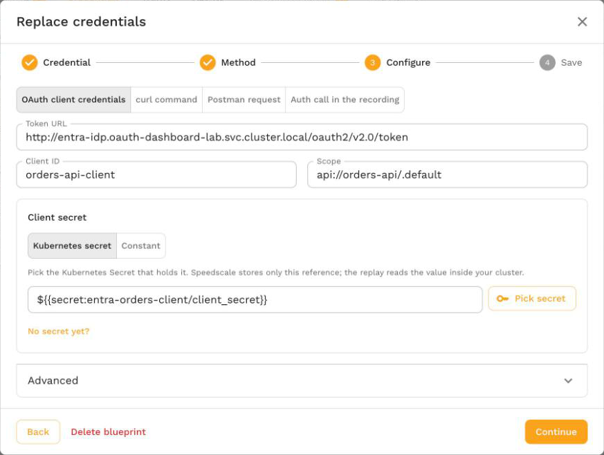

# token_fetch

The `token_fetch` transform replaces the extracted value, normally the recorded `Authorization` header, with a token it requests itself during the replay. It sends either an OAuth 2.0 client credentials request or a token request you describe (method, URL, headers and body), reads the token from the response, and caches it for every vUser in the generator until shortly before it expires.

The generator sends the token request straight to the token URL. The identity provider does not have to appear in the recorded traffic, and it is never mocked or retargeted to the service under test.

[Replace credentials](/guides/replay/replace-credentials.md) builds this transform for you from the dashboard or proxymock web, for its **OAuth client credentials**, **curl command** and **Postman request** sources. Write it by hand when you edit transforms directly or keep blueprints in a proxymock workspace.

- **Transform type name (config/API):** `token_fetch`. [`oauth_client_credentials`](./oauth_client_credentials.md) is the same transform with `grant` set to `client_credentials`, kept so existing chains keep working.
- **Side:** request side, in generator chains.
- **Requires:** Speedscale v2.5.1198 or later, including the operator in the replay cluster, so the generator it starts includes the transform. [Chained requests](#chain-token-requests), `clientAssertion` and `tokenPath: "@body"` require v2.5.1322 or later.

## From the dashboard

You rarely need to write this transform by hand. Open the snapshot's **Credentials** tab, select **Replace credentials** on the credential, choose **Fetch a fresh token**, and pick **OAuth client credentials**, **curl command** or **Postman request**. Speedscale saves a credential blueprint with a `token_fetch` chain and adds it to every replay of matching traffic. The [Replace credentials guide](/guides/replay/replace-credentials.md#fetch-a-fresh-token) walks through each field.



## Write it by hand

To add the chain yourself, in the transform editor or a proxymock blueprint, request a token with the client credentials grant and send it as the `Authorization` header. The client secret comes from the Kubernetes Secret `orders-client` in the replay namespace:

```json
{
  "extractor": { "type": "http_req_header", "config": { "name": "Authorization" } },
  "transforms": [
    {
      "type": "token_fetch",
      "config": {
        "grant": "client_credentials",
        "tokenUrl": "https://login.microsoftonline.com/<tenant-id>/oauth2/v2.0/token",
        "clientId": "<client-id>",
        "clientSecret": "${{secret:orders-client/client_secret}}",
        "scope": "api://orders-api/.default"
      }
    }
  ]
}
```

Send your own login request instead, with the password read from a secret:

```json
{
  "extractor": { "type": "http_req_header", "config": { "name": "Authorization" } },
  "transforms": [
    {
      "type": "token_fetch",
      "config": {
        "grant": "request",
        "method": "POST",
        "url": "https://auth.example.com/api/login",
        "headers": "{\"Content-Type\":\"application/json\"}",
        "body": "{\"user\":\"svc-replay\",\"password\":\"${{secret:login/password}}\"}",
        "tokenPath": "data.token"
      }
    }
  ]
}
```

A recorded `Authorization: Bearer eyJ...` header goes out as `Authorization: Bearer <fresh token>`.

## Chain token requests

Some token requests need a token from an earlier request. A cloud workload identity exchange is the common case: the generator gets an ID token from its cloud's metadata server, then presents it to another identity provider as a client assertion. List each earlier request under `fetches`, and reference its token with `${{fetch:name}}`.

In this chain, a generator with a GKE workload identity exchanges its Google service account's ID token for a Microsoft Entra ID access token:

```json
{
  "extractor": { "type": "http_req_header", "config": { "name": "Authorization" } },
  "transforms": [
    {
      "type": "token_fetch",
      "config": {
        "grant": "client_credentials",
        "tokenUrl": "https://login.microsoftonline.com/<tenant-id>/oauth2/v2.0/token",
        "clientId": "<client-id>",
        "scope": "api://orders-api/.default",
        "clientAssertion": "${{fetch:google}}",
        "fetches": "{\"google\":{\"grant\":\"request\",\"method\":\"GET\",\"url\":\"http://metadata.google.internal/computeMetadata/v1/instance/service-accounts/default/identity?audience=api://AzureADTokenExchange\",\"headers\":{\"Metadata-Flavor\":\"Google\"},\"tokenPath\":\"@body\"}}"
      }
    }
  ]
}
```

Transform config values are strings, so `fetches` is a JSON object written as a string, like `headers`. Decoded, the `fetches` value above is:

```json
{
  "google": {
    "grant": "request",
    "method": "GET",
    "url": "http://metadata.google.internal/computeMetadata/v1/instance/service-accounts/default/identity?audience=api://AzureADTokenExchange",
    "headers": { "Metadata-Flavor": "Google" },
    "tokenPath": "@body"
  }
}
```

1. The `google` fetch asks the GKE metadata server for an ID token with the audience Entra ID expects. The server answers with the bare token, so `tokenPath` is `@body`.
2. The outer request sends that token to Entra ID as `client_assertion`, with `client_assertion_type` set to `urn:ietf:params:oauth:client-assertion-type:jwt-bearer`.
3. The Entra ID access token replaces the recorded `Authorization` header.

For this to work, the generator must run as a Kubernetes service account bound to the Google service account. See [Run the generator as your own service account](/guides/replay/generator-service-account.md). The Entra ID app registration also needs a federated credential with issuer `https://accounts.google.com`, the Google service account's unique ID as the subject, and the audience `api://AzureADTokenExchange`. See [Microsoft's workload identity federation guide](https://learn.microsoft.com/en-us/entra/workload-id/workload-identity-federation-create-trust).

Rules for `fetches`:

- Each entry takes the same fields as `token_fetch`, except `fetches`. Chains are one level deep, so a nested fetch cannot reference another.
- With `grant: request`, references can appear in `url`, `headers` and `body`. With `grant: client_credentials`, they can appear in `clientAssertion`.
- Every reference must name an entry, and every entry must be referenced.
- A nested token replaces its reference without the nested fetch's `prefix`.
- Each nested fetch is cached on its own. A response read with `@body` has no lifetime, so the nested token is reused for its `ttl`, 5 minutes by default.

[Replace credentials](/guides/replay/replace-credentials.md) does not build chains with `fetches`. Add them in the transform editor.

## How It Works

1. **Skip values that do not need a token.** An empty value is returned unchanged, so a request recorded without the header goes out without one and sends no token request. When `prefix` is set (`Bearer ` by default), a value that does not start with it, compared without regard to case, keeps its recorded value. A `Basic` header on the same host is left alone.
2. **Resolve secrets.** For `client_credentials`, `clientId` and `clientSecret` or `clientAssertion` are used as written, or read from a secret when the whole value is a `${{secret:name/key}}` reference. For `request`, every `${{secret:name/key}}` reference in the URL, headers and body is replaced with the secret's value. See [Secrets](#secrets).
3. **Reuse a cached token.** Tokens are cached per token request and shared by every vUser and chain in the generator. See [Caching and Refresh](#caching-and-refresh).
4. **Resolve fetches.** On a cache miss, each entry in `fetches` gets its token from its own cache or its own request, and the token replaces every `${{fetch:name}}` reference to it. See [Chain token requests](#chain-token-requests).
5. **Request a token.** `client_credentials` sends `POST <tokenUrl>` with a form body of `grant_type=client_credentials`, `client_id`, `client_secret` and, when set, `scope`. With `clientAssertion`, the form carries `client_assertion_type` and `client_assertion` instead of `client_secret`. `request` sends the configured method, URL, headers and body as they are. When the body is set and no `Content-Type` header is given, it is sent as JSON when the body is valid JSON and as `application/x-www-form-urlencoded` otherwise.
6. **Read the token.** The token is read at `tokenPath` (default `access_token`) from a JSON response, from a response header when `tokenPath` is `header:<name>`, or from the whole response body, with surrounding whitespace trimmed, when `tokenPath` is `@body`. `expiresInPath` (default `expires_in`), when present in a JSON response, sets the token's lifetime.
7. **Replace the value.** The extracted value becomes `prefix + token`.

In analysis mode the transform returns the recorded value unchanged and never sends a token request, so analyzing a snapshot does not reach your identity provider.

## Configuration

| Parameter | Required | Default | Description |
|---|---|---|---|
| `grant` | No | `client_credentials` when `tokenUrl` is set, `request` when only `url` is set | `client_credentials` or `request`. |
| `tokenUrl` | For `client_credentials` | none | The token endpoint. An absolute `http` or `https` URL. |
| `clientId` | For `client_credentials` | none | The OAuth client ID, as a literal or a `${{secret:name/key}}` reference. |
| `clientSecret` | For `client_credentials`, unless `clientAssertion` is set | none | The OAuth client secret, as a literal or a `${{secret:name/key}}` reference. |
| `clientAssertion` | For `client_credentials`, unless `clientSecret` is set | none | A client assertion sent in place of the client secret, as a literal, a `${{secret:name/key}}` reference or a `${{fetch:name}}` reference. Set `clientSecret` or `clientAssertion`, not both. |
| `clientAssertionType` | No | `urn:ietf:params:oauth:client-assertion-type:jwt-bearer` | Sent as `client_assertion_type` with `clientAssertion`. |
| `scope` | No | not sent | Sent as the `scope` form field as written. Separate several scopes with spaces. |
| `url` | For `request` | none | The token request URL. An absolute `http` or `https` URL. |
| `method` | No | `POST` | The token request method. |
| `headers` | No | none | A JSON object of header names to values, as a string, for example `{"X-Api-Key":"${{secret:auth/key}}"}`. |
| `body` | No | none | The token request body. |
| `tokenPath` | No | `access_token` | JSON path of the token in the response, for example `data.token`, `header:<name>` to read a response header, or `@body` to use the whole response body. |
| `expiresInPath` | No | `expires_in` | JSON path of the token's lifetime in seconds. |
| `ttl` | No | `5m` | How long to reuse a token whose response has no lifetime, as a duration such as `10m`. |
| `prefix` | No | `Bearer ` | Written before the token. When set, only values that already start with it are replaced. Set it to an empty string to replace every non-empty value with the bare token. |
| `name` | No | none | A label for people reading the config. It is never sent. |
| `fetches` | No | none | Earlier token requests whose tokens this one references with `${{fetch:name}}`, as a JSON object of names to `token_fetch` configs, written as a string. See [Chain token requests](#chain-token-requests). |

Chain initialization fails with a message such as `tokenUrl is required`, `url is required`, `clientSecret or clientAssertion is required`, `set clientSecret or clientAssertion, not both`, `headers must be a JSON object of header names to values` or `ttl must be a positive duration such as 10m` when a field is missing or invalid. A `fetches` mistake fails with a message such as `${{fetch:google}} names no entry in fetches`, `fetches.google is not referenced by url, headers, body or clientAssertion` or `fetches.google: a nested fetch cannot have fetches of its own`.

## Caching and Refresh

- **One token per token request.** The cache key covers the grant, method, URL, headers, body, token path, lifetime path and `fetches` configs, after secrets are resolved and before fetch references are. A refreshed nested token does not start a new cache entry. Every vUser and chain in a generator that sends the same request shares one token. Each generator replica keeps its own cache.
- **Refresh before expiry.** A token is refreshed 60 seconds before it expires, or at half its lifetime if that is shorter.
- **Default lifetime.** With no lifetime in the response, a token is reused for `ttl`, 5 minutes by default.
- **Failure backoff.** A failed token request is remembered for 10 seconds. Requests in that window keep their recorded value without another token request, then the next request retries.
- **Timeouts and limits.** Each token request times out after 15 seconds. The response body is read up to 1 MiB.

When the transform cannot get a token, the request keeps its recorded value and the transform reports an error, so the service under test usually answers with a 401.

## Errors

Errors name the token URL without its query string or user information, the HTTP status, and the provider's OAuth `error` and `error_description` when the response has them. They never include a secret or a token, including a fetched token. Client credentials errors start with `oauth token`, and request errors with `token`. A failed nested request is prefixed with `fetch "<name>":`. For example:

```
token endpoint https://auth.example.com/api/login returned HTTP 401 (invalid_credentials); check the request, its secrets and the URL
```

Each affected request carries an error event that starts with `transform chain failed:`. A blueprint's errors also appear on the replay report's **Credentials in this replay** card. The [oauth_client_credentials errors table](./oauth_client_credentials.md#errors) lists the common causes and fixes, which apply to both grants.

## Secrets

| Where the replay runs | Where `${{secret:name/key}}` is read from |
|---|---|
| In a Kubernetes cluster | Key `key` of the Kubernetes Secret `name` in the replay namespace. The operator mounts the Secret into the generator pod; if it does not exist, the pod cannot start and Kubernetes reports a `FailedMount` event. |
| proxymock on your machine | The file `<workspace>/proxymock/secrets/<name>/<key>`. See [proxymock Secrets](/proxymock/guides/secrets.md). |

Trailing line endings in a secret value are removed. Secret values are read at replay time and never stored in the snapshot, the transform config or the report.

Apart from `${{fetch:name}}`, `token_fetch` does not expand other `${{...}}` keywords such as `${{env_var:...}}` or variable-cache values: they are sent as written. Use [`constant`](./constant.md) when the token itself should come from an environment variable or an earlier chain.

## When to Use It

| Situation | Use |
|---|---|
| Your service accepts tokens you can request from an identity provider or login endpoint | `token_fetch` |
| You hold the key that signs the tokens your service accepts, and want to keep the recorded claims | [`jwt_resign`](./jwt_resign.md) |
| You have a long-lived token that stays valid for the whole replay | [`constant`](./constant.md) |
| The recording contains the login, served by the service under test, and later requests should use the token the replayed login returns | [`smart_replace_recorded`](./smart_replace_recorded.md) |
| The request is signed with AWS SigV4 | [`aws_auth`](./aws_auth.md) |

## Related

- [Replace credentials](/guides/replay/replace-credentials.md): save a blueprint that adds this transform to every replay of matching traffic.
- [`oauth_client_credentials`](./oauth_client_credentials.md): the client credentials form of this transform, with worked Microsoft Entra ID examples.
- [`http_req_header`](../extractors/http_req_header.md): the extractor normally paired with this transform.
