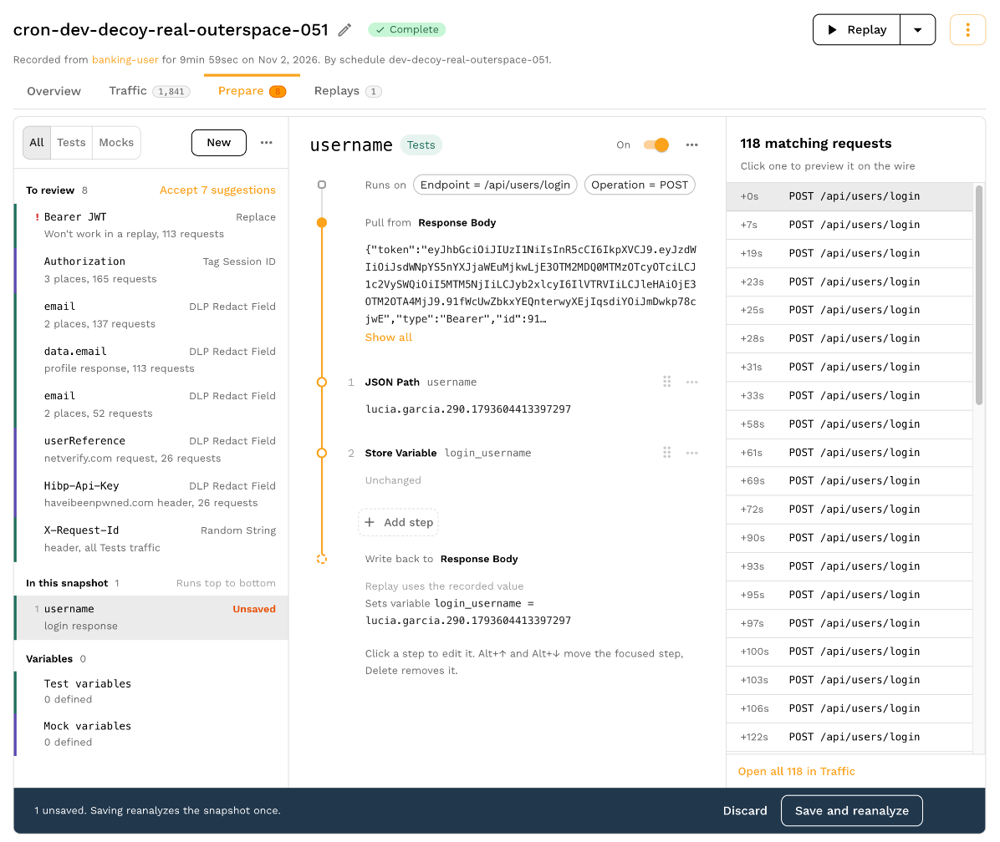
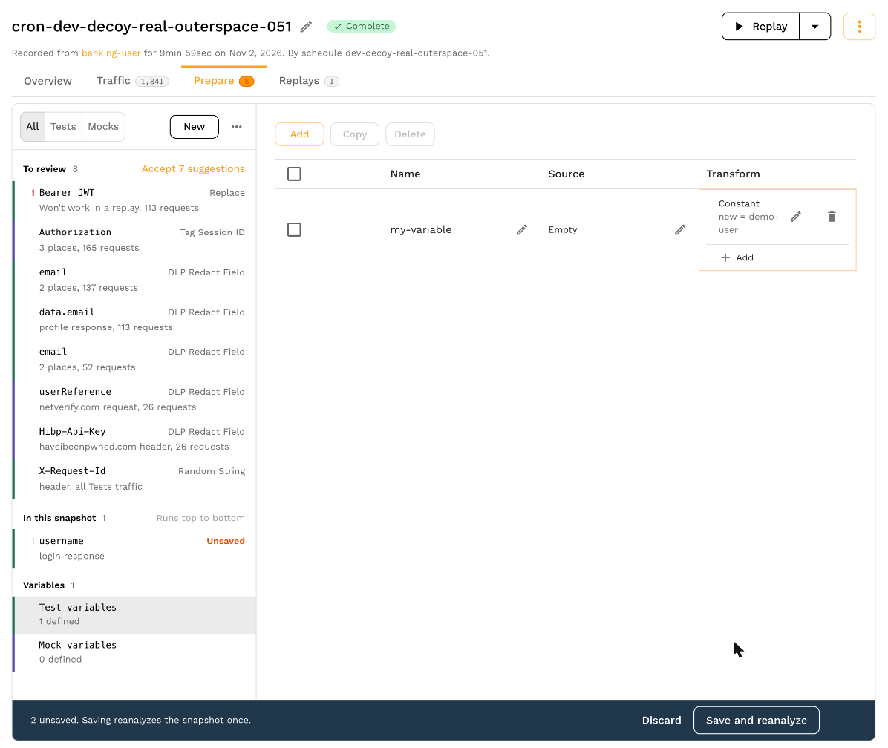
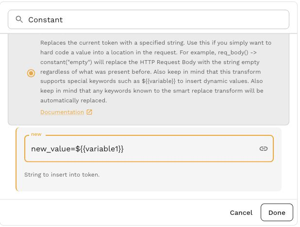
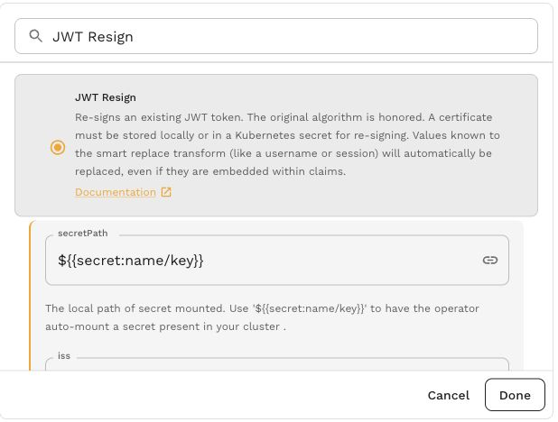
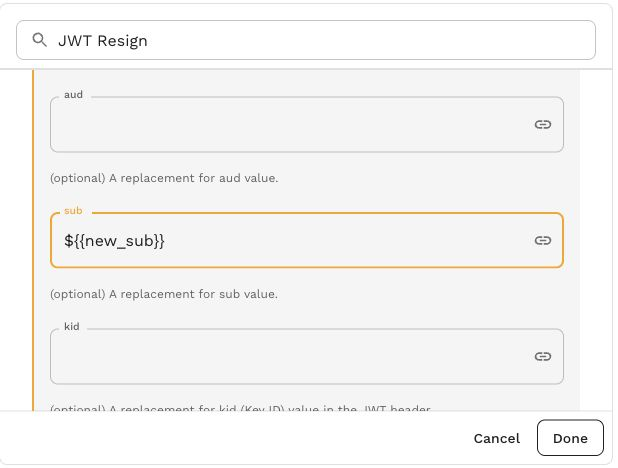

import JwtSecretReferenceImage from '../../concepts/transforms/jwt-secret-reference.jpg';
import JwtEmbeddedSubjectImage from '../../concepts/transforms/jwt-embedded-subject.jpg';

import ConstantEmbeddedImage from '../../concepts/transforms/constant-embedded.jpg';

# Variables

Variables allow you to store a piece of data persistently across requests. Variables are stored using a key and value and can be loaded at any time.

## Variables

Transform variables provide a way to share data between requests.  For example, you may want to store an ID from the response body of one request and use it in the URL of another.

Variables can be thought of as a map of key=value pairs. Once set, they can be retrieved and modified using a set of transforms including:

- **[var_store](/guides/transformation/transforms/variable_store)** - Assign a new value to a variable
- **[var_load](/guides/transformation/transforms/variable_load)** - Replace current value with the value of a variable

This is the simplest way to interact with the variable storage system, but not necessarily the most powerful. Keep in mind that [smart replace](/guides/transformation/transforms/smart_replace/) transforms are independent of the variable cache and changes made in one will not be reflected in the other. Variables are for custom use cases. Smart replace is for more automated use cases and is a better starting place for most users.

### Scope

Variables for Tests on the Prepare tab are scoped to the current [vUser](/reference/glossary.md#vuser) or "thread" within the load generator, which runs through the snapshot traffic at most 1 time. Each vUser has a separate variable cache, just like HTTP clients talking to the same server don't share information.

If you need more of a "global replace" functionality you should use variables from **Test variables** or **Mock variables** on the Prepare tab.  Transforms created here are run once at the start of each vUser.

### Embedded

Embed a variable in transform configuration with `${{variable1}}`. For example, a [Constant](/guides/transformation/transforms/constant.md) value of `new_value=${{variable1}}` substitutes the stored value while keeping the `new_value=` prefix.

<a href={ConstantEmbeddedImage}>Open screenshot full size</a>

The same syntax works in configuration fields for [JWT Resign](/guides/transformation/transforms/jwt_resign.md). Keep the placeholder in the field whose value should be supplied from a variable.

These two views of the JWT Resign form show a secret reference in `secretPath` and a variable in `sub`. The values are configuration placeholders.

<a href={JwtSecretReferenceImage}>Open screenshot full size</a>

<a href={JwtEmbeddedSubjectImage}>Open screenshot full size</a>

Embedded values also support environment variables, random strings, files, [user data](/reference/glossary.md#user-data), dataframe lookups and secrets. See [Embedded Syntax](/guides/transformation/embedded-syntax.md) for the complete reference.
