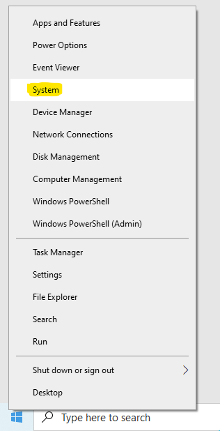
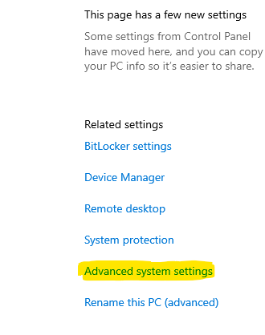
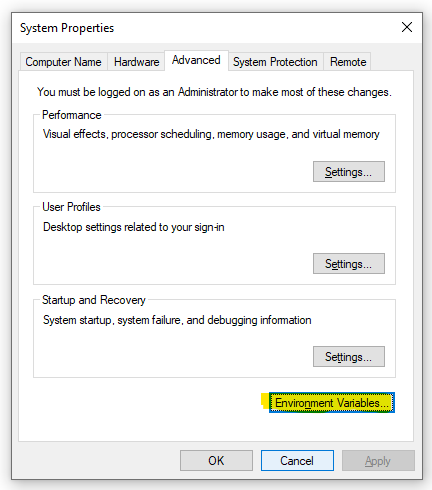
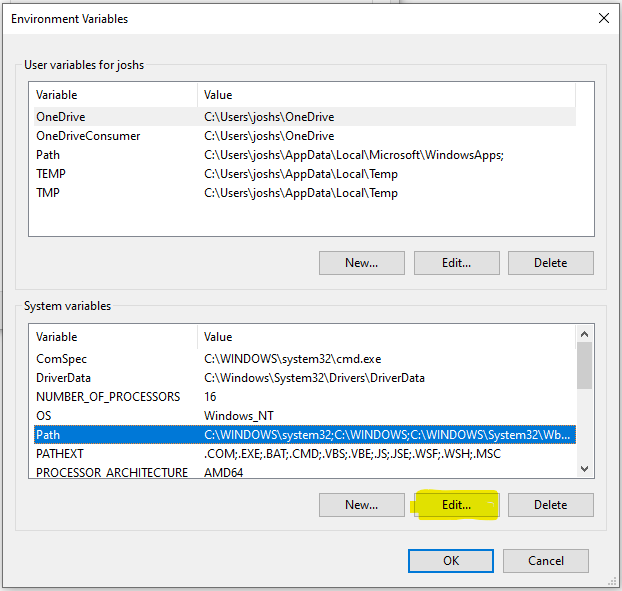
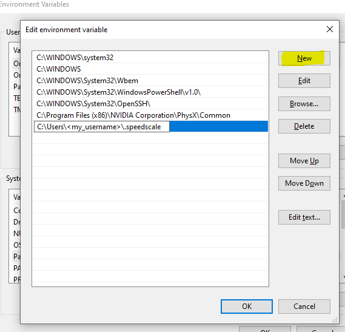

import WindowsWarning from './_windows_warning.mdx'

<WindowsWarning />

Open PowerShell, create a Speedscale directory and download **proxymock** into it:

```powershell
mkdir -Force $env:USERPROFILE\.speedscale
curl.exe -L "https://downloads.speedscale.com/proxymock/proxymock.exe" -o $env:USERPROFILE\.speedscale\proxymock.exe
```

Add the directory to your user Path so you can run `proxymock` from any folder. This does not need administrator rights.

```powershell
$dir = "$env:USERPROFILE\.speedscale"
$userPath = [Environment]::GetEnvironmentVariable("Path", "User")
if (($userPath -split ';') -notcontains $dir) {
  [Environment]::SetEnvironmentVariable("Path", (($userPath.TrimEnd(';') + ";$dir").TrimStart(';')), "User")
}
```

Restart PowerShell, then run `proxymock --help` to confirm it is on your Path.

<details>
<summary>Prefer the Settings window?</summary>

Right click the Windows button and click **System**.



Click **Advanced system settings**.



Click **Environment Variables**.



Select **Path** and click **Edit**. Choose it under user variables for your account only, or under **System variables** for every user, which needs administrator rights.



Click **New** and enter the Speedscale directory. Run `echo $env:USERPROFILE\.speedscale` in PowerShell if you are unsure of the exact path.



Click **OK** and restart PowerShell.

</details>

:::note HTTPS traffic on Windows
Clients that use the Windows certificate store, such as .NET, need the proxymock CA in that store before recording or mocking HTTPS traffic. Follow the [Windows certificate store](/proxymock/getting-started/language-reference#windows-tls-trust) steps.
:::
