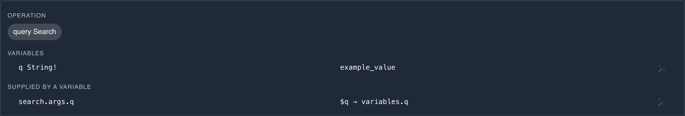

# Generate tests and mocks from a schema

When a GraphQL service has a schema but no recording yet, `proxymock generate` turns the schema into requests. Each root query and mutation field becomes one named operation, with variables for its required arguments and a response that matches what it selects. Generated as inbound tests, they drive your server for a first recording. Generated as outbound mocks, they stand in for a GraphQL API your app calls before you can record it.

## Run it

```bash
proxymock generate --direction both --out proxymock/generated schema.graphql
```

The schema can come from three places, and proxymock tells them apart on its own:

| Source | Example |
|---|---|
| SDL, in a `.graphql`, `.graphqls` or `.gql` file | `schema.graphql` |
| An introspection result saved as JSON, with or without the `data` wrapper | `introspection.json` |
| The URL of a running endpoint, which proxymock introspects | `http://localhost:8080/graphql` |

SDL is read without validation, so a schema that uses directives or types defined elsewhere, such as Apollo Federation's `@key`, still loads.

Run against the [graphql-demo](https://github.com/speedscale/demo/tree/master/graphql-demo) server, which has four queries and two mutations, generation ends with:

```
Total Endpoints Processed: 6
Total RRPairs Generated: 12
...
PLACEHOLDERS: 2 of 6 inbound test(s) still send generated placeholders ("example_value" or ${{param:...}}).
Generated inbound tests are drivers, not a baseline: replace the placeholders with real values
before replaying them at a real implementation or recording them through proxymock record.
  - proxymock/generated/localhost/query_search_200_inbound.md
  - proxymock/generated/localhost/mutation_trackEvent_200_inbound.md
```

Each operation is written once per direction, named after its operation type and field:

```
proxymock/generated/localhost/
├── mutation_createUser_200.md
├── mutation_createUser_200_inbound.md
├── query_plans_200.md
├── query_plans_200_inbound.md
└── ...
```

Files ending in `_inbound.md` are tests for `proxymock replay`. The others are mocks for `proxymock mock`.

## What each operation holds

For the demo's `createUser` mutation, the generated request is:

```graphql
mutation CreateUser($input: CreateUserInput!) {
  createUser(input: $input) {
    email
    id
    plan
    tags
  }
}
```

with variables `{"input": {"email": "user@example.com"}}`, and the generated response is:

```json
{"data": {"createUser": {"email": "user@example.com", "id": "12345", "plan": "example_value", "tags": ["example_value", "example_value"]}}}
```

The operation is named after the field, with its first letter capitalized. The request is a `POST` with a JSON body, the same shape a recording holds, so `proxymock mock` and `proxymock replay` treat generated and recorded files alike.

**The selection** takes every scalar and enum field of the returned type that needs no argument, plus the same for object fields one level down. Fields that need an argument are left out, and a type is not expanded again inside itself. A union or interface selects `__typename` and an inline fragment for each type it can be. `--include-optional` goes three levels down.

**The variables** cover the field's required arguments. `--include-optional` adds its optional arguments too, each set to its schema default when it has one. Input objects get their required fields, or all their fields with `--include-optional`, and lists get two items.

**The values** follow the same rules as [generating from OpenAPI](../guides/openapi.md):

| Type | Value |
|---|---|
| Enum | Its first member |
| `Int` and `Float` | `50` and `50.5` |
| `Boolean` | `true` |
| `String` and `ID` | A value that fits the field's name, such as `12345` for `id`, `user@example.com` for `email`, or `Example Name` for `name`, else `example_value` |
| A custom scalar | A value that fits the scalar's name, such as a date for `DateTime`, else one that fits the field's name |

A response list has two identical items, and a union or interface returns its first possible type, alphabetically.

## Choose what to generate

| Flag | For GraphQL |
|---|---|
| `--direction` | `outbound` (default) writes mocks, `inbound` writes tests, `both` writes both. |
| `--out` | Output directory. Files go into a subdirectory named after the host. Defaults to `proxymock/generated-<timestamp>`. |
| `--host`, `--port` | Where generated requests go. Default to the host and port of a schema URL, else `localhost` on port 80. |
| `--path` | The endpoint path. Defaults to the path of a schema URL, else `/graphql`. |
| `--include-paths`, `--exclude-paths` | Comma-separated patterns over operations, such as `query.*`, `mutation.createUser` or `mutation.delete*`. A pattern without a dot matches the field name under either root, so `user*` matches `query.users` and `mutation.userCreate`. |
| `--include-optional` | Adds optional arguments and input fields, and selects three levels deep instead of one. |
| `--examples-only` | Skips operations whose required arguments would need synthesized values, since a schema carries no examples. |
| `--tag-filter` | Rejected: a schema has no tags. Use `--include-paths` instead. |

A path other than one ending in `/graphql` works for mocks and tests, but proxymock then treats the requests as plain JSON over HTTP rather than reading them as operations. See [How proxymock recognizes GraphQL](./index.md#how-proxymock-recognizes-graphql).

Subscriptions are not generated. The run lists them, with operations `--examples-only` skipped, under `SKIPPED:`:

```
SKIPPED: 1 operation(s) were not generated:
  - subscription.bookAdded (subscriptions are not generated)
```

## Turn generated tests into a recording

Generated values make a request valid, not meaningful. The `PLACEHOLDERS:` list names the tests that still send `example_value`, and proxymock web shows where each one sits. Run `proxymock web` in the workspace and pick the `generated` run. This is its `search` test, on **Request → Body**:



Beyond those, a value your server checks needs a real one: a token it verifies, an id that must exist, a string it parses. In the demo, `trackEvent` takes a JSON document as a string and `session` takes a signed JWT, so both answer with GraphQL errors until you rewrite them.

Rewrite each test with values from your code, seed data or fixtures, or delete it. Then send the tests through `proxymock record` so the recording holds your server's real responses, and use that recording as the baseline for [replay](./replay.md). From an AI coding assistant, the proxymock MCP server's `generate` tool takes the same schema sources, and the [quality-loop skill](../agent-skills.md) walks a service with no recording through these steps.

## Mock an API before you can record it

Outbound files are mocks of the schema's API. Serve them and point your app at the mock:

```bash
proxymock generate --out proxymock/generated schema.graphql
proxymock mock --in proxymock/generated -- ./your-app
```

A generated mock answers the generated operation exactly. A client that sends a different selection or different variables gets no match, so edit the generated request to the document your client sends, or record the client against the real API as soon as you can. See [Mock a GraphQL API](./mock-graphql.md).
