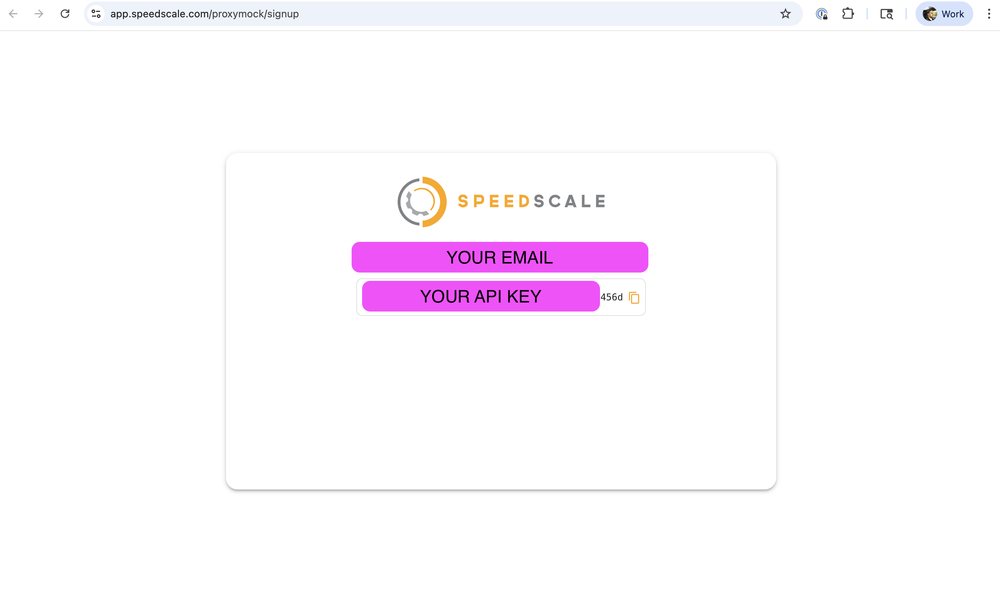

import Tabs from '@theme/Tabs';
import TabItem from '@theme/TabItem';
import ProxymockLanguageLinks from '@site/src/components/ProxymockLanguageLinks';

# Initialize API Key

Before initializing, check whether you can [reuse an existing speedctl configuration](/getting-started/command-line-tools/#credentials). Both clients must select the same configuration file and account context. If that configuration already has access to your tenant, skip initialization.

For a new local setup, run the following command and use the browser sign-in flow:

```bash
proxymock init
```

Run `proxymock version --client` to see which configuration file your installed version uses. To access a tenant's cloud snapshots, follow [enterprise account setup](#enterprise-account), including the replacement steps if you already activated proxymock with another account.

Speedscale does not share or sell your email address, although we might send you updates or announcements if we can ever figure out this marketing thing. Engineering is more our wheelhouse.

### Getting an API Key

<Tabs>
  <TabItem value="New User">
[Sign up for an API key](https://app.speedscale.com/proxymock/signup). For local workstation setup, it is usually faster to run `proxymock init` and complete the browser flow. If you need a manual or headless setup, copy your key from the page (see below) and run `proxymock init --api-key <your key>`.


  </TabItem>

  <TabItem value="Existing Enterprise Customer">
Get your personal API key from your [Profile page](https://app.speedscale.com/profile) (API Key section). Follow [enterprise account setup](#enterprise-account) below. If your current configuration uses another account, follow the [replacement steps](#replace-credentials).
  </TabItem>
</Tabs>

## Use your enterprise account {#enterprise-account}

Use an account with access to the tenant that owns the snapshot. Free local activation alone does not grant that access. If an existing configuration already includes the right tenant's account context, select it with `--context <name>` when running your commands; replacement is unnecessary.

The initialization examples below use the default configuration in `~/.speedscale`. For a custom directory or filename, pass both `--home <directory>` and `--config <path>` to `init` so it writes to the intended file.

For a fresh installation with no configuration file, run `proxymock init` and sign in with your enterprise account. For API-key setup, get your personal key from the [Profile page](https://app.speedscale.com/profile) and replace `YOUR_ENTERPRISE_API_KEY` below:

```bash
proxymock init --api-key "YOUR_ENTERPRISE_API_KEY"
```

### Replace an existing configuration {#replace-credentials}

If you already activated proxymock locally or configured another account, `proxymock init --api-key` keeps the existing configuration unless you also pass `--overwrite`. A message saying the file already exists and the download was skipped means the credentials were not replaced.

Replacement backs up and replaces the entire selected configuration file, including its saved contexts. Both CLIs using that file will use the replacement configuration. Check the file path with `proxymock version --client` before proceeding, and keep the backup path printed by initialization.

On an interactive workstation, run `proxymock init`. Choose browser sign-in with your enterprise account and accept the prompt to back up and overwrite the configuration. For API-key or headless replacement, use:

```bash
proxymock init --overwrite --api-key "YOUR_ENTERPRISE_API_KEY"
```

After initialization succeeds, return to [pulling your cloud snapshot](./cloud-snapshot-local.md#pull). Keep using the same configuration file and account context for the pull, mock, and replay commands.

## CI and other non interactive modes

If you're trying to initialize **proxymock** without any prompts, specify the API key on the command line:

```bash
proxymock init --api-key <Your API Key>
```

This command initializes a fresh environment. To change credentials in an environment that already has a configuration file, follow [Replace an existing configuration](#replace-credentials).

After initialization, start with the [proxymock CLI quickstart](/proxymock/getting-started/quickstart/quickstart-cli/), or [replay an existing cloud snapshot locally](./cloud-snapshot-local.md). Use the [agent tutorial](/proxymock/agent-tutorial/) if you prefer agent prompts. For language-specific setup, use the examples below:

<ProxymockLanguageLinks className="space-y-1 mt-3" />

:::warning
- Non-interactive mode (like as part of a CI pipeline) requires proxymock Pro or Speedscale Enterprise.
:::

## Troubleshooting for Enterprise Customers

Does your organization already have a Speedscale tenant? If so, you can skip ahead to [Automatic Tenant Assignment](#automatic-tenant-assignment).

If you want to sign up for Speedscale Enterprise and your organization does not already have a Speedscale tenant, you can create one by visiting [Speedscale Enterprise](https://speedscale.com) and clicking "Free Trial".

### Automatic Tenant Assignment

For most tenants, you can automatically join the tenant doing **one** of the following:

1. Log into https://app.speedscale.com using your corporate email address. You will automatically be added to the tenant after some validation.
1. Dial a friend. Have your friend click the "Invite" button in the Speedscale UI and enter your email address. Check your email and sign in.

If you get stuck you can always reach us on [slack](https://slack.speedscale.com).

:::tip
Did you log into your tenant but it looks empty? This usually happens because your organization's email domain is not configured. Speedscale Support can fix this if you ping us on [slack](https://slack.speedscale.com) or at [support@speedscale.com](mailto:support@speedscale.com).
:::
