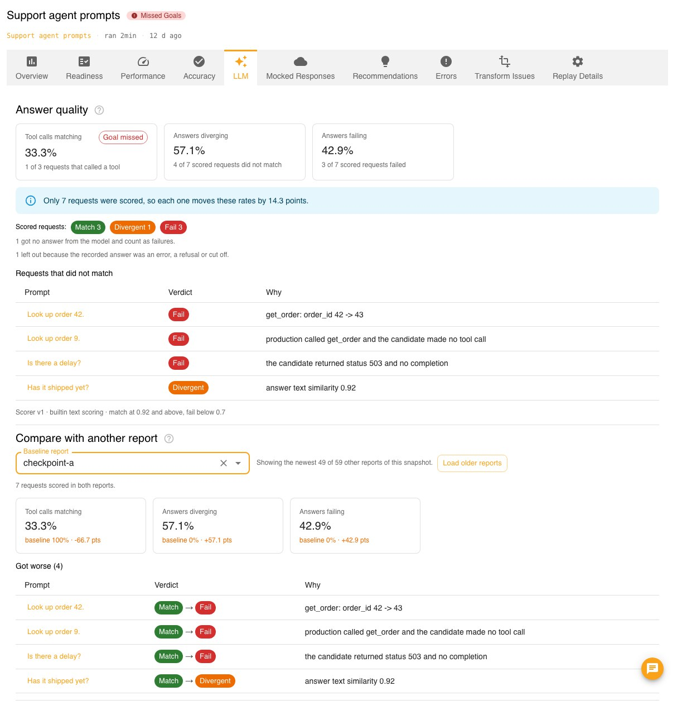
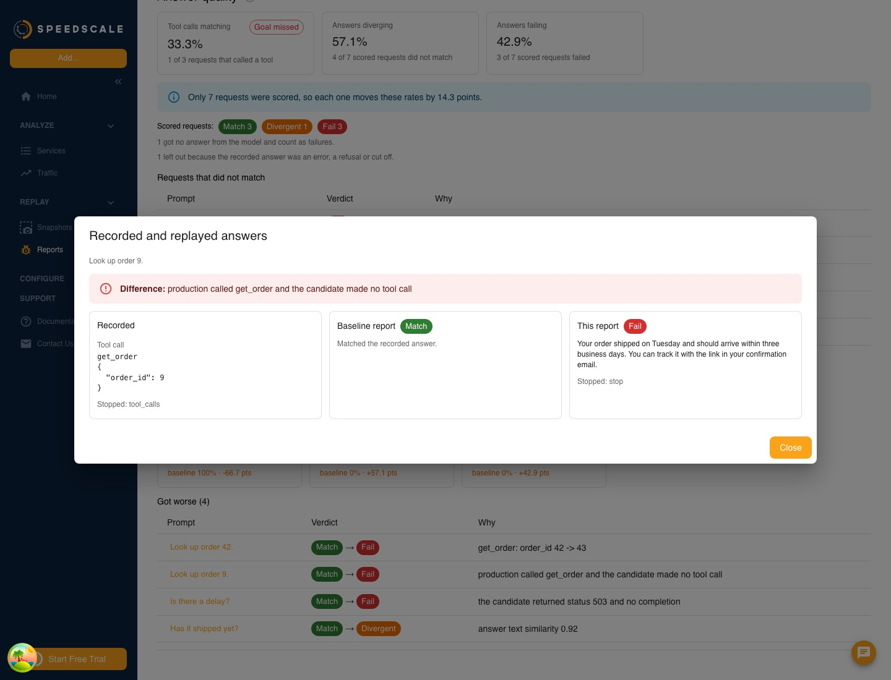

# Regression Test a Model Swap

Before you move an application to another model, a new checkpoint, or a new quantization, replay the prompts production already sent and check that the answers are still right. proxymock sends each recorded LLM request to the candidate model, compares its answer with the recorded one, and reports three rates that a CI job can gate on.

Answers are read from four API formats:

| Format | Requests scored | Served by |
| --- | --- | --- |
| OpenAI-compatible | Chat completions, text completions and the Responses API (`/v1/responses`) | OpenAI, Azure OpenAI, vLLM, NIM, TGI, and the `/v1` endpoints of Ollama and other servers |
| Anthropic Messages | `/v1/messages` | The Anthropic API and servers compatible with it |
| Ollama native | `/api/chat` and `/api/generate` | Ollama |
| Amazon Bedrock | `Converse` and `ConverseStream` for any model. `InvokeModel` and `InvokeModelWithResponseStream` for Anthropic, Amazon Titan text, Meta Llama, Mistral, and Cohere Command and Command R models | Amazon Bedrock |

Streamed and non-streamed responses are both scored in every format, and a streamed replay of a non-streamed recording compares correctly. The candidate must serve the same API format that was recorded. proxymock does not translate a request from one format to another.

In a Responses API answer, function calls are compared as tool calls and reasoning items are kept out of the answer text. In an `InvokeModel` answer, tool calls are compared for Anthropic, Mistral chat and Cohere Command R models, and the other model families are scored on their text.

By default, scoring runs in process and makes no network call. Two optional settings send response text to an endpoint you choose: an external embedding backend, and a judge for divergent pairs. [Compare Response Meaning](./semantic-comparison.md#choose-where-text-scoring-runs) explains both.

`proxymock replay` and `proxymock replay score` also run when Speedscale cannot be reached, for example inside a private network. They print one warning and continue. See [Run without a connection to Speedscale](../how-it-works/data_and_privacy.md#run-without-a-connection-to-speedscale) for what still needs the connection.

## Replay the recorded prompts at the candidate

Start from a recording of your application's LLM traffic, made with `proxymock record` or the Speedscale sidecar. The same replay also reports how fast the candidate answers: see [LLM Streaming Metrics](/guides/replay/llm-streaming-metrics.md).

In a recording of an application that calls a model, the LLM requests are outbound traffic. A replay sends inbound traffic by default and serves outbound calls as mocks, so select the LLM calls as tests with `--tests-filter`:

```shell
export CANDIDATE_API_KEY=your-candidate-key

proxymock replay \
  --in ./proxymock/recorded-example \
  --tests-filter '(networkaddr IS "api.openai.com:443")' \
  --test-against http://localhost:8000 \
  --llm-model checkpoint-b \
  --llm-api-key-env CANDIDATE_API_KEY \
  --fail-if 'llm.tool-call-match-pct < 100' \
  --fail-if 'llm.failure-pct > 5'
```

Use the address of the model API your application called. `(direction IS OUT)` selects every outbound call instead, which is enough when the model is the only dependency in the recording. Without a filter, a recording that holds only outbound calls has nothing to replay and the replay stops with an error. [Choose What a Replay Tests](./choose-replay-tests.md) has the filter syntax.

Leave out `--tests-filter` when you recorded in front of the model server itself, where the LLM requests are inbound.

| Flag | Effect |
| --- | --- |
| `--tests-filter` | Which recorded requests are sent to the candidate |
| `--test-against` | Address of the candidate model server |
| `--llm-model` | Model name sent in each recorded LLM request, in place of the recorded one |
| `--llm-api-key-env` | Name of the environment variable holding the candidate's API key, sent in place of the recorded credential |

Both overrides apply to `POST` requests in these formats. Everything else in each request is sent as recorded, including the conversation history. The sampling settings are sent as recorded too, unless you [pin them](#pin-the-sampling-settings).

| Requests | `--llm-model` replaces | `--llm-api-key-env` sends the key as |
| --- | --- | --- |
| OpenAI-compatible chat completions, text completions and Responses API (`/v1/responses`) | The model name in the request body | A Bearer token in the `Authorization` header |
| Anthropic Messages, recognized by the `anthropic-version` header | The model name in the request body | The `x-api-key` header when the recorded request has one, otherwise a Bearer token |
| Ollama native | The model name in the request body | A Bearer token in the `Authorization` header |
| Amazon Bedrock `Converse`, `ConverseStream`, `InvokeModel` and `InvokeModelWithResponseStream` | The model id or inference profile ARN in the request URL | An Amazon Bedrock API key, as a Bearer token in place of the recorded SigV4 signature |

### Amazon Bedrock requests

A Bedrock request names its model in the URL, and a SigV4 signature covers that URL. A request recorded with a SigV4 signature is pointed at another model only when `--llm-api-key-env` is also given. For Bedrock, the variable holds an Amazon Bedrock API key. A request recorded with an API key in place of a signature is pointed at the candidate by `--llm-model` alone.

```shell
export BEDROCK_API_KEY=your-bedrock-api-key

proxymock replay \
  --in ./proxymock/recorded-example \
  --tests-filter '(networkaddr IS "bedrock-runtime.us-east-1.amazonaws.com:443")' \
  --test-against https://bedrock-runtime.us-east-1.amazonaws.com \
  --llm-model <model-id-or-inference-profile-arn> \
  --llm-api-key-env BEDROCK_API_KEY
```

With `--llm-model` and no `--llm-api-key-env`, a signed Bedrock request is replayed at its recorded model. The replay then prints a warning that says how many Bedrock requests kept their recorded model, and `replay-verdict.json` holds the count as `summary.bedrockKeptRecordedModel`. The results of those requests describe the recorded model, so add `--llm-api-key-env` before you read them as the candidate's.

With `InvokeModel` and `InvokeModelWithResponseStream`, the request body belongs to the recorded model family. Choose a candidate of the same family, or record with `Converse`.

To replay with SigV4 credentials in place of an API key, change the model id in the URL with a [transform](/guides/transformation/overview.md) and sign the request again with [`aws_auth`](/guides/transformation/transforms/aws_auth.md).

### The candidate's key

The key replaces the credential the recorded request carried. Pass the name of the variable to `--llm-api-key-env`, never the key. proxymock stores the variable name in the run's snapshot and reads the key when it sends a request. The replay output records each request as it was sent, as a recording does.

Leave out `--llm-api-key-env` to send the recorded credential. Leave out `--llm-model` to send the recorded model name, for example when the candidate is a different server that serves the same model name.

An agent or a script can set the same overrides. The MCP `replay_traffic` tool takes `llm-model` and `llm-api-key-env`, and `POST /v1/replays/run` of the [REST API](./rest-api.md) takes `llmModel` and `llmApiKeyEnv`. `llmApiKeyEnv` names a variable in the REST server's environment, and the key itself is never sent.

## What is compared

Each recorded response and its replay are reduced to the answer itself: the text, the tool calls and the reason the model stopped. Response ids, timestamps and tool-call ids are ignored.

**Tool calls are compared structurally and decide the pair first.** The candidate must call the same functions the same number of times. Arguments are compared as parsed JSON:

- Keys, numbers, booleans and short strings must be equal.
- A string of four or more words is treated as prose and compared for meaning, so a reworded search query still matches.
- The order of calls within one response is ignored, and the number of reordered pairs is reported.

A tool-call mismatch fails the pair whatever its text says. That includes a tool call on one side and prose on the other, and arguments that are not valid JSON.

**Answer text is compared for meaning**, using the same scorer and thresholds as [semantic comparison](./semantic-comparison.md). Reasoning text is not scored. When a response offers several choices, only the first is scored.

Some self-hosted servers leave a model's thinking in the answer text, wrapped in tags such as `<think>`. Thinking differs between runs of a model that reaches the same answer, so a thinking block at the start of an answer is treated as reasoning and not scored. This covers `<think>`, `<thinking>`, `<reasoning>` and `[THINK]` blocks, and an answer that starts inside a block the chat template opened. You can also have the server separate the thinking itself, with vLLM's `--reasoning-parser` option or the `think` field of an Ollama request, which keeps it out of your application as well.

| Situation | How it is counted |
| --- | --- |
| The candidate returns an error or no completion | A failure |
| The candidate refuses a request production answered | A failure |
| The candidate's answer is cut short | Scored on what arrived, and counted as truncated |
| The recorded answer is an error, a refusal or cut off | Left out of every rate |

## Gate on the three rates

| `--fail-if` name | Meaning |
| --- | --- |
| `llm.tool-call-match-pct` | Of the pairs where either side called a tool, the percentage whose calls matched |
| `llm.divergence-pct` | Percentage of scored pairs that did not match, failures included |
| `llm.failure-pct` | Percentage of scored pairs that failed |

No gate on these rates applies by default. Scoring LLM responses does not fail a replay by itself: with no condition and no goal on these rates the replay prints `scored but not gated`, and its exit code comes from whatever other gates are in force.

A condition on a rate that has nothing to measure is an error, not a pass. For example, `llm.tool-call-match-pct` is not reported when no scored pair called a tool.

The rates are not reported with `--no-out`, `--load-test` or `--ignore-body-changes`, because those options do not keep or score response bodies.

### Gate with a test config goal

A goal in a [test config](./test-configs.md) gates on the same rates, under the metric names `llmToolCallMatchPct`, `llmDivergencePct` and `llmFailurePct`. `proxymock replay --test-config` evaluates such a goal from the same scoring `--fail-if` uses. A missed goal fails the run with exit code `1` and appears in the goals section of `replay-verdict.json`, as it does on a [cloud or cluster report](#score-a-cloud-or-cluster-replay).

A goal on one of these rates fails when nothing was scored for it. The goal is shown as `not scored` with the reason, for example:

- The replay had no LLM traffic.
- No scored answer called a tool, for a goal on `llmToolCallMatchPct`.
- The replay ran with `--load-test`, which keeps no responses to score.
- The goal is scoped to one location or method. The rates are measured for the whole run, so leave the goal's location and method empty.

The Replay tab of the proxymock web UI does not score LLM answers, so it reports these goals as not evaluated.

## Read the result

The replay prints each failed pair with its reason, then the rollup:

```text
LLM FAIL: POST /v1/chat/completions get_order: order_id 42 -> 43
LLM quality: 4 scored · tool calls 1/3 matched (33.3%) · divergence 75.0% · failures 50.0%
```

`replay-verdict.json` holds the detail:

- `summary.llm` has the counts behind each rate, the rates, how the run was scored (scorer version, thresholds, text scorer, judge and any [sampling pin](#pin-the-sampling-settings)), and the run's LLM speed metrics under `speed`.
- Each LLM pair has an `llm` object with its band (`match`, `divergent` or `fail`), the reason, and the tool-call comparison.
- Each LLM pair has an `llmPrompt`: up to 120 characters of the last user message, so you can tell one request from another.

A warning is printed when fewer than 30 pairs were scored, because each pair then moves a rate by several points.

The built-in text scorer compares wording, not meaning. When it bands an answer divergent or failed and no judge ran, the replay summary says how many answers that applies to. To compare meaning, set `llmEval.embedder` or `llmEval.judge` in the [test config](#keep-the-scoring-settings-in-the-test-config), or pass `--semantic` with `--semantic-embedder` or `--semantic-judge`.

## Compare two checkpoints

Replay the same recording at each model into its own directory, then score the candidate's run against the baseline's:

```shell
proxymock replay \
  --in ./proxymock/recorded-example \
  --test-against http://localhost:8000 \
  --llm-model checkpoint-a \
  --out ./proxymock/results/checkpoint-a

proxymock replay \
  --in ./proxymock/recorded-example \
  --test-against http://localhost:8001 \
  --llm-model checkpoint-b \
  --out ./proxymock/results/checkpoint-b

proxymock replay score ./proxymock/results/checkpoint-b \
  --baseline ./proxymock/results/checkpoint-a \
  --html llm-comparison.html
```

Use the same `--tests-filter` on both replays when the LLM calls were recorded as outbound.

Both runs are scored against the recorded answers, and every change is the candidate minus the baseline:

```text
LLM quality: 4 scored · tool calls 1/3 matched (33.3%) [-66.7 pts] · divergence 75.0% [+75.0 pts] · failures 50.0% [+50.0 pts]
             vs baseline: 4 request(s) compared, 3 got worse, 0 got better
             match -> fail  get_order: order_id 42 -> 43  ("Where is order 42?")
             match -> divergent  answer text similarity 0.92  ("Has my package shipped yet?")
             llm.ttft-p95 212.00 -> 240.00 (+13.2%)
```

- The three rates show their change in percentage points.
- The requests whose verdict got worse are listed worst first, each with the reason and the start of its prompt.
- The headline speed metrics show their change. [LLM Streaming Metrics](/guides/replay/llm-streaming-metrics.md) defines them.

`-o json` puts the full comparison under `deltas.llm`, including `regressed`, `improved` and every speed metric. `--html` writes the same comparison as one self-contained HTML page with no scripts and no external requests, so it opens from disk on a machine with no network.

proxymock refuses to compare two runs that were scored differently, and names the setting that differs, for example a different `--semantic-pass` threshold, text scorer, judge or [sampling pin](#pin-the-sampling-settings). The scorer version is 3. Two runs or reports scored with different scorer versions are refused as well, so score both runs with the same release, and reanalyze a report to rescore it. It also refuses two runs that share no recorded request. A difference between such runs would describe the scoring or the recordings, not the models. Rerun one replay with the other's settings.

## Measure the noise first

By default, requests are replayed with their recorded sampling settings, so a model can answer the same prompt differently on two runs. Before you judge a candidate, measure how much the current model disagrees with itself. Replay the recording twice at the model that produced it, then score the second run against the first:

```shell
proxymock replay \
  --in ./proxymock/recorded-example \
  --test-against http://localhost:8000 \
  --out ./proxymock/results/noise-1

proxymock replay \
  --in ./proxymock/recorded-example \
  --test-against http://localhost:8000 \
  --out ./proxymock/results/noise-2

proxymock replay score ./proxymock/results/noise-2 \
  --baseline ./proxymock/results/noise-1
```

Use the same `--tests-filter` on both replays when the LLM calls were recorded as outbound, as in [the first replay](#replay-the-recorded-prompts-at-the-candidate). Without it, neither replay sends the LLM requests.

The three rates of either run are the noise floor: what the gate reports when nothing changed. The comparison lists the requests whose verdict differs between the two runs. Those prompts are unstable for this model, so a change on one of them says little about a candidate.

The tool-call match rate is the most stable of the three, because it does not depend on wording.

### Pin the sampling settings

To lower the noise, set the same temperature and seed on every recorded LLM request of a replay. The pin is opt-in: without these flags each request keeps its recorded sampling settings.

```shell
proxymock replay \
  --in ./proxymock/recorded-example \
  --test-against http://localhost:8000 \
  --llm-temperature 0 \
  --llm-seed 42 \
  --out ./proxymock/results/noise-1
```

| Flag | Effect |
| --- | --- |
| `--llm-temperature <number>` | Sets the temperature of every recorded LLM request, replacing the recorded value or adding one. `0` is the usual choice. |
| `--llm-seed <integer>` | Sets a whole-number seed on every recorded LLM request, replacing the recorded value or adding one. |

| Requests | Temperature | Seed |
| --- | --- | --- |
| OpenAI-compatible chat completions and text completions | `temperature` | `seed` |
| Ollama native | `options.temperature` | `options.seed` |
| Anthropic Messages | `temperature` | Not set, because the API has no seed |
| Responses API and Amazon Bedrock | Not changed | Not changed |

A seed repeats sampling only as far as the model server honours it, so measure the noise floor again with the pin in place.

The pin is recorded in `replay-verdict.json` as `summary.llm.pinnedTemperature` and `summary.llm.pinnedSeed`. `proxymock replay score --baseline` refuses two runs that were pinned differently, so pin the baseline and the candidate the same way.

The pin is available on local replays only: the flags above, the `llm-temperature` and `llm-seed` parameters of the MCP `replay_traffic` tool, and `llmTemperature` and `llmSeed` of the REST API's `POST /v1/replays/run`. A cluster or cloud replay cannot be pinned, so a pinned local run does not compare with a cloud report.

## Choose starting conditions

No condition applies by default, so a replay gates on answers only when you add one. Start from the noise floor and tighten as you learn how the rates move:

| Condition | Starting point | Reason |
| --- | --- | --- |
| `llm.tool-call-match-pct` | Fail below the noise floor's rate, which is `100` when the noise runs matched every tool call | A changed tool call is a changed action, and this rate does not move with wording |
| `llm.failure-pct` | Fail above the noise floor's rate plus the weight of two requests | A failure is a wrong tool call, an error, a refusal or an answer that means something else |
| `llm.divergence-pct` | Fail above the noise floor's rate plus 10 points, or leave it out at first | It counts reworded answers too, which a new model produces even when it is right |

The weight of one request is 100 divided by the number of scored pairs. With 50 scored pairs each request moves a rate by 2 points, so the failure condition above starts 4 points over the noise floor. A margin smaller than one request cannot hold.

For a model that matched every tool call and failed nothing in the noise runs, that gives:

```shell
--fail-if 'llm.tool-call-match-pct < 100' \
--fail-if 'llm.failure-pct > 4' \
--fail-if 'llm.divergence-pct > 10'
```

Gate on the rates across many prompts, not on any single prompt. Before you trust the divergence condition, read the divergent requests of a few runs, or let a [judge](#let-a-judge-rule-on-reworded-answers) rule on them.

## Use it with semantic comparison

The three rates are computed whether or not `--semantic` is set. Without `--semantic`, they are reported and every other verdict stays as it was.

With `--semantic`, an LLM pair's body verdict is its LLM result. A changed tool call fails the pair, a reworded answer is reported as divergent, and the optional judge can rule on the divergent pairs.

## Let a judge rule on reworded answers

A reworded answer lands in the divergent band, where the score alone cannot say whether the meaning changed. With `--semantic`, a judge model can rule on those pairs:

```shell
proxymock replay \
  --in ./proxymock/recorded-example \
  --test-against http://localhost:8000 \
  --llm-model checkpoint-b \
  --semantic \
  --semantic-judge openai \
  --semantic-judge-endpoint http://localhost:11434/v1 \
  --semantic-judge-model judge-model
```

The judge is shown the recorded answer and the candidate's answer as plain text: the answer followed by any tool calls and their arguments. It is not shown the raw response body, so a streamed response is judged on what it says.

A judge that rates the two the same clears the pair, and one that finds a material difference fails it. The three rates count each pair in the band the judge left it in. A tool-call mismatch is already a failure and is never sent to the judge.

Use a judge that is not the model you are evaluating. proxymock warns when the judge is served from the address under test with the same model name, because a model grading its own answers is lenient.

The judge receives the recorded answer and the candidate's answer of every pair it rules on, so choose the backend by where that text may go:

| `--semantic-judge` | Where the answers are sent |
| --- | --- |
| `openai` with `--semantic-judge-endpoint` | The server at that address, such as a model you host in your own network |
| `openai` with no endpoint | The OpenAI API |
| `anthropic` | The Anthropic API |
| `managed` | The model Speedscale provides, outside your network |

Only the first keeps the answers inside your network. With no judge and the built-in scorer, scoring sends the answers nowhere.

A judged run and an unjudged run are scored differently, so [comparing them](#compare-two-checkpoints) is refused. Judge both runs or neither. [Compare Response Meaning](./semantic-comparison.md#optional-judging-of-divergent-pairs) covers the judge backends, the call cap and where the text is sent.

## Keep the scoring settings in the test config

The thresholds, the embedding backend and the judge can live in the test config, so everyone who replays with it scores answers the same way. Add an `llmEval` section to a workspace test config such as `proxymock/testconfigs/model-swap.json`:

```json
{
  "llmEval": {
    "passThreshold": 0.92,
    "failThreshold": 0.7,
    "judge": {
      "backend": "openai",
      "endpoint": "http://judge.internal:8000/v1",
      "model": "judge-model",
      "maxCalls": 25
    }
  }
}
```

| Setting | Meaning |
| --- | --- |
| `passThreshold`, `failThreshold` | Answer text similarity at or above which a pair matches, and below which it fails. Leave out for the defaults of the embedding backend. |
| `embedder` | `backend` is `builtin` (the default, in process), `local` (an Ollama-compatible server) or `openai`, with `endpoint`, `model` and `apiKeyEnv`. |
| `judge` | `backend` is `managed`, `openai` or `anthropic`, with `endpoint`, `model`, `apiKeyEnv` and `maxCalls`. Leave out for no judge. |

`apiKeyEnv` names the environment variable that holds a key. The key itself never goes in a test config.

Pass the test config with `--test-config model-swap`. With `--semantic`, the `--semantic-*` flags override these settings, and the settings override your preferences. Without `--semantic`, only LLM answers are scored, with these settings, and a judge named here still rules on the reworded ones.

## Score a cloud or cluster replay

A replay that Speedscale runs in a cluster scores LLM answers the same way when its report is analyzed. It runs the same scoring code as `proxymock replay` and reads the same `llmEval` settings from the test config, so a report and a local run of the same recording and settings carry the same results.

The three rates are report metrics, and a goal in the test config can fail the report on them:

| Report metric | `--fail-if` name |
| --- | --- |
| `llmToolCallMatchPct` | `llm.tool-call-match-pct` |
| `llmDivergencePct` | `llm.divergence-pct` |
| `llmFailurePct` | `llm.failure-pct` |

For example, a goal of `llmToolCallMatchPct` too low at `100` marks the report as missed goals when any tool call changed. A rate with nothing to measure is not reported, and a goal on it fails: the goal shows `not scored`, and the report carries a warning with the reason. [Gate with a test config goal](#gate-with-a-test-config-goal) lists the reasons, which on a report also include generator low data mode.

Each replayed LLM request is tagged with how it scored: `llmBand` is `match`, `divergent`, `fail` or `unscorable`, and `llmToolCalls` is `match` or `mismatch` when either side called a tool. The tags hold the score before any judge ruled. The report also stores every scored request's result, with the judge's rating when one ruled, in its `llm-eval.json` artifact.

On a report in Speedscale cloud, scoring uses the builtin scorer and, when the test config asks for one, the `managed` judge. That judge is the model Speedscale provides, and the redacted answer text is sent to it, outside your network.

A judge or embedding backend on a server the test config names is not called from Speedscale cloud, and `apiKeyEnv` is never read there. The report drops that setting, scores without it and shows a warning. Where Speedscale's analyzer runs in your own network, its operator can allow these servers with the `llm_eval_allow_endpoints` setting.

A judge that cannot be reached, or settings that cannot be applied, do not fail the report. The answers keep the verdict their score gave them and the report shows a warning.

Reports made before this feature gain these results when they are reanalyzed, and a report scored with an older scorer version is rescored. A replay in generator low data mode is not scored, because it keeps no response bodies.

### A cluster replay with no Speedscale cloud

A [cluster replay started from your kubeconfig](./cluster.md#replay) with no Speedscale cloud is scored too. Its generator scores the replayed LLM answers in the cluster, with the same scoring a local replay and a cloud report use.

- `proxymock cluster replay status` and `proxymock cluster replay start --wait` show the tool-call match, divergence and failure rates.
- Goals on the three rates gate the replay: a missed goal makes `--wait` exit nonzero. This path has no `--fail-if`, so set the goals in the test config you pass with `--test-config`.
- Scoring uses the test config's `llmEval` section. An embedding backend or judge named there is called from the generator pod, and `apiKeyEnv` is read from that pod's environment.
- The `managed` judge needs Speedscale cloud, so a cloud-free replay scores without it and shows a warning.
- Every scored answer's result is stored beside the report in the cluster, as `llm-eval.json`.

## Read a report in the dashboard

A report whose replay sent LLM requests has an **LLM** tab. Its **Answer quality** section shows the three rates with the counts behind them, and says whether a goal on each rate was met.



Below the rates:

- How many scored requests matched, diverged and failed, and how many were left out and why.
- A note when fewer than 30 requests were scored.
- What a judge did, when the test config named one: how many answers it ruled on and how many it could not.
- The requests that did not match, worst first, each with its verdict and the reason.

Select a request's prompt to read the recorded answer beside the replayed one. Both are shown as the answer itself, with any tool calls and their arguments, so a streamed response and a whole one read the same. The difference that decided the verdict is called out above them.

The answer dialog links to the full requests, and each link opens in a new tab. **Open the recorded request** opens that request in the snapshot's traffic. **Open the replayed request** opens the report's **Accuracy** tab filtered to the request the report sent for it.

### Compare two reports

Under **Compare with another report**, choose another report of the same snapshot in the **Baseline report** field, such as the report from the previous checkpoint. The field opens on the snapshot's newest reports. To reach another one:

- Type to narrow the list.
- Select **Load older reports** to add the next 25.
- Enter an older report's whole tag or report ID to find it directly.

Clear the field to stop comparing. With a baseline chosen, the section shows:

- The change in each of the three rates, in percentage points, with a change for the worse highlighted.
- The change in the LLM speed metrics, with a change of 10% or more for the worse highlighted.
- The requests whose verdict got worse, worst first, and the ones that got better.

Select a request in either list to read the recorded answer beside what each report's model answered. Each report's column has its own **Open the replayed request** link.



This is the same comparison as [`proxymock replay score --baseline`](#compare-two-checkpoints). When the two reports were scored with different settings, the section says which setting differs and shows no change, because the difference would describe the scoring and not the models.

A report analyzed before answers were scored shows a prompt to reanalyze it. The lists hold up to 200 requests, and a report keeps both answers for up to 1,000 requests that did not match.

### Compare two reports from the command line

The same comparison is available without the dashboard. Pull both reports into a workspace, then score one against the other by report ID:

```bash
proxymock cloud pull report <baseline-report-id>
proxymock cloud pull report <candidate-report-id>
proxymock replay score <candidate-report-id> --baseline <baseline-report-id>
```

The output has the same `llm` section and the same deltas as a comparison of two local replays, because the report's results were computed by the same scoring. A report and a local replay of the same snapshot can be compared with each other too: name the report ID on one side and the replay's output directory on the other.

## Try it in a lab

The [LLM streaming lab](https://github.com/speedscale/mock-lab/tree/main/labs/llm-streaming) in the mock-lab repository runs this guide end to end with no model API key and no model to host. Its `make eval-gate` target replays a recorded assistant at a model that answers as recorded and at one that regressed. The gate passes the first and fails the second on a changed tool-call argument, and the comparison lists the two requests that got worse.
