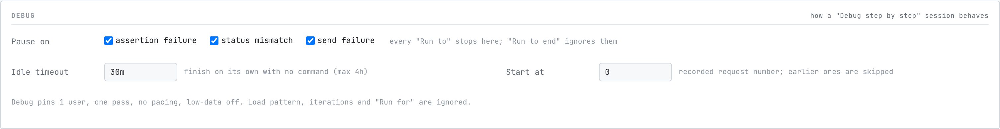
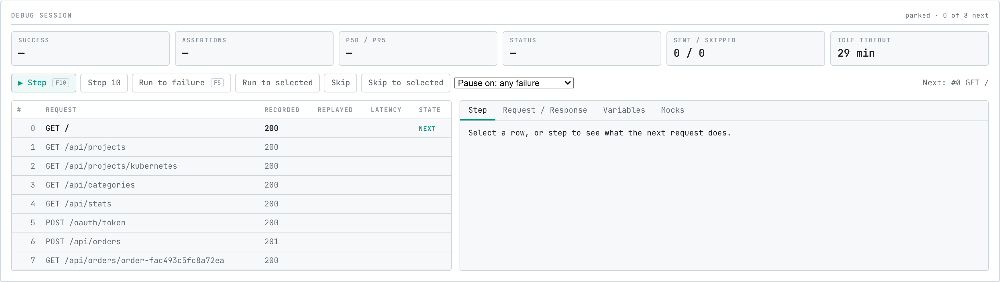
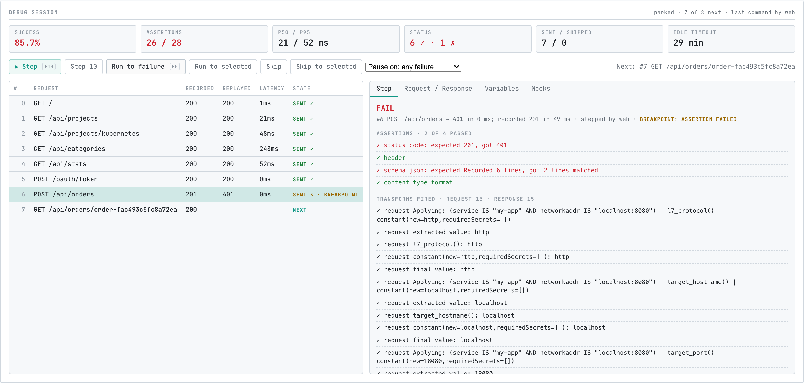

# Debug a Replay Step by Step

A finished replay tells you which request failed. It does not show you what the app had seen by then, which transform fired on the way out, or what the response looked like before the next request overwrote it. The replay debugger answers those questions by running the same replay one request at a time.

This guide walks through one failure in the [mock-lab](https://github.com/speedscale/mock-lab) Go demo three ways: from the CLI with `curl`, from the Debug sub-tab in proxymock web, and from an AI agent through the MCP server. Each path drives the same session, so pick whichever fits how you work.

:::info
The debugger is local only in this release. It applies to replays that run on this machine, not to replays in your cluster or through Speedscale cloud. See [Limits in this release](#limits-in-this-release).
:::

## What a debug session is

A debug session is an ordinary replay whose generator parks before every recorded request instead of sending the next one on its own. It loads the recording, applies the test config, probes the target, and then waits for a command. Every command sends some of the recording and reports, per request, what was sent, what came back against the recording, which assertions passed, and which transforms fired.

| Command | What it does |
|---|---|
| Step | Send the next request (or the next N) and park again |
| Run to | Send requests until a breakpoint fires or the recording ends |
| Skip | Pass over the next request without sending it |
| Jump | Skip everything before a recorded message number and park there |
| Pause | Stop a running command after the request in flight |
| Finish | End the session now and write the report |
| Abort | Cancel the session; no report is written |

Finishing produces the same report a plain replay does, over what was sent. Requests you skipped, and requests after the point you finished at, are not failures. They are simply not in the report.

A session pins one virtual user, one pass through the recording, no pacing, and verbose transforms. Load flags such as `--vus`, `--for` and `--load-test` are refused with `--debug`.

A parked session that receives no command for the idle timeout finishes itself and writes the report. The default is 30 minutes and the maximum is 4 hours.

## Before you begin

Make sure you have:

- `proxymock` [installed](../getting-started/quickstart/quickstart-cli.md)
- `git`
- Go installed, for the mock-lab demo app

Clone mock-lab and start the Go app on port 18080. The demo ships a recording under `proxymock/recording` with 8 inbound requests, so you do not need to record anything:

```shell
git clone https://github.com/speedscale/mock-lab.git
cd mock-lab/go
PORT=18080 go run .
```

Leave the app running and work from `mock-lab/go` in another terminal.

The recording's last three requests form an auth flow: `POST /oauth/token` issues a bearer token, `POST /api/orders` creates an order with it, and `GET /api/orders/{order_id}` reads the order back. The token in the recording is stale, so on replay the app answers `POST /api/orders` with a 401 where the recording has a 201. That is the failure the walkthrough runs to.

## From the CLI

Start the replay with `--debug`. The session listens for commands on a local port; pin it so the examples below match:

```shell
proxymock replay --debug \
  --debug-listen 127.0.0.1:7901 \
  --in proxymock/recording \
  --test-against http://localhost:18080 \
  --out proxymock/results/debug-cli
```

The command prints where to drive the session from, then prepares the replay and parks:

```text
Replay debug session
  session:  http://127.0.0.1:7901/api/replay/current/debug/state
  run dir:  proxymock/results/debug-cli
  steps:    proxymock/results/debug-cli/.debug/steps.jsonl
  The generator parks before the first request once the target answers; drive it with:
    step:         curl -X POST http://127.0.0.1:7901/api/replay/current/debug/step -d '{"count":1}'
    run to fail:  curl -X POST http://127.0.0.1:7901/api/replay/current/debug/run-to -d '{"until":["failure"]}'
    skip / jump:  curl -X POST http://127.0.0.1:7901/api/replay/current/debug/skip -d '{"count":1}'   |   .../debug/jump -d '{"msg_num":12}'
    finish here:  curl -X POST http://127.0.0.1:7901/api/replay/current/debug/finish
    run to end:   curl -X POST http://127.0.0.1:7901/api/replay/current/debug/run-to -d '{"ignore_pause_on":true}'
    steps so far: curl http://127.0.0.1:7901/api/replay/current/debug/steps?after=0
  or from proxymock web's Replay tab, chat, or the MCP replay_debug tool. Idle timeout: 30m0s.
```

The replay flags you already use (`--in`, `--test-against`, `--out`, `--test-config`, `--tests-filter`) work unchanged. These flags are specific to a debug session:

| Flag | Meaning |
|---|---|
| `--debug` | Park the generator before the first request and wait for commands |
| `--debug-listen` | Address the session is driven from. Default `127.0.0.1:0`, which picks a free port |
| `--debug-pause-on` | Breakpoints every run-to stops at: `assertion-fail`, `status-mismatch`, `send-fail` or `msg:N`. Repeatable. `failure` means the first three |
| `--debug-idle-timeout` | Finish the session when no command arrives for this long. Default `30m`, maximum `4h` |
| `--debug-start-at` | Park at this recorded message number and skip everything before it |

### 1. Check where the session is

In a second terminal, read the session state:

```shell
curl -s http://127.0.0.1:7901/api/replay/current/debug/state
```

```json
{
  "id": "replay_ed1ce7dc-2110-4e4d-8111-eb4ab3d9a5e9",
  "idleDeadline": "2026-10-12T15:38:27.661947Z",
  "outDir": "proxymock/results/debug-cli",
  "phase": "PARKED",
  "reportId": "proxymock",
  "status": "running",
  "stepsPath": "proxymock/results/debug-cli/.debug/steps.jsonl",
  "total": 8
}
```

The `phase` is `PARKED` and nothing has been sent. The cursor is the recorded message number sent next; it is omitted while it is 0. Phases you will see are `PREPARING`, `PARKED`, `STEPPING`, `RUNNING_TO`, `FINISHING` and `DONE`.

### 2. Step one request

```shell
curl -s -X POST http://127.0.0.1:7901/api/replay/current/debug/step -d '{"count":1}'
```

The command returns as soon as the generator accepts it, with the phase `STEPPING`. The step result lands in the step log a moment later. Read every step after sequence 0:

```shell
curl -s 'http://127.0.0.1:7901/api/replay/current/debug/steps?after=0'
```

The response carries a `steps` array and the current `state`. The state now shows `"cursor": 1` and `"sent": 1`. Each step records the message number, method and path, the replayed status against the recorded one, the latency, every assertion with its expected and actual values, the transform events that fired, a response excerpt, and the report so far under `running`. Trimmed to the fields you will read first:

```json
{
  "seq": "1",
  "action": "SENT",
  "command": "GET",
  "location": "/",
  "status": 200,
  "recordedStatus": 200,
  "durationUs": "905",
  "match": true,
  "assertions": [
    { "typeEnum": "STATUS_CODE", "status": "PASS", "expected": "200", "actual": "200" },
    { "typeEnum": "HEADER", "status": "PASS", "expected": "1/1 Headers Matched", "actual": "1/1 Headers Matched" },
    { "typeEnum": "SCHEMA_JSON", "status": "PASS", "expected": "Recorded 5 lines", "actual": "5 lines matched" },
    { "typeEnum": "CONTENT_TYPE_FORMAT", "status": "PASS", "expected": "Valid JSON data", "actual": "Valid JSON data" }
  ]
}
```

### 3. Run to the first failure

```shell
curl -s -X POST http://127.0.0.1:7901/api/replay/current/debug/run-to -d '{"until":["failure"]}'
```

`failure` expands to the three local breakpoints: an assertion failure, a status mismatch, or a send failure. The generator sends requests 1 through 6 and parks when request 6 fails:

```shell
curl -s http://127.0.0.1:7901/api/replay/current/debug/state
```

```json
{
  "cursor": 7,
  "id": "replay_ed1ce7dc-2110-4e4d-8111-eb4ab3d9a5e9",
  "lastStepSeq": "7",
  "pauseReason": "breakpoint: assertion failed",
  "phase": "PARKED",
  "sent": 7,
  "status": "running",
  "total": 8
}
```

Read the step that tripped the breakpoint:

```shell
curl -s 'http://127.0.0.1:7901/api/replay/current/debug/steps?after=6'
```

```json
{
  "seq": "7",
  "msgNum": 6,
  "action": "SENT",
  "command": "POST",
  "location": "/api/orders",
  "status": 401,
  "recordedStatus": 201,
  "breakpoint": true,
  "breakpointReason": "breakpoint: assertion failed",
  "assertions": [
    { "typeEnum": "STATUS_CODE", "status": "FAIL", "expected": "201", "actual": "401" },
    { "typeEnum": "HEADER", "status": "PASS" },
    { "typeEnum": "SCHEMA_JSON", "status": "FAIL", "expected": "Recorded 6 lines", "actual": "2 lines matched" },
    { "typeEnum": "CONTENT_TYPE_FORMAT", "status": "PASS" }
  ],
  "response": { "statusCode": 401, "contentType": "application/json", "body": "..." }
}
```

The response body is base64 in the step. Decoded, it says `{"error": "missing or invalid bearer token"}`: the app rejected the recorded token. The step before it, `POST /oauth/token`, returned a fresh token that the replay never carried forward. That is a correlation to fix with a transform, not an app bug; see [Fix the failure](#fix-the-failure).

The 8th request, `GET /api/orders/{order_id}`, has not been sent. It would fail the same way, and sending it tells you nothing new.

### 4. Finish

```shell
curl -s -X POST http://127.0.0.1:7901/api/replay/current/debug/finish
```

The state returns with `"phase": "FINISHING"` and `"finishedBy": "command"`. The replay process writes its report and exits, the same way a plain replay does:

```text
Replay verdict: proxymock/results/debug-cli/replay-verdict.json (mismatch)
```

The verdict covers the 7 requests that were sent, with one mismatch. The unsent request is absent, not failed.

### The HTTP commands

Every path starts with `/api/replay/current`. `current` is an alias for the session id in `state`, so a client that only knows the address can drive the session; `/api/replay/<id>/...` works too.

| Method and path | Body | What it does |
|---|---|---|
| `GET .../debug/state` | | Phase, cursor, totals, breakpoints, idle deadline, paths |
| `GET .../debug/steps?after=N` | | Steps newer than sequence N, oldest first, plus the state. `limit` caps the page at up to 500 |
| `POST .../debug/step` | `{"count":1}` | Send the next `count` requests |
| `POST .../debug/run-to` | `{"until":["failure"]}` | Send until a named breakpoint or the session's pause-on fires. `{"ignore_pause_on":true}` with no `until` runs to the end |
| `POST .../debug/skip` | `{"count":1}` | Pass over the next `count` requests |
| `POST .../debug/jump` | `{"msg_num":5}` | Skip everything before message 5 and park there |
| `POST .../debug/pause` | | Stop a run-to after the request in flight |
| `POST .../debug/finish` | | End the session and write the report |
| `POST .../debug/abort` | | Cancel the session without a report |

Breakpoint names are `assertion-fail`, `status-mismatch`, `send-fail` and `msg:N` for a recorded message number. `failure` is shorthand for the first three.

Every command accepts an optional `seq`. The generator rejects a command whose `seq` is not newer than the last one it accepted, with a 409 that carries the state it was rejected against, so two drivers on one session cannot double-send a request:

```json
{"error":"stale command: seq 1 is not newer than the last accepted seq 2","stale":true,"state":{"phase":"PARKED","cursor":7,"total":8,"sent":7,"lastSeq":"2"}}
```

A jump backwards is refused the same way. A session only moves forward.

### Start further in, with breakpoints set

The session's own breakpoints come from `--debug-pause-on`, and `--debug-start-at` skips the beginning of a recording you have already seen. This parks at the token request with the three failure breakpoints armed:

```shell
proxymock replay --debug \
  --debug-listen 127.0.0.1:7902 \
  --debug-pause-on failure \
  --debug-start-at 5 \
  --in proxymock/recording \
  --test-against http://localhost:18080 \
  --out proxymock/results/debug-cli-2
```

The state shows `"cursor": 5`, `"skipped": 5` and the three breakpoints under `pauseOn`. A run-to with an empty body stops at the same 401, because the session's pause-on applies to every run-to:

```shell
curl -s -X POST http://127.0.0.1:7902/api/replay/current/debug/run-to -d '{}'
```

To send the rest regardless of breakpoints, which turns the session into an ordinary replay from the cursor onward:

```shell
curl -s -X POST http://127.0.0.1:7902/api/replay/current/debug/run-to -d '{"ignore_pause_on":true}'
```

A run-to that reaches the last request finishes the run on its own and writes the report. A step or skip that handles the last request instead parks the session at the end, so the last result stays on screen; step and skip are refused there, and finish writes the report.

## From proxymock web

Start proxymock web from `mock-lab/go` so it sees the recording:

```shell
proxymock web --in proxymock
```

In the Replay tab, keep **On this machine** selected, tick the `recording` directory, and set **Send all to** to `http://localhost:18080`. The run bar offers **Debug step by step** next to **Run replay**. The debug button is only shown for replays on this machine.

Before you press it, open **Options** and find the **Debug** section. It sets how a session behaves:



| Setting | Meaning |
|---|---|
| Pause on | Which of assertion failure, status mismatch and send failure every **Run to** stops at. **Run to end** ignores them |
| Idle timeout | How long a parked session waits for a command before finishing on its own. Default `30m`, maximum `4h` |
| Start at | The recorded request number to park at; earlier requests are skipped |

The load pattern, iterations and **Run for** settings are ignored by a debug session.

### The Debug sub-tab

Press **Debug step by step**. proxymock prepares the replay, probes the target, and opens the **Debug** sub-tab in place of **Live** once the generator has parked:



From the top:

- **The KPI strip** is the report so far: success rate, assertions passed over total, p50 and p95 latency, replayed status counts, sent over skipped, and the time left on the idle timeout. Values turn red once a request fails.
- **The controls** map to the HTTP commands. **Step** (F10) sends one request; **Step 10** sends ten. **Run to failure** (F5) runs until the breakpoint chosen in the **Pause on** dropdown fires. **Run to selected** sends up to, not including, the selected row, and **Skip to selected** passes over every request before it. **Skip** passes over the next request. A **Pause** button appears while a run-to is in flight.
- **The table** lists every recorded request with its recorded status, and fills in the replayed status, latency and state as requests are sent. Click a row to select it. Rows that have not been reached yet are previewed from the recording in timestamp order; with a tests filter or ignored services the generator's order can differ, and the stepped rows are always authoritative.
- **The detail panel** on the right shows the selected row, or the request about to be sent.

The run bar changes too: **Run to end** sends the rest of the recording without stopping, **Finish here** ends the session now, and **Abort** cancels it without a report.

Press **Step**, then **Run to failure**. The session sends requests 0 through 6 and parks with a banner reading "Parked at request #7: breakpoint: assertion failed":



Each row's **State** column tells you what happened to it:

| State | Meaning |
|---|---|
| `SENT` with a check mark | Sent, status and assertions matched the recording |
| `SENT` with a cross, or `N assertions failed` | Sent and did not match. `SEND FAILED` means the request never got a response |
| `BREAKPOINT` | Appended to the row that stopped a run-to |
| `SKIPPED` | Passed over; dimmed and absent from the report |
| `NEXT` | The request the cursor is on, in bold |
| blank | Not reached yet |

The detail panel has four tabs:

- **Step** shows the verdict for the request, the replayed status and latency against the recording, who issued the command, every assertion with its expected and actual value, the transforms that fired on the request and the response, and the variables the step changed. For request 6 it reads "status code: expected 201, got 401" and "schema json: expected Recorded 6 lines, got 2 lines matched".
- **Request / Response** opens the observed pair in the same viewer the Requests tab uses, with the request, response, tokens and the blueprints that applied.
- **Variables** lists the variables this step changed and every change so far in the session. No transform writes a variable in this recording, so the tab is empty here; it fills in once a blueprint extracts the token.
- **Mocks** is reserved for cluster mode, where the responder runs alongside the generator and its hits and misses can be joined to each step. A local session uses whatever answers the app's dependencies, so the tab explains that there is nothing to show yet.

Press **Finish here**. The session ends, the **Report** sub-tab opens with the report over the 7 sent requests, and the banner counts the sent requests that failed with a status mismatch, a failed assertion or a send failure, plus how many were sent and skipped. Skipped requests are not failures. A session finished by the idle timeout says so in the same banner.

A web session writes its step log under `proxymock/results/replayed-<timestamp>/.debug/steps.jsonl` in the workspace. It does not write `replay-verdict.json`; the report is in the Report sub-tab, as for every replay started from proxymock web.

## From an AI agent

The MCP server exposes one tool, `replay_debug`, that starts `proxymock replay --debug` as a child process and drives it over the same HTTP commands. If the server is already configured for your editor, a prompt like this is enough:

```text
start a debug session against http://localhost:18080 from proxymock/recording, run to the first failure, tell me what failed, then finish
```

The tool takes an `action`: `start`, `state`, `step`, `run_to`, `skip`, `jump`, `finish` or `abort`. `start` takes the same inputs as `replay_traffic` (`in-directory`, `test-against`, `out-directory`, `test_config`, `tests-filter`) plus `pause_on`, `idle_timeout` and `start_at`. `step` and `skip` take a `count`, `run_to` takes `until` or `to_end`, and `jump` takes `msg_num`. Load parameters are refused.

What the agent reads back is text, so it can reason over it. The `run_to` result for this walkthrough ends with:

```text
#5 POST /oauth/token — 200 in 233µs, as recorded
  assertions: 4 of 4 passed
  transforms fired: 30
  report so far (6 sent): result-match-pct=100.0, failed=0.0, latency.p95=119.0, assertions 24/24

#6 POST /api/orders — 401 in 174µs; recorded 201 [breakpoint: assertion failed]
  assertions: 2 of 4 passed
    ✗ STATUS_CODE: expected 201, got 401
    ✗ SCHEMA_JSON: expected Recorded 6 lines, got 2 lines matched
  transforms fired: 30
  response body: {
  "error": "missing or invalid bearer token"
}

  report so far (7 sent): result-match-pct=85.7, failed=0.0, latency.p95=119.0, assertions 26/28
```

`finish` waits for the process to exit and names the verdict and the step log, so the agent can hand off to the [replay verdict](./replay-verdicts.md) flow. A long `run_to` returns after `wait_seconds` with the session still running; `state` keeps reading. One session runs per server at a time.

The same tools are available to the chat panel in proxymock web, which drives the session you can see in the Debug sub-tab.

## What lands on disk

| File | Written by | Contents |
|---|---|---|
| `<out>/replay-verdict.json` | CLI, MCP | The verdict over the sent requests, in the same shape as a plain replay. See [Gate CI on Replay Results](./replay-verdicts.md) |
| `<out>/.debug/steps.jsonl` | CLI, MCP, web | One step per line, sent and skipped, in order, with the fields shown above. Review a finished session offline from this file |
| `<out>/.debug/session.json` | CLI | The session id, the control address, the output directory and the process id, for a driver that attaches after the fact |
| `<out>/localhost/*.md` | CLI, MCP, web | The observed request and response for each sent request, as for a plain replay |

Here `<out>` is the `--out` directory for the CLI, the `out-directory` for MCP, and `proxymock/results/replayed-<timestamp>` for proxymock web.

## Limits in this release

- **Local only.** The debugger runs replays on this machine. The in-cluster and Speedscale cloud paths do not offer it.
- **No mock join.** Mock hits and misses are not attached to steps, and the Mocks tab says so. The `mock-miss` breakpoint name is accepted but never fires locally.
- **Breakpoints apply to run-to only.** Step and skip do not stop at breakpoints; a step that fails is reported and the session parks before the next request as usual.
- **No stepping backwards.** Jump and skip move forward. To look at an earlier request again, finish and start a new session, with `--debug-start-at` to get back quickly.
- **One request at a time.** A session sends one request at a time, once, in recorded order, so it is not a load test. Run to end from the cursor to turn the rest into an ordinary single-user replay.
- **One session per server.** proxymock web and the MCP server each run one debug session at a time.

## Fix the failure

The 401 is the recording's stale bearer token. The fix is a transform that extracts `access_token` from the `POST /oauth/token` response and writes it into the `Authorization` header of the requests that follow. [Fix Replay Failures with Recommendations](./recommendations.md) detects exactly this kind of expired token and generates a `smart_replace` blueprint that carries the live token forward. Start a new debug session after the change and run to failure again: with the token re-chained, the Variables tab shows the token being written on request 5, and the session should run to the end of the recording.
