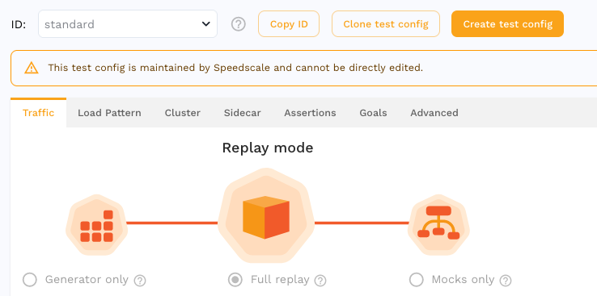

# Test Config

Speedscale's load generator relies upon a basic set of config items to
determine how it will behave at runtime.

You can view these in the [UI](https://app.speedscale.com/config):



Or via the CLI:

```bash
# get all test configs
speedctl get testconfigs -o pretty

# pull a test config to the local cache
speedctl pull test-config my-config

# push a test config after modification
speedctl push test-config my-config
```

### Structure

There are several sections within a Test Config:

1. **Traffic** - Set general configuration for how a replay should run
1. **Load Pattern** - Set how load should be applied throughout the replay
1. **Cluster** - Set infrastructure specific settings
1. **Sidecar** - Set sidecar secrets for replays running inside a Kubernetes cluster
1. **Assertions** - Set expected responses from the application
1. **Goals** - Set thresholds which will constitute a failed test report
1. **Advanced** - A text representation of the test config

Some sections contain more details on the following pages.


### Replay seed

`replaySeed` is a top-level string field that seeds the variation a replay configures, so one value makes that variation repeatable.

```json
{
  "id": "my-config",
  "replaySeed": "run-42"
}
```

When `replaySeed` is set, it replaces the test config ID as the seed for [chaos](../../concepts/chaos.md) rules and replaces the snapshot ID as the seed for a load plan and for which sessions a sessions stage replays.

Explicit seeds still win. A chaos rule with its own `seed` uses that seed, and `generator.loadSeed`, including zero, wins over `replaySeed` for the load plan and sessions stages.

When `replaySeed` is absent or an empty string, nothing changes: chaos rules seed from the test config ID, and the load plan and sessions stages seed from the snapshot ID.

A replay with chaos rules records the chaos seed it used as a replay settings event named `ChaosSeed` in the report.

To set it from proxymock, edit `replaySeed` in `proxymock/testconfigs/<name>.json`, or use the MCP `test_config` tool with `action=set` and `fields` of `{"replaySeed": "run-42"}`. A `null` value removes the field.

The same seed, test config, recording and Speedscale version reproduce the planned arrivals and the chaos choices.

Randomness inside your application, operating system scheduling, response timing and which replica serves a request are outside that boundary, so two runs with the same seed can still differ in those.
