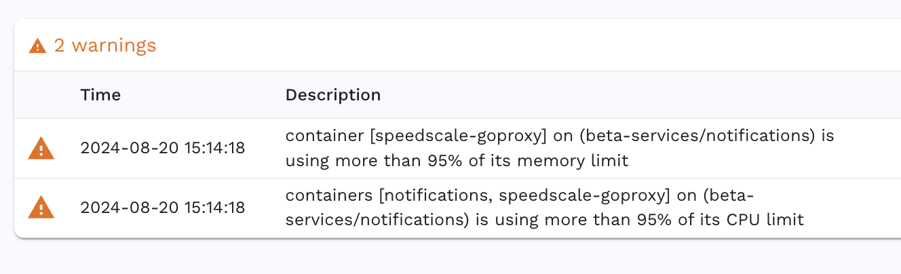

# Cluster

The Cluster section is used for setting up infrastructure-related configurations. This includes specifying the log level, build tag, and resource limits for both the Generator and Responder components.

## Generator service account

`generatorServiceAccount` runs the generator as an existing service account in the replay namespace instead of the one Speedscale creates, so the generator carries that account's cloud workload identity. The account must match a selector in the operator's Helm values. See [Run the generator as your own service account](/guides/replay/generator-service-account.md).

# Container resource warnings

Speedscale introduces additional load during testing, which can lead to higher resource consumption, particularly in terms of CPU and memory.

### Impact:
- Lower throughput than expected.
- Potentially not reaching the desired Transactions Per Second (TPS) from your test configuration.

### Solution:
Increase your container's resource limits to accommodate the additional load generated by Speedscale.
