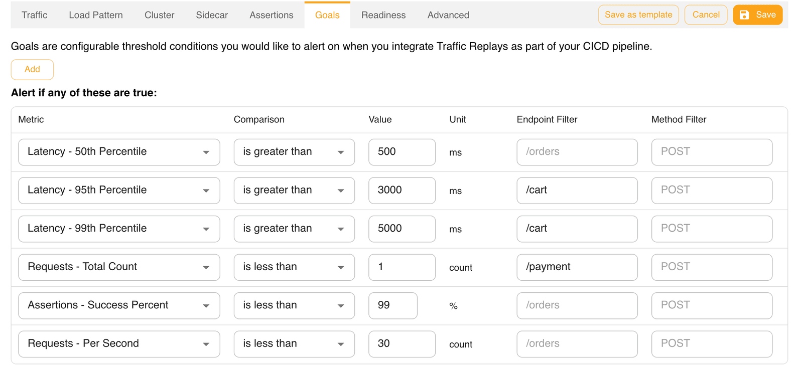

# Goals

The goals section allows you to define what a successful test run looks like. If
any of the goals defined are triggered the report will fail. If the report
fails as a part of your CI/CD integration your pipeline may stop so when using
Speedscale in CI/CD ensure your goals are set properly

The UI contains hints explaining the different metrics.

## Examples

Let's create a useful example for our application.

Reports run with this test config will fail if any of the metrics defined are
true when the replay completes.

| Metric                              | Reasoning               |
|-------------------------------------|-------------------------|
| Any location 50% latency > 500ms    | Most users should have a fast experience with responses less than 500 ms. |
| /cart location 95% latency > 3000ms | The cart is especially important and the majority of users should get a response in less than 3 seconds. |
| /cart location 99% latency > 5000ms | Virtually all users should see a cart response within 5 seconds or we risk them clicking away, losing the company money. |
| /payment requests > 1               | This replay should contain at least one call to the /payment endpoint to ensure it's tested. |
| successful assertions < 99%         | Of the assertions being run, basically all of them should pass. |
| RPS < 30                            | There is a business requirement that my application can handle at least 30 requests per second. |

## LLM streaming goals

A replay that sends streamed LLM requests reports time to first token, inter-token latency, request latency and token rates, so goals can hold a model server to them, for example `llmTtftP95` too high at `800`. See [LLM Streaming Metrics](../../guides/replay/llm-streaming-metrics.md) for every metric name and its definition.

## LLM answer quality goals

A replay of LLM traffic also reports whether the answers are still right: `llmToolCallMatchPct`, `llmDivergencePct` and `llmFailurePct`. Use **too low** on the tool-call match rate and **too high** on the other two, for example `llmToolCallMatchPct` too low at `100`. See [Regression Test a Model Swap](../../proxymock/guides/llm-eval-gate.md#score-a-cloud-or-cluster-replay).

## Pub/Sub subscriber goals

A replay that republishes Google Pub/Sub deliveries reports whether the subscriber kept up: its backlog and ack rate from Cloud Monitoring, and, where the subscriber's own calls were captured, how many republished messages it acked and how fast. Use **too high**, for example `pubsubUnackedCount` too high at `0` or `pubsubBacklogEnd` too high at `0`. See [Check that the subscriber kept up](../../guides/message-brokers/google-pubsub.md#check-that-the-subscriber-kept-up) for every metric name.
