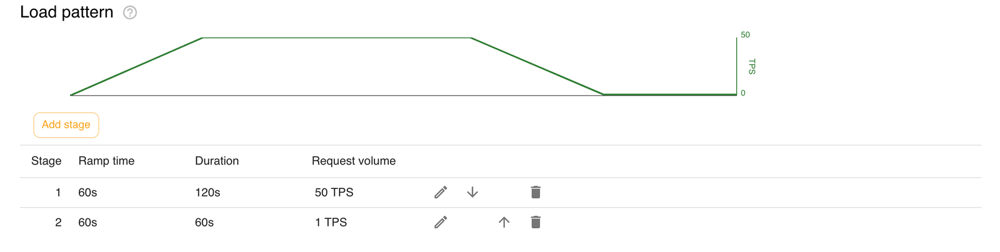
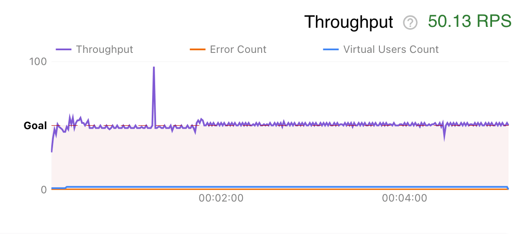

# Load Pattern

The Load Pattern tab allows you to shape the load over the course of a traffic replay.

Let's say we want to create a load pattern that ramps up to 50 requests per second (RPS) over the course of a minute, holds at 50 RPS for another minute, and ramps down over a third minute.

We can actually implement this with only two stages.

The first stage will ramp from 0 to the target rate over 60 seconds then hold for the remainder of the stage duration. The second stage has the same total duration as the ramp time so the full stage will be used to ramp from the current rate of 50 TPS down to its target. A request rate must be a positive whole number, so the second stage targets 1 TPS, the lowest rate a stage accepts. The chart above the stages table previews the pattern.

While a stage holds its target, the report's throughput chart stays at that rate. This chart comes from a replay that held 50 TPS for five minutes:

## Per-endpoint and session schedules

Use [load groups](./endpoint-load-plans.md) when selected endpoints or complete sessions need independent schedules, shared arrival rates or budgets. Group ramps use the same duration/ramp semantics. See the [banking how-to](../../guides/replay/endpoint-load-how-to.md) for an interference test and the [feature guide](../../guides/replay/endpoint-session-load-plans.md) for dashboard and proxymock controls.
