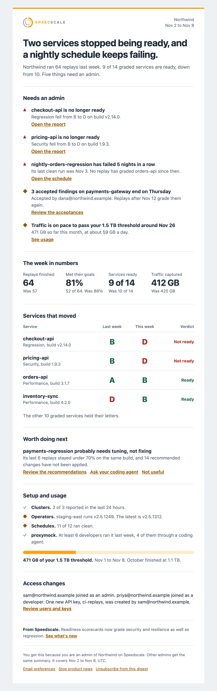

# Weekly admin digest

The weekly digest is one email to each tenant admin that answers four questions in order: what needs me, are we safe to ship, is Speedscale working, and who got access.

The subject line and headline state the answer, so you learn the most important thing without opening the dashboard.

## Who gets it and when

Every user with the admin role in a tenant gets their own copy, sent on its own to their address.

Users with other roles do not get the digest.

It is sent on Mondays at 13:00 UTC.

It covers the previous week, from Monday 00:00 UTC to the following Monday 00:00 UTC, and the footer states the dates.

It comes from `digest@notifications.speedscale.com`.

The digest is on by default. The footer of every email says why you got it and links to your email preferences.

## Example

This is a busy week for a fictional tenant:

## The four kinds of email

Speedscale picks one kind of email for each tenant each week.

| Kind | When it is sent | What it contains |
| --- | --- | --- |
| Setup | The tenant has never finished a replay | The four setup steps with your current step highlighted, and one next step |
| Busy | At least one item needs an admin | The full digest |
| Quiet | There was activity, and nothing needs an admin | A short digest headed "Nothing needs you this week" |
| Silent | No traffic and no replays for 3 weeks, on a tenant that had some before | A short note that Speedscale has seen nothing, with what to check |

### Setup email

The setup email replaces the digest until the tenant's first replay finishes.

It shows the same four steps as the setup checklist in the dashboard: connect a cluster, capture traffic, save a snapshot, and run a replay.

| Your step | The email asks you to |
| --- | --- |
| No cluster has connected | Connect a cluster, or start with proxymock if you are not on Kubernetes |
| A cluster is connected, and no service has been captured | Add a service, or import a Postman or HAR file |
| Services are captured, and there is no snapshot | Snapshot your busiest service, named in the email |
| A snapshot exists, and no replay has run | Replay that snapshot, named and linked in the email |

Each step also offers a prompt you can hand to your coding agent.

A tenant that imported or pushed a snapshot goes straight to running a replay, even with no cluster.

A tenant that used proxymock in the last 30 days and has no cluster is treated as working locally, so it is not asked to connect a cluster.

You get at most 4 setup emails for each step. After that they pause until you reach the next step.

### Silent email

A silent email is sent at most twice. After that the digest pauses until Speedscale sees traffic or a replay from the tenant again.

The first silent email tells you that the next one is the last. The digest restarts on its own when activity returns, with nothing for you to do.

## What each section means

Sections with nothing to report are left out. The digest never shows a section with zero items.

### Needs an admin

This lists only things an admin can act on. Each item has one reason and one link.

Items are ranked with blocking items first, then items with a deadline:

1. A service went from Ready to Not ready.
2. A schedule failed 3 or more runs in a row.
3. A cluster has not reported for more than 24 hours.
4. Accepted findings end in the next 7 days.
5. Traffic is on pace to pass your tenant's threshold this month.
6. Your trial ends in the next 14 days.

The digest shows up to 5 items, then says how many more there are.

### The week in numbers

Four tiles compare this week with last week: replays finished, replays that met their goals, services ready, and traffic captured.

A replay counts when it started in the week and finished as Passed, Missed goals or Error. Canceled replays, replays still running and debug sessions do not count.

Met their goals is the number that passed divided by all three outcomes together.

With fewer than 5 replays in the week, the digest shows counts instead of percentages.

If none of the week's reports are graded, the digest leaves out Services ready.

### Services that moved

This lists graded services whose verdict or a family letter changed during the week, worst first.

It shows up to 5 services, then says how many others held their letters.

The digest reads each report's [readiness](../guides/readiness/index.md) verdict and letters as they were recorded. It never grades a report itself, so it always agrees with the Readiness tab.

Each service is compared with its own [trend](../guides/readiness/service-trend.md). When a test config or chaos rule change moved a letter, the digest says so, so it does not read as a code regression.

### Worth doing next

This shows up to 2 suggestions, or 1 when 3 or more items block a release. See [Suggestions](#suggestions).

### Setup and usage

This shows whether Speedscale itself is working:

- **Clusters:** how many reported in the last 24 hours.
- **Operators:** whether each operator runs the latest version.
- **Schedules:** how many ran clean.
- **proxymock:** how many developers ran proxymock last week, as a count. See [Privacy](#privacy).
- **Traffic:** a meter of traffic captured this month against your tenant's threshold.

### Access changes

This lists new users, new admins and new API keys. It only appears when something changed.

Speedscale does not record role changes, so the digest says a person "joined" with a role. It never says someone was promoted.

### From Speedscale

One line about something new in Speedscale, with one link. It is the last thing before the footer.

It is never based on your data, and it never appears in setup or silent emails.

To keep the digest and drop this line, use **Stop product news** in the footer or turn off **Product news in the digest** in your profile.

## Suggestions

Each suggestion comes from something Speedscale measured in your tenant.

| Suggestion | Shown when | Not shown when |
| --- | --- | --- |
| Tune a snapshot | The same snapshot stayed under 80% success or under 90% mock match for its last 3 or more replays on the same build, and it has open recommendations you can apply | A snapshot that did well dropped on a new build. That is a possible regression, so it goes under Needs an admin |
| Test untested services | A captured service has had no replay in 30 days. The digest names the 3 busiest | The service stopped sending traffic |
| Move from sidecar to eBPF | A workload captures with a sidecar | The operator is a namespaced install, which cannot run eBPF capture |
| Try more scenarios | Every replay in 30 days used a built-in regression config, or no graded report has a resilience letter | The tenant uses custom configs that Speedscale cannot classify |
| Automate it | Replays run by hand with no schedule | Fewer than 5 replays in 30 days |
| Try proxymock | A cloud tenant has no proxymock activity in 30 days | Less than 4 weeks since the tenant's first replay |

A tune suggestion says the snapshot "probably" needs tuning, because it is a guess based on success rate and mock match. A drop after a new build always reads as a possible regression.

The eBPF suggestion links to the [eBPF requirements](./ebpf-traffic-collection/README.md#system-requirements). Switching restarts each workload, and your nodes must meet the requirements.

A suggestion shown 2 weeks in a row then rests for 4 weeks. It goes away once its condition clears.

Each suggestion has a **Not useful** link that turns it off for your whole tenant. The link opens a page where you confirm, so a mail scanner that follows links cannot dismiss it.

## Turn it off

### For yourself

Go to **Profile > Email** in the dashboard:

- **Weekly digest** turns the digest on or off for you.
- **Product news in the digest** turns the From Speedscale line on or off.

Only admins receive the digest. Other users see these settings turned off with the note "Only admins receive the weekly digest."

### For your whole tenant

Admins can go to **Tenant settings > Weekly digest**:

- **Send the weekly digest to admins** turns it off for every admin in the tenant.
- **Counts only** replaces service, schedule and cluster names with counts.

Only admins can change these settings.

### One-click unsubscribe

Every digest has an **Unsubscribe from this digest** link in the footer. Mail apps that show their own unsubscribe button use the same link.

The link works without signing in. It opens a page that says what will be turned off, with one button to confirm. Mail apps that support one-click unsubscribe skip that page.

Unsubscribe and **Not useful** links work for 60 days. If one has expired, the page tells you to change the setting in your profile.

## Privacy

The digest contains names and counts only. It never contains traffic content.

It may contain:

- Service, schedule and cluster names.
- Build tags and readiness letters.
- Counts.
- Email addresses of people who are already in your tenant.

It never contains request or response content, URLs with parameters, headers, field paths, finding details, or the reason someone gave when accepting a finding.

In counts only mode, the digest replaces service, schedule and cluster names with counts and links.

Links in the digest carry no secrets. You still sign in to the dashboard to open them, and the only tracking on a link is `src=digest`.

The proxymock row counts the developers in your tenant who ran proxymock while signed in to it, and how many of them ran it through a coding agent. It never names developers or says what they ran. Runs by developers who are not signed in are not counted, so the row says "at least". See [proxymock data and privacy](../proxymock/how-it-works/data_and_privacy.md).
