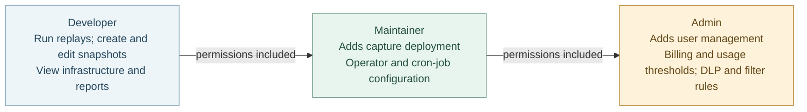

# Access Model

Speedscale uses role-based access control (RBAC) with three pre-defined roles: **Admin**, **Maintainer**, and **Developer**. Every user is assigned exactly one role. Roles are hierarchical — each role inherits the capabilities of the roles below it.

| Role | Typical users |
|------|---------------|
| Admin | Platform owners, team leads who manage users and billing |
| Maintainer | Infrastructure engineers who manage clusters and schedules |
| Developer | Day-to-day testers and developers running replays |

## Permission overview

## Roles

### Admin

Admins have full control over the Speedscale platform. They can do everything a Maintainer can do, plus:

| Activity | Notes |
|----------|-------|
| Add / modify / remove users | Includes inviting users at any role level |
| Add / modify DLP rules | DLP rules are consumed by the forwarder and affect live traffic processing |
| Add / modify traffic filters | Block traffic from ingest at the cluster level |
| Manage usage thresholds and billing alerts | |
| Unlock any locked snapshot | Non-admins can only unlock snapshots they locked themselves. See [Locking a Snapshot](/guides/locking-a-snapshot.md) |

### Maintainer

Maintainers manage infrastructure and automation. They can do everything a Developer can do, plus:

| Activity | Notes |
|----------|-------|
| Install / remove sidecars from the UI | Sidecars can also be installed via CRDs or the local CLI without Maintainer access |
| Enable / disable local capture on a forwarder | |
| Update operator configuration | |
| Add / modify / run schedules (cron jobs) | |
| Deploy the Speedscale demo environment | |

### Developer

Developers can perform all day-to-day testing and observation tasks:

| Activity | Notes |
|----------|-------|
| View and search captured traffic | |
| Create and edit snapshots | |
| Run replays and view reports | |
| Manage transforms on snapshots | Snapshot transforms only — creating DLP rules from transforms requires Admin |
| Lock and unlock snapshots | A locked snapshot is read-only. Any user can lock; only the locking user or an Admin can unlock |
| Invite other Developers | |

## Inviting users

The roles a user can assign when inviting a new team member depend on their own role:

| Inviter role | Can invite |
|--------------|-----------|
| Admin | Admin, Maintainer, Developer |
| Maintainer | Maintainer, Developer |
| Developer | Developer |

The first user to sign up for a tenant is automatically assigned the Admin role. All subsequent users who sign up without an invitation default to Developer.

## Changing a user's role

Admins can change any user's role from the **Tenant → Users** page. Select the user and choose a new role from the dropdown. The change takes effect immediately.

:::note
Generative AI features are enabled or disabled for all users by the tenant owner. Contact support@speedscale.com to change your tenant's settings.
:::

## SSO and roles

When using [Single Sign-On (SSO)](./sso.md), users are provisioned with the Developer role by default. An Admin must manually promote users to Maintainer or Admin after their first login.
